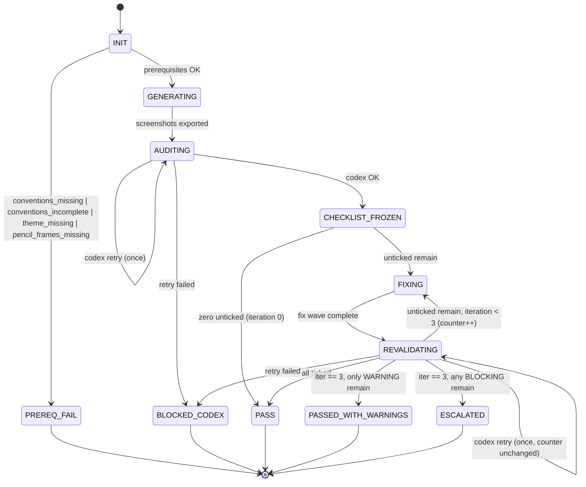

<!-- @spec FR-001..FR-016: Mockup Factory entry point — https://github.com/julien-m/project-brainstorm/blob/717494f5d8b475d59ed59405036e648b2e3b87cd/.specs/features/005-mockup-factory/spec.md -->
<!-- @spec FR-003, FR-007, FR-010: Invocation contract + output layout — https://github.com/julien-m/project-brainstorm/blob/717494f5d8b475d59ed59405036e648b2e3b87cd/.specs/features/009-mockup-export-naming/spec.md -->

# Mockup Factory — Orchestrator Posture

A deterministic, decision-driven pipeline that produces mockups conformant to a
project's `.conventions/` + `theme.css` via parallel Pencil agents audited by an
independent model (`cc-hub codex`), with a frozen checklist and bounded iterations.

## Invocation

```
/mockup-factory [--target <path>] --groups <g1,g2> --product <enum> [--notify]
```

**Flags:**
- `--target <path>` — optional; defaults to the current working directory
- `--groups <csv>` — required; a list of logical group ids (e.g. `auth,dashboard`)
- `--product <enum>` — required; value MUST come from the closed enum defined in **Read** [`references/naming-convention.md`](references/naming-convention.md). Validated at dispatch; unknown or missing values cause the skill to refuse dispatch and surface an error listing the allowed values.
- `--notify` — optional; send a Telegram summary via `cc-hub telegram` on terminal status (AC-015)

## Posture contract

When this skill is invoked, Claude adopts the **mockup-factory orchestrator posture**:
read **Read** [`references/orchestrator.md`](references/orchestrator.md) and follow its
contract. Generator and fixer agents are dispatched via the **Agent tool** (real subagents)
— documented deviation from Constitution Principle 3 (see **Read**
[`https://github.com/julien-m/project-brainstorm/blob/717494f5d8b475d59ed59405036e648b2e3b87cd/.specs/stacks/decisions/ADR-004-mockup-factory-subagents.md`](https://github.com/julien-m/project-brainstorm/blob/717494f5d8b475d59ed59405036e648b2e3b87cd/.specs/stacks/decisions/ADR-004-mockup-factory-subagents.md)).

## State machine (per group)



<!-- @spec FR-010, FR-011, AC-016: State lifecycle with severity-aware terminal — spec.md#fr-010 -->

## Hard constraints

- **Parallelism cap:** ≤ 6 concurrent Agent-tool subagents per batch — never more (NFR-002, FR-003, AC-003).
- **Codex budget:** ≤ `1 + 3 = 4` Codex calls per group, overridable via `MOCKUP_FACTORY_MAX_CODEX_CALLS` (NFR-001).
- **Auditor independence:** never fall back to a Claude self-audit (NFR-003, FR-011).
- **Checklist sole-writer:** only the orchestrator writes `checklist.md`; fix agents return diffs (AC-017, FR-008).
- **Group size:** ≤ 5 screens per group (AC-001, FR-002).
- **Frame dimensions, overlays & content margins:** when the target loads `design-views` or the orchestrator falls back to the ai-ressources defaults, every mockup MUST use a canonical frame size from **Read** [`device-frames.md`](../../../design/references/device-frames.md). Watch and iPhone (non-SE) screens MUST also render their mandatory system overlay (heure top-right / status bar). Web screens are frame nue — no overlay required. Every screen frame MUST use `borderRadius=0` (simulator captures are rectangular). Every screen MUST wrap its content in an App content Frame using the canonical paddings from the Content layout margins table (iPhone, including SE: 16/16/16; Watch: 16/24/16). No arbitrary dimensions; no absolute positioning for overlays.

## Naming & manifest

All exports use the structured filename `{product}_{parent}[_{subview}][_{state}].png`
and each batch folder receives a `manifest.json` (schemaVersion 2) alongside its PNGs.
The format, closed product enum, conditional numbering rule, and full manifest schema
(including the 7 specify-flows linkage fields: `sourceNodeId`, `sourceFile`,
`sourceGeneratedAt`, `specFlow`, `specScreen`, `specStatus`, `specGeneratedAt`) are defined
in **Read** [`references/naming-convention.md`](references/naming-convention.md)
— the single source of truth. Do NOT restate the enum values in this file or any
other. Validation is at the source (orchestrator on invocation, generator on
payload-to-filename conversion) — no post-export renaming.

## Reference files

| File | Purpose |
|---|---|
| **Read** [`references/orchestrator.md`](references/orchestrator.md) | Orchestrator posture, preload + group-splitting + batching |
| **Read** [`references/prereq-check.md`](references/prereq-check.md) | Prerequisite guard (FR-012) |
| **Read** [`references/agents/generator.md`](references/agents/generator.md) | Pencil generator subagent contract |
| **Read** [`references/agents/fixer.md`](references/agents/fixer.md) | Fix subagent contract |
| **Read** [`references/codex-call.md`](references/codex-call.md) | `cc-hub codex` wrapper, retry-once policy |
| **Read** [`references/checklist-writer.md`](references/checklist-writer.md) | Frozen checklist writer (sole-writer, idempotent) |
| **Read** [`references/state-writer.md`](references/state-writer.md) | `state.json` shape + counter-advance rule |
| **Read** [`references/fix-orchestration.md`](references/fix-orchestration.md) | Fix wave dispatch (batch ≤6) |
| **Read** [`references/revalidation.md`](references/revalidation.md) | Binary revalidation + severity tally |
| **Read** [`references/terminal.md`](references/terminal.md) | Terminal artifact writers + `--notify` |
| **Read** [`references/naming-convention.md`](references/naming-convention.md) | Structured filename format, product enum, numbering rule, manifest schema |
| **Read** [`device-frames.md`](../../../design/references/device-frames.md) | Canonical frame sizes (Watch / iPhone / Web) + mandatory system overlays when `design-views` or its fallback is loaded |

## Templates

| Template | Purpose |
|---|---|
| **Read** [`templates/checklist.md.tmpl`](templates/checklist.md.tmpl) | Frozen checklist (YAML + body) |
| **Read** [`templates/audit-prompt.md.tmpl`](templates/audit-prompt.md.tmpl) | Codex initial audit prompt |
| **Read** [`templates/revalidate-prompt.md.tmpl`](templates/revalidate-prompt.md.tmpl) | Codex revalidation prompt |
| **Read** [`templates/audit-report.md.tmpl`](templates/audit-report.md.tmpl) | Final per-run report |
| **Read** [`templates/escalation.md.tmpl`](templates/escalation.md.tmpl) | ESCALATED escalation summary |

## Output layout (written under `<target>/`)

```
<target>/
├── .gitignore                                (amended: + .mockup-validation/)
└── .mockup-validation/
    ├── audit-report.md                       (global, on PASS / PASSED_WITH_WARNINGS)
    └── <group>/
        ├── checklist.md                      (frozen, YAML + body)
        ├── state.json                        (MockupGroup + iterations)
        ├── manifest.json                     (naming + export metadata — see references/naming-convention.md)
        ├── codex-raw.log                     (only on BLOCKED_CODEX)
        ├── escalation.md                     (only on ESCALATED)
        └── {product}_{parent}[_{subview}][_{state}].png   (one per screen — see references/naming-convention.md)
```
