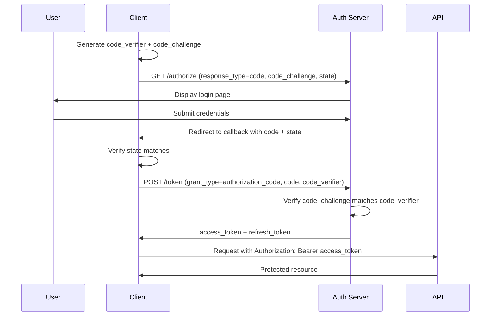
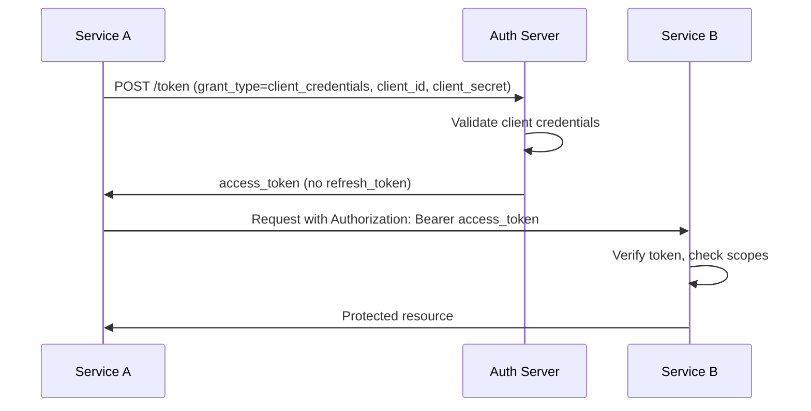
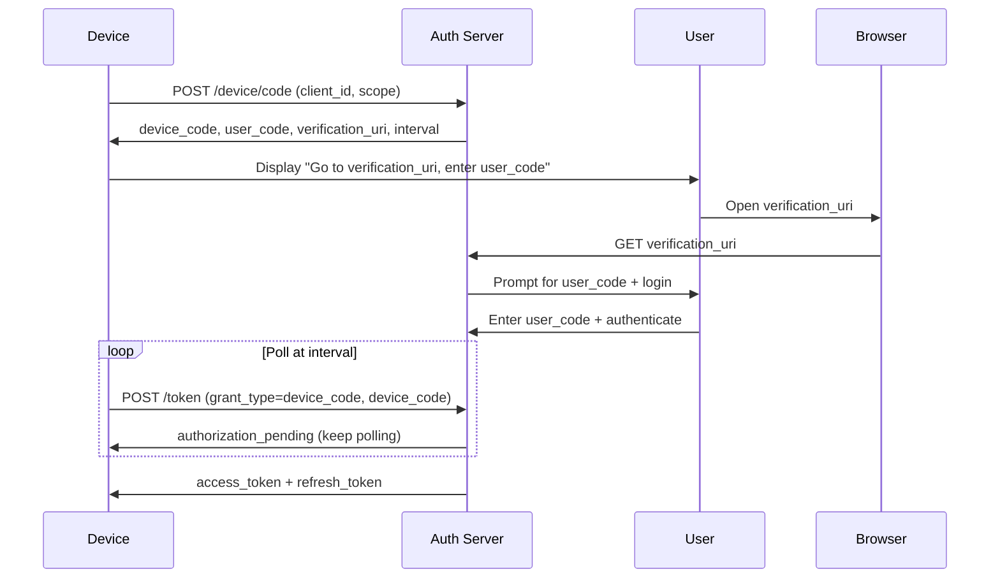
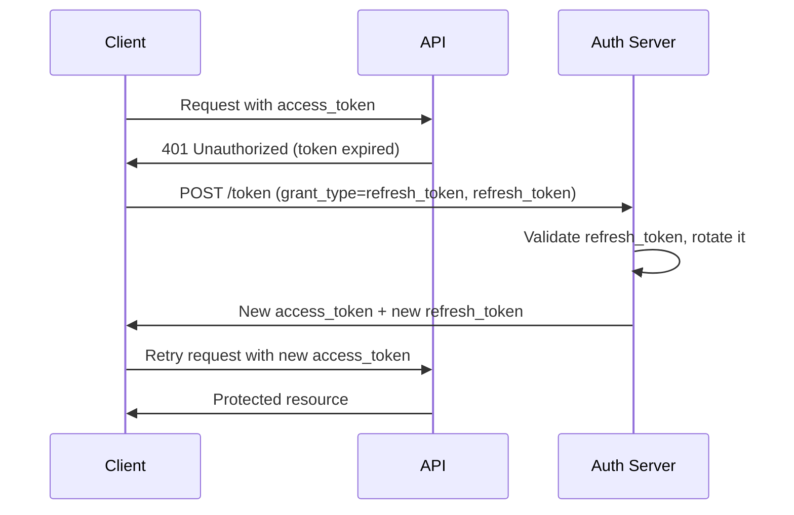
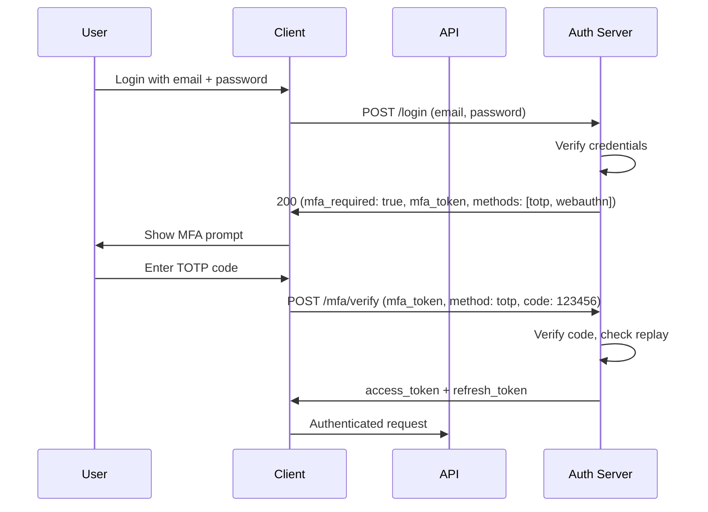

# Auth Flows

Authentication and authorization patterns for SaaS applications: OAuth2, OIDC, JWT, session management, MFA.

These patterns implement the layered architecture defined in **Read** [`code-conventions/architecture.md`](../code-conventions/architecture.md). Auth logic belongs in the **service/use-case layer** (section 3.3); transport-level concerns (cookie parsing, header extraction) belong in **handlers/controllers** (section 3.2); token/session persistence belongs in **repositories** (section 3.4); provider integrations (social login SDKs, SMS OTP providers) belong in **gateways/adapters** (section 3.5).

---

## Overview

**Authentication** answers "who are you?" -- verifying identity via credentials, tokens, or federated providers.

**Authorization** answers "what can you do?" -- enforcing permissions, roles, and resource-level access after identity is established.

### Session-based vs Token-based

| Criteria | Session-based | Token-based (JWT) |
|----------|--------------|-------------------|
| State | Server stores session data | Stateless -- token carries claims |
| Scalability | Requires shared session store or sticky sessions | Scales horizontally without shared state |
| Revocation | Immediate (delete session) | Delayed (wait for expiry, or maintain revocation list) |
| Storage | HttpOnly cookie (session ID) | HttpOnly cookie or Authorization header |
| Best for | Web apps with SSR, monoliths | APIs, SPAs, mobile, microservices |
| Complexity | Lower | Higher (token rotation, key management) |

**Decision rule:** prefer session-based for server-rendered web apps; prefer token-based for APIs, mobile clients, and distributed architectures. Hybrid approaches (JWT access + server-side refresh) are common and valid.

## OAuth 2.0 Flows

### Authorization Code + PKCE (recommended for all clients)

The recommended flow for all client types -- web, mobile, CLI, and single-page applications. PKCE prevents authorization code interception even without a client secret.



Key requirements:
- **PKCE is mandatory** for all clients, including server-side (prevents code interception attacks)
- **State parameter** is mandatory for CSRF protection -- generate random value, store before redirect, verify on callback
- Redirect URI must be registered and validated exactly (no wildcards, no open redirects)
- Authorization code is single-use and short-lived (max 10 minutes)

### Client Credentials (service-to-service)

For backend-to-backend communication where no user context exists.



Rules:
- No refresh tokens -- request a new access token when the current one expires
- Short-lived tokens (5-15 minutes)
- Client secret stored securely (environment variable via keychain, never in code)
- Scope the token to the minimum required permissions

### Device Authorization (CLI, TV, IoT)

For input-constrained devices that cannot open a browser directly.



Rules:
- Display the user code clearly (large font, spaced characters)
- Respect the polling interval from the server response
- Handle `slow_down` responses by increasing the interval
- Device code expires after a configured timeout (typically 15 minutes)

## JWT Token Strategy

### Token structure

```
Header: { "alg": "RS256", "typ": "JWT", "kid": "key-id-2024" }
Payload: { "sub": "user_123", "iss": "https://auth.example.com", "aud": "https://api.example.com", "exp": 1700000000, "iat": 1699999100, "roles": ["member"], "org_id": "org_456" }
Signature: RSASHA256(base64url(header) + "." + base64url(payload), private_key)
```

Rules:
- **Keep tokens small** -- only essential claims for authorization decisions
- **No PII in access tokens** -- no email, name, or phone (use a /userinfo endpoint instead)
- **Access token:** 15 minute expiry, stateless verification via public key
- **Refresh token:** 7-30 days expiry, stored securely, rotated on every use, server-side revocable
- Use asymmetric signing (RS256 or ES256) for distributed verification without sharing secrets
- Include `kid` (key ID) in header for key rotation support

### Token rotation



Implementation rules:
- **Interceptor pattern:** the HTTP client automatically detects 401, refreshes tokens, and retries the original request
- **Queue concurrent requests:** if multiple requests fail simultaneously, only one refresh should execute; others wait and retry with the new token
- **Refresh token reuse detection:** if a refresh token is used twice, assume it was stolen -- revoke all tokens for that session and force re-authentication
- **Absolute refresh token lifetime:** even with rotation, enforce a maximum lifetime (e.g., 30 days) after which re-authentication is required

## Token Storage

| Platform | Storage | Security |
|----------|---------|----------|
| Web (SPA) | HttpOnly Secure SameSite=Strict cookie | Never use localStorage or sessionStorage for tokens |
| Web (SSR) | HttpOnly cookie + server-side session | Best option for web applications |
| iOS | Keychain Services | Use kSecAttrAccessibleWhenUnlockedThisDeviceOnly |
| Android | EncryptedSharedPreferences | Backed by AndroidKeyStore hardware |
| CLI | OS keychain (macOS Keychain, libsecret, Windows Credential Manager) | Never store tokens in plaintext config files |
| React Native | react-native-keychain | Wraps platform keychain on both iOS and Android |

Rules:
- **Never store tokens in localStorage** -- vulnerable to XSS
- **Never store tokens in URLs** -- logged in server logs, browser history, referrer headers
- Cookie flags are non-negotiable: `HttpOnly`, `Secure`, `SameSite=Strict` (or `Lax` if cross-site navigation is required)
- For SPAs using cookie-based auth: implement CSRF protection (double-submit cookie or synchronizer token)

## Session Management

### Session lifecycle

```
create → active → refresh (on activity) → idle timeout → destroy
                                        → absolute timeout → destroy
                                        → explicit logout → destroy
                                        → remote revocation → destroy
```

### Timeout rules

| Timeout | Value | Behavior |
|---------|-------|----------|
| Idle timeout | 30 minutes | Reset on each authenticated request |
| Absolute timeout | 24 hours | Force re-authentication regardless of activity |
| Remember me | 30 days | Extended idle timeout, still subject to absolute limit |

### Concurrent session management

- Configurable limit per user (default: 5 active sessions)
- When limit is reached: reject new login, or revoke oldest session
- Session listing: expose active sessions to the user with device, IP/location, and last active timestamp
- Remote revocation: allow users to terminate any session from their security settings
- On password change: invalidate all other sessions

## Social Login / Federation

Common providers: Google, GitHub, Apple, Microsoft.

### Implementation rules

- Use OpenID Connect (OIDC) on top of OAuth 2.0 -- the `id_token` provides verified identity claims
- Always request the `email` scope and verify the email is confirmed by the provider
- Never trust unverified emails from providers -- a malicious provider could claim any email

### Account linking

- **First login with social provider:** create account, populate profile from provider claims (name, avatar)
- **Existing account with same email:** prompt user to link accounts (do not auto-merge without verification)
- **Multiple social providers:** allow linking additional providers from account settings
- Store provider ID + provider user ID for each linked account (not the access token)

### Security considerations

- Validate `id_token` signature and claims (`iss`, `aud`, `exp`) server-side
- Use `nonce` parameter to prevent replay attacks
- Apple Sign In: handle the "hide my email" relay feature

## Multi-Factor Authentication (MFA)

### Methods

| Method | Security | UX | Recommendation |
|--------|----------|-----|----------------|
| TOTP (authenticator app) | High | Medium | Recommended default |
| WebAuthn / Passkeys | Highest | Best | Recommended, growing adoption |
| SMS OTP | Low (SIM swap risk) | Easy | Discouraged, fallback only |
| Email OTP | Medium | Easy | Acceptable for low-risk operations |
| Recovery codes | N/A | One-time use | Always provide as backup |

### Enrollment flow

1. User navigates to security settings (or prompted after first login)
2. **TOTP:** display QR code + manual entry key, user scans with authenticator app, verify with first 6-digit code
3. **WebAuthn:** browser prompt for biometric/security key, store credential ID + public key server-side
4. **Recovery codes:** generate 10 single-use codes, display once, require user to confirm they saved them
5. Store MFA method and status on the user record -- never store TOTP secrets in plaintext (encrypt at rest)

### Challenge flow



### When to challenge MFA

- **Always:** login, password change, MFA method changes, API key creation/viewing
- **Configurable:** payment actions, role changes, data export, account deletion
- **Remember device:** "Trust this device for 30 days" -- store a signed device token, skip MFA challenge when present
- **Fallback:** always allow recovery code entry as an alternative to the primary method

## Role-Based Access Control (RBAC)

### Standard role hierarchy

```
owner > admin > member > viewer
```

### Permission model

```
Role → Permissions → Resources
member → [read, create, update] → [projects, documents]
admin → [read, create, update, delete, manage_members] → [projects, documents, team]
owner → [all permissions] → [all resources, billing, danger zone]
```

### Enforcement rules

- **Server-side enforcement is mandatory** -- every API endpoint checks permissions before executing
- **Middleware pattern:** extract user from token, load permissions, check against required permission for the route
- **Frontend hides UI elements** based on permissions for UX, but this is cosmetic only -- never rely on frontend for security
- **Deny by default:** if no explicit permission grants access, deny
- **Resource-level checks:** beyond role, verify the user has access to the specific resource (e.g., belongs to the same organization)

## API Authentication

### Bearer tokens

Standard approach for API access: `Authorization: Bearer <token>`.

### API keys

For server-to-server integrations managed by end users:

- Prefix keys with an identifier: `sk_live_`, `sk_test_`, `pk_live_` (secret vs publishable, live vs test)
- Hash API keys before storage (SHA-256 is sufficient -- they are high-entropy random strings)
- Show the full key only once at creation, then display only the last 4 characters
- Support multiple active keys per user/organization for zero-downtime rotation
- Scope keys to specific permissions and resources
- Include creation date, last used date, and optional expiration
- Rate limit per key independently

### Key rotation procedure

1. User creates a new API key
2. User updates their integration to use the new key
3. Both keys work during the transition period
4. User revokes the old key
5. Log key creation and revocation events

## Security Checklist

- Always use HTTPS -- no exceptions, including development (use mkcert for local certs)
- Hash passwords with bcrypt (cost 12+) or argon2id -- never SHA-256, MD5, or plain text
- Rate limit login attempts: 5 per minute per email, 20 per minute per IP
- Lock account after 10 consecutive failed attempts -- notify via email, require email-based unlock
- Use constant-time comparison for tokens, passwords, and HMAC values (prevent timing attacks)
- Log all auth events: login, logout, failed login, MFA challenge, password change, session revocation
- Never reveal account existence: login error is always "Invalid email or password", not "User not found"
- CSRF protection on all state-changing endpoints (POST, PUT, PATCH, DELETE)
- Validate redirect URIs strictly: exact match against registered URIs, no open redirects
- Set security headers: `Strict-Transport-Security`, `X-Content-Type-Options`, `X-Frame-Options`
- Rotate signing keys periodically (every 90 days) with overlap period for graceful transition
- Monitor for credential stuffing: detect patterns of distributed login attempts across accounts
- Implement account recovery securely: time-limited reset tokens, invalidate on use, notify user
