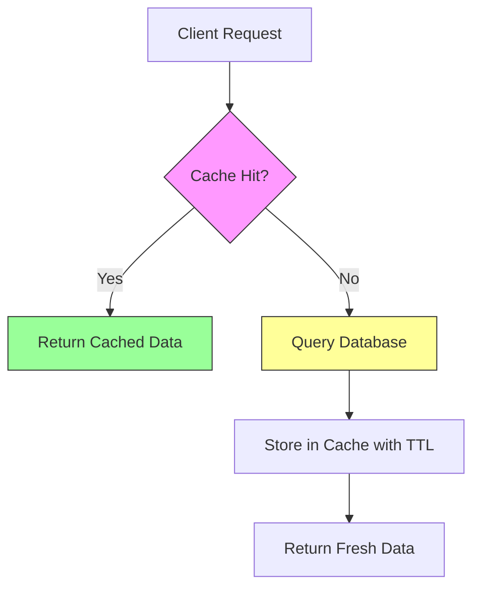

# Caching Strategies

Multi-layer caching strategies for SaaS: application-level, distributed cache, CDN/edge. Invalidation patterns and consistency trade-offs.

Complements **Read** [`code-conventions/architecture.md`](../code-conventions/architecture.md) for layer placement — caching logic belongs in the infrastructure/adapter layer, never in domain or application services directly.

---

## Cache Layers

| Layer | Hit Latency | Scope | Invalidation Ease | Best For |
|-------|-------------|-------|-------------------|----------|
| Browser (HTTP cache) | 0 ms (local) | Single user | Hard (depends on headers + user behavior) | Static assets, personalized responses with `private` |
| CDN / Edge | 1-50 ms | Global / regional | Medium (purge APIs, surrogate keys) | Public assets, API responses shared across users |
| Application / Redis | 1-5 ms (in-memory), 1-10 ms (Redis) | Per-instance or shared cluster | Easy (explicit delete/TTL) | Session data, hot queries, computed aggregations |
| Database query cache | 0.1-1 ms savings | Per-connection | Automatic (invalidated on write) | Simple read-heavy workloads, small tables |

**Rule of thumb:** cache as close to the consumer as possible, but only where you can tolerate the staleness window. Each layer added increases complexity and invalidation surface.

---

## Application-Level Caching

### In-Memory Caching

Best for hot paths accessed many times per second within a single process: configuration, feature flags, permission matrices, parsed templates.

**Patterns:**

- **LRU (Least Recently Used):** Fixed-size cache, evicts least-recently-accessed entries. Use when memory is bounded and access patterns follow a power law.
- **TTL (Time-To-Live):** Entries expire after a fixed duration. Use when staleness is acceptable within a known window.
- **LRU + TTL:** Combine both — bounded size with automatic expiration. **Recommended default.**

**Node.js patterns:**

```typescript
// Simple Map + TTL wrapper
class TTLCache<T> {
  private cache = new Map<string, { value: T; expires: number }>();

  get(key: string): T | undefined {
    const entry = this.cache.get(key);
    if (!entry) return undefined;
    if (Date.now() > entry.expires) {
      this.cache.delete(key);
      return undefined;
    }
    return entry.value;
  }

  set(key: string, value: T, ttlMs: number): void {
    this.cache.set(key, { value, expires: Date.now() + ttlMs });
  }
}
```

For production use, prefer `lru-cache` (npm) which handles LRU eviction, TTL, size limits, and stale-while-revalidate out of the box.

### Memoization

| Scope | Lifetime | Use Case | Risk |
|-------|----------|----------|------|
| Per-request | Single request | Avoid duplicate DB lookups within one handler | None — garbage collected with request |
| Per-instance | Process lifetime | Config, feature flags, static reference data | Stale data after deploy or config change |
| Shared (Redis) | Explicit TTL | Cross-instance consistency | Invalidation complexity |

**Rule:** Per-request memoization is always safe. Long-lived memoization requires an invalidation strategy.

---

## Distributed Cache (Redis / KV)

### Key Design

Use a structured namespace format to prevent collisions and enable bulk operations:

```
{namespace}:{version}:{entity}:{id}
```

Examples: `catalog:v2:product:8f3a-b1c2`, `auth:v1:session:user-uuid`, `billing:v1:invoice:inv-2024-001`

- **namespace** — service or domain boundary
- **version** — cache schema version (bump to mass-invalidate on schema change)
- **entity** — the type of cached object
- **id** — unique identifier

For tenant-scoped keys, see **Read** [`multi-tenant.md`](multi-tenant.md) which defines the `tenant:{id}:{key}` prefix pattern for cache key isolation.

### Serialization

| Format | Size | Speed | Schema Evolution | Best For |
|--------|------|-------|-----------------|----------|
| JSON | Largest | Moderate | Flexible (additive) | Debugging ease, interop, small objects |
| MessagePack | ~30% smaller | Faster | Flexible (additive) | High-throughput, large objects |
| Protocol Buffers | Smallest | Fastest | Strict (schema required) | Internal services with stable schemas |

**Recommendation:** JSON for most SaaS workloads (debuggable, universal). MessagePack when payload size or serialization speed is a measured bottleneck.

### Caching Patterns

| Pattern | How It Works | Pros | Cons | When to Use |
|---------|-------------|------|------|-------------|
| Cache-Aside (Lazy Loading) | App checks cache first; on miss, fetches from source, stores, returns | Only requested data cached; cache failures non-fatal | Miss penalty; thundering herd on popular keys | **Recommended default** for most SaaS read paths |
| Read-Through | Cache fetches from source on miss; app always reads from cache | Simpler application code — single read path | Tighter coupling; cache library must support async loaders | When cache library supports async loaders |
| Write-Through | Written to cache and source synchronously; ack when both succeed | Cache always consistent with source | Higher write latency; caches data that may never be read | Strong consistency requirements |
| Write-Behind (Write-Back) | Written to cache immediately, flushed to source asynchronously | Lowest write latency; batching reduces DB load | Risk of data loss if cache crashes before flush | High-throughput write paths, eventual consistency acceptable |



### Stampede Prevention

When a popular cache key expires, many concurrent requests may simultaneously hit the data source — a **cache stampede** (thundering herd).

| Strategy | How It Works | Complexity | Best For |
|----------|-------------|------------|----------|
| Mutex / lock | First request acquires a lock, others wait or get stale data | Medium | Low-concurrency, critical data |
| Probabilistic early expiration | Each request has a random chance of refreshing before TTL | Low | High-concurrency, tolerant of occasional stale reads |
| Stale-while-revalidate | Serve stale data immediately, refresh in background | Medium | Read-heavy endpoints, UX-sensitive paths |

**Probabilistic early expiration formula:**

```
shouldRefresh = (currentTime - (fetchTime + ttl * (1 - beta * ln(random())))) > 0
```

Where `beta` controls how early refreshes can start (typically `1.0`). This statistically spreads recomputation across time, preventing synchronized expiration.

For Redis-based rate limiting, which often shares the same Redis cluster, see **Read** [`rate-limiting.md`](rate-limiting.md) for specialized counter-based cache patterns that differ from general caching.

---

## CDN / Edge Caching

### Cache-Control Headers

```http
Cache-Control: public, s-maxage=3600, max-age=60, stale-while-revalidate=86400, stale-if-error=604800
```

| Directive | Meaning | Use When |
|-----------|---------|----------|
| `public` | Any cache (CDN, proxy) may store | Response is not user-specific |
| `private` | Only browser may cache | Response contains user-specific data |
| `s-maxage=N` | TTL for shared caches (CDN) | Different CDN vs browser TTL needed |
| `max-age=N` | TTL for all caches including browser | Simple, same TTL everywhere |
| `stale-while-revalidate=N` | Serve stale while refreshing in background | Read-heavy, staleness-tolerant |
| `stale-if-error=N` | Serve stale if origin is down | Resilience during outages |
| `no-store` | Never cache | Sensitive data, real-time responses |
| `no-cache` | Cache but revalidate every time | Must check freshness, but allow 304 |

**Rules:**
- Never use `public` on authenticated or tenant-specific responses
- Always set `Vary: Authorization` (or `Vary: Cookie`) on personalized responses to prevent cross-user cache pollution
- Prefer `s-maxage` over `max-age` when CDN and browser TTLs should differ

### Surrogate Keys / Cache Tags

Tag cached responses with metadata so you can purge related entries without knowing exact URLs.

```http
Surrogate-Key: product-123 category-electronics tenant-acme
```

**Invalidation:** Purge all entries tagged `product-123` when the product is updated — regardless of how many URL variants are cached (pagination, locale, query params).

Supported by: Fastly (native), Cloudflare (Cache Tags), Varnish (xkey), Akamai (Edge-Cache-Tag).

### Edge Compute Caching

**Cloudflare Workers Cache API:**

```typescript
const cacheKey = new Request(url.toString(), request);
const cache = caches.default;

let response = await cache.match(cacheKey);
if (!response) {
  response = await fetch(request);
  response = new Response(response.body, response);
  response.headers.set("Cache-Control", "s-maxage=600");
  ctx.waitUntil(cache.put(cacheKey, response.clone()));
}
return response;
```

**Vercel ISR (Incremental Static Regeneration):** Serve pre-rendered pages from edge, revalidate in background after TTL. Combines static performance with dynamic freshness.

---

## Invalidation Strategies

### Decision Matrix

| Consistency Requirement | Acceptable Staleness | Strategy | Complexity |
|------------------------|---------------------|----------|------------|
| Eventual (seconds) | 1-60 seconds | TTL-based expiration | Lowest |
| Eventual (fast) | < 5 seconds | Event-driven invalidation | Medium |
| Near-real-time | < 1 second | Event-driven + pub/sub broadcast | High |
| Strong | 0 (none) | Write-through + synchronous invalidation | Highest |

- **TTL-Based:** Set a TTL on every cache entry. Use for reference data, product catalogs, configuration — start here unless you have a proven consistency requirement.
- **Event-Driven:** Publish invalidation events when data changes; subscribers delete or refresh affected keys. Use for shopping carts, user profiles, inventory counts. Example: `OrderService --publish--> "order.updated" → CacheInvalidator deletes keys matching "orders:*:{orderId}"`
- **Versioned Keys:** Include a version number in the key; bump to invalidate all old entries without explicit deletion. Use for schema changes, bulk migrations, deploy-time busting. Old keys evicted by LRU/TTL naturally.
- **Purge APIs:** Programmatic clearing via CDN/cache provider APIs. Use for content publishing, emergency invalidation. **Warning:** always prefer targeted purges over global purges — purge-all causes origin overload (sudden cache miss storm).

---

## Cache Key Design

Every cache key must be globally unique: `{service}:{version}:{entity}:{id}:{variant}`

**Variant examples:** locale (`en`, `fr`), format (`full`, `summary`), permissions context (`public`, `admin`).

- Tenant isolation: see **Read** [`multi-tenant.md`](multi-tenant.md) for the `tenant:{id}:{key}` prefix — do not duplicate tenant key logic here
- Locale/variant: `catalog:v1:product:123:en:full` — always derive from a controlled set (enum of locales, known formats), never from raw user input

### Anti-Patterns

| Anti-Pattern | Risk | Correct Approach |
|-------------|------|------------------|
| User input directly in cache keys | Cache poisoning, injection, unbounded key space | Hash or validate input, use IDs from trusted sources |
| Unbounded key spaces (one key per search query) | Memory exhaustion, low hit ratio | Cache by normalized parameters, cap cardinality |
| Missing namespace/version prefix | Key collisions across services or deploys | Always use `{service}:{version}:` prefix |
| Inconsistent key generation across services | Phantom misses, stale reads | Centralize key generation in a shared utility |
| Caching errors or empty results without short TTL | Stale errors served long after recovery | Use a short TTL (5-30s) for negative cache entries |

---

## Monitoring

### Key Metrics

| Metric | What It Tells You | Alert Threshold |
|--------|-------------------|-----------------|
| Hit ratio | Cache effectiveness | < 80% sustained (investigate miss patterns) |
| Eviction rate | Cache is undersized | > 5% of sets result in evictions |
| Latency P50 / P95 / P99 | Cache performance degradation | P99 > 10ms for Redis, > 100ms for CDN |
| Memory usage | Capacity planning | > 80% of allocated memory |
| Key count / cardinality | Unbounded growth detection | Monotonic growth without plateau |
| Miss storm rate | Stampede detection | Sudden spike in misses for same key pattern |

### Alerting Strategy

- **Hit ratio drop:** Investigate key expiration patterns, recent deploys, or traffic shifts
- **Eviction spike:** Scale cache instance or reduce TTLs on low-value entries
- **Latency increase:** Check network, Redis slow log, key size growth
- **Memory saturation:** Audit key cardinality, enforce TTLs on all entries, consider eviction policy change (allkeys-lru vs volatile-lru)

### Observability Checklist

- Log cache hit/miss per endpoint (not per key — too noisy)
- Track hit ratio per cache layer (browser, CDN, Redis) independently
- Dashboard: hit ratio trend, eviction rate, latency percentiles, memory usage
- Correlate cache metrics with application latency — a cache regression often appears as a slow endpoint before it appears as a cache alert
