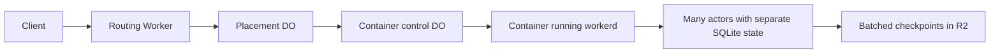

# Pooling Durable Objects in Cloudflare Containers

Consider this cost optimization when many small stateful actors must remain awake but use little CPU. Run their classes in `workerd` inside Cloudflare Containers, sharing provisioned resources instead of paying native Durable Object (DO) duration per actor. Keep native DOs for mostly sleeping schedules and state that requires their managed durability.

Reviewed on **2026-10-16**. This is an independently authored assessment of Robert Chandler's `do-pool` experiment, not a deployed or benchmarked implementation in this repository. **Read** [the original thread](https://x.com/bertie_ai/status/2110818486947872950) and [the pinned experiment report](https://github.com/nyacg/do-on-container/blob/5eb83a3de11a01bb630a286e998809727f89b8fd/POST.md) for the author's evidence.

## What changes

A container is a separately hosted execution environment built from a container image; it does not run inside a Worker. `workerd`, Cloudflare's open-source runtime, executes many object instances inside that environment. An object retains its own identity and SQLite state. Native DOs still provide container control and placement; thousands of native DO instances are not nested inside one larger DO.



The experiment uses a portability base class, registration and a binding bridge. Keeping the business class similar does not make this a configuration-only migration or preserve the native service's guarantees. **Read** [the pinned implementation overview](https://github.com/nyacg/do-on-container/blob/5eb83a3de11a01bb630a286e998809727f89b8fd/README.md) and [Cloudflare Containers documentation](https://developers.cloudflare.com/containers/).

## When the optimization can help

These are candidate workloads, not capacity claims. Compare each with native hibernation before adopting pooling.

| Workload | Why pooling might help | State that must remain elsewhere or be recoverable |
|---|---|---|
| Collaborative cursors and presence | Many small rooms with periodic presence sweeps | Documents, permissions and authoritative edits |
| Transient game simulations | Many lightweight rooms with frequent ticks | Purchases, inventories and final authoritative results |
| Agent scratchpads and live progress | Many agents holding outbound model streams or timers | User commands, tool-effect receipts and completed outputs |
| Live feed subscriptions | Many mostly waiting outbound connections | Durable offsets and source data needed for replay |
| Reconstructible realtime dashboards | Small actor state refreshed from authoritative events | Canonical events, access rules and durable job results |

An open client WebSocket alone does not justify pooling: native WebSocket hibernation can keep the connection without continuous DO duration charges. High fan-out or CPU-heavy actors may erase the saving; benchmark actual message volume and serialization work.

## When native Durable Objects are preferable

- **Reservation reminders and editable schedules:** persist the deadline, arm an alarm and finish the handler. Cloudflare can wake the object later; waiting days does not require days of billed execution. **Read** [the scheduling pattern](cloudflare-job-scheduling.md).
- **Bookings, payments, locks and irreplaceable writes:** preserve an authoritative transaction and recovery contract. The experiment's checkpoints do not replace native replicated storage.
- **Mostly idle chat rooms:** try WebSocket hibernation and automatic responses before building a container pool.
- **Latency-sensitive or region-constrained services:** qualify actual placement, routing and restart behavior against current platform controls.

Native duration charges stop when an idle DO becomes eligible for hibernation, even before actual eviction. Persisted SQLite data remains separately billable while the object sleeps. Timers, unfinished I/O and outbound connections can prevent hibernation. **Read** [DO lifecycle rules](https://developers.cloudflare.com/durable-objects/concepts/durable-object-lifecycle/), [alarm APIs](https://developers.cloudflare.com/durable-objects/api/alarms/) and [DO pricing](https://developers.cloudflare.com/durable-objects/platform/pricing/).

## Cost model and evidence boundaries

| Native DO | Container pool |
|---|---|
| Duration uses an allocated 128 MB per active object, regardless of actual memory use | Running containers charge provisioned memory/disk and actual CPU use |
| Requests, alarms and storage operations have separate charges | Workers, control DOs, R2, traffic and observability add to container charges |
| Sleeping objects incur no duration charge; stored data still counts | A continuously running pool has a resource baseline even when actors do little |

**Read** [current DO rates](https://developers.cloudflare.com/durable-objects/platform/pricing/) and [current container rates](https://developers.cloudflare.com/containers/platform/pricing/) before calculating. Use billed active seconds rather than monthly active users or the total number of stored objects. Account allocations are shared, not granted separately to every application or actor.

The author reports approximately **$4,050 versus $22/month for 1,000 always-awake objects**, extrapolated from short tests. Each actor had a 1 Hz loop and a WebSocket client; the container used about 0.2 vCPU. He measured roughly 200 KB per resident object. These are workload-specific observations, not a guaranteed monthly bill, an equivalent-durability comparison, or evidence that 100,000 actors fit one container. His approximately two-hours-awake-per-month crossover also depends on his workload and assumptions.

Use these inputs for a project estimate:

- Native: invocation count, cumulative billed seconds, physical SQLite size and retention, row operations, retries and remaining included usage.
- Pool: measured resident actors per node, peak concurrency, CPU and provisioned memory/disk, minimum running nodes, checkpoints, recovery traffic and control-plane usage.
- Compare equal workloads and the required recovery/latency objectives; report the shared plan fee once and identify common application costs separately.

For a sleeping reminder workload, an illustrative 100,000 reservations with 10 cumulative active seconds each consume 128,000 GB-seconds. At 32 KiB of average physical state per retained object, 100,000 retained objects use about 3.3 GB. Both fit the reviewed paid-plan duration/storage allocations, if available. This is arithmetic under stated assumptions, not a production benchmark or a complete application bill.

## Optimizations retained from the experiment

- **WebSocket passthrough:** the author bypassed the library's JavaScript frame relay through the container TCP port. His tests reduced fronting-DO message/duration charges and removed a throughput bottleneck. Verify the installed SDK/runtime behavior; this is not a permanent claim about every library version.
- **Batched checkpoints:** persist dirty actor state together with a manifest instead of one R2 write per actor per flush. Define retention and compaction; old checkpoint segments must not accumulate indefinitely.
- **Placement and scaling:** assign actors to nodes, preserve assignment epochs, move hot actors and scale before saturation prevents checkpoint/recovery work. The author observed a 4,096 inbound-connection limit per container; recheck current limits before sizing.
- **Memory controls:** measure socket/compression overhead as well as actor memory; the author disabled WebSocket compression after observing substantial per-socket overhead.

## Durability and failure contract

The experiment checkpoints every 30 seconds. A hard container failure can lose changes since the last completed checkpoint, including acknowledged writes; a delayed or failed checkpoint can extend that window. Planned drains and tested live migrations lost no acknowledged writes in the author's runs. Those results do not establish crash safety. A recovery point objective (RPO) describes tolerated data loss, not a guarantee inferred from the configured flush interval.

```mermaid
stateDiagram-v2
    [*] --> Running
    Running --> Running : checkpoint committed
    Running --> Draining : planned stop or move
    Draining --> Restoring : checkpoint committed and ownership fenced
    Running --> Restoring : hard crash; uncheckpointed changes lost
    Restoring --> Running : restore durable checkpoint and reconcile
```



Before changing ownership, make the snapshot durable and fence stale owners. Clients need reconnect/replay behavior. If SQL owns the canonical state, rebuilding the projection can recover committed facts but still delays dispatch; protect external effects with durable idempotency outside the disposable projection. A checkpoint alone does not prevent duplicate emails, payments or tool calls.

```gherkin
Feature: Choosing an actor hosting model
  Scenario: A reminder waits several days
    Given the scheduler can persist its deadline and finish all I/O
    When it arms a native DO alarm
    Then the estimate excludes sleeping time from billed duration

  Scenario: A pooled presence node fails
    Given presence can be rebuilt from reconnecting clients
    When the container loses changes after its durable checkpoint
    Then clients restore presence without treating it as authoritative booking state
```

## Validation before adoption

| Decision | Required evidence |
|---|---|
| Pooling is cheaper | Native hibernation baseline and pool billing for identical representative load, including idle periods and shared allocations |
| Capacity is sufficient | Resident-state footprint, SQLite growth, socket count, CPU peaks and checkpoint lag under load |
| Recovery is acceptable | Hard-kill, planned rollout, failed checkpoint and restore tests; observed loss and recovery time |
| Migration preserves identity | Concurrent writes, stale-owner fencing, reconnects, retries and duplicate-effect tests |
| Operations remain bounded | Scaling headroom, alarms, checkpoint garbage collection, tenant isolation and recovery ownership |

Keep this as an optional optimization for measured awake-but-light workloads. Freeze durability, latency, state ownership, retention and recovery policy before implementation; retain native DO alarms as the baseline for sleeping reminders. No container is deployed and no consuming project's architecture is changed by this reference.
