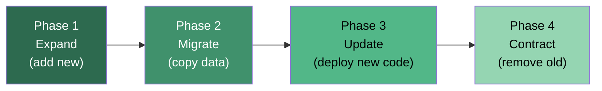
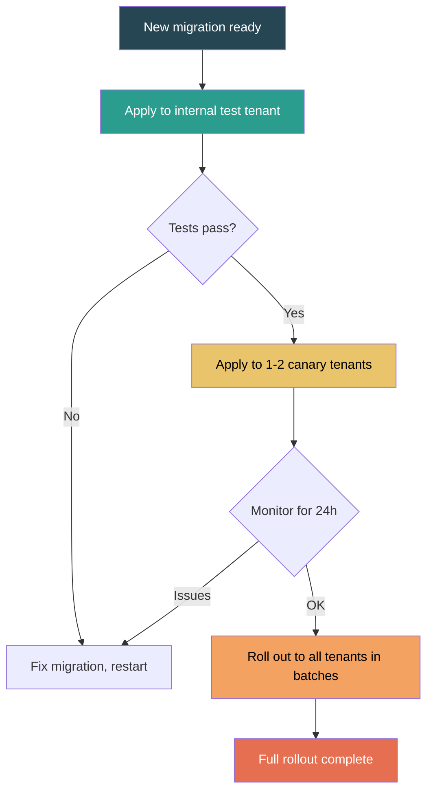

# Database Migrations

Database migration patterns for SaaS: schema versioning, zero-downtime migrations, data migrations, rollback strategies.

These patterns follow the SQL conventions defined in **Read** [`code-conventions/database.md`](../code-conventions/database.md). Migration orchestration belongs in the **infrastructure layer** as defined in **Read** [`code-conventions/architecture.md`](../code-conventions/architecture.md) (section 3 — layered architecture). For multi-tenant migration ordering, see **Read** [`multi-tenant.md`](multi-tenant.md).

---

## 1. Migration Types

| Type | Description | Risk Level | Reversibility |
|------|-------------|------------|---------------|
| Schema migration (DDL) | Structural changes: CREATE, ALTER, DROP tables/columns/indexes | Medium–High | Reversible if additive; destructive changes require backup |
| Data migration (DML) | Transform, backfill, or move data: UPDATE, INSERT, DELETE | Medium | Reversible with backup or inverse operation |
| Combined (DDL + DML) | Schema change followed by data backfill in one migration | High | Difficult — avoid when possible |
| Seed data | Insert reference/lookup data required by the application | Low | Reversible (delete seeded rows) |

**Rule:** Never combine DDL and DML in a single migration file. Separate them into two sequential migrations — the schema change first, then the data backfill. This keeps each migration atomic, reviewable, and independently reversible.

---

## 2. Versioning

### Numbering strategies

| Strategy | Format | Pros | Cons |
|----------|--------|------|------|
| Sequential | `001_create_users.sql` | Simple, clear ordering | Conflicts in parallel branches |
| Timestamp-based | `20260322140000_add_column.sql` | No conflicts across branches | Harder to read ordering at a glance |

**Recommendation:** Use timestamp-based naming for teams with parallel branches. Use sequential numbering for solo developers or linear trunk-based workflows.

### File naming convention

```
<version>_<description>.<direction>.sql

# Examples — timestamp-based
20260322140000_create_users_table.up.sql
20260322140000_create_users_table.down.sql
20260322143000_add_email_verified_column.up.sql
20260322143000_add_email_verified_column.down.sql

# Examples — sequential
001_create_users_table.up.sql
001_create_users_table.down.sql
002_add_email_verified_column.up.sql
002_add_email_verified_column.down.sql
```

### Migration ledger

Every migration system maintains a ledger table tracking applied migrations:

```sql
CREATE TABLE schema_migrations (
  version     TEXT        PRIMARY KEY,
  name        TEXT        NOT NULL,
  applied_at  TIMESTAMPTZ NOT NULL DEFAULT now(),
  checksum    TEXT        NOT NULL,
  duration_ms INTEGER
);
```

The ledger is the source of truth for which migrations have run. Never modify it manually.

### Tooling

| Tool | Ecosystem | Approach | Notes |
|------|-----------|----------|-------|
| Drizzle Kit | Node/TS | Schema-diff generation from TS definitions | Primary choice for Drizzle ORM projects |
| Prisma Migrate | Node/TS | Schema-diff from `schema.prisma` | Generates SQL files, supports shadow DB |
| Raw SQL files | Any | Hand-written `.up.sql` / `.down.sql` | Maximum control, no abstraction |
| Flyway | JVM | Versioned SQL or Java migrations | Enterprise standard, convention-based |
| Liquibase | JVM | XML/YAML/SQL changelog | Supports rollback, preconditions |

**Recommendation:** For Node/TS projects, prefer Drizzle Kit or raw SQL files. Use ORM-generated migrations as a starting point, then review and edit the generated SQL before committing.

---

## 3. Zero-Downtime Migrations (Expand/Contract)

The expand/contract pattern ensures the database schema is always compatible with both the old and new versions of the application code during deployment.

### The four phases



**Phase 1 — Expand:** Add the new column, table, or index alongside the existing structure. Old code continues working unchanged.

**Phase 2 — Migrate:** Backfill data from old structure to new. Write to both old and new during this phase (dual-write).

**Phase 3 — Update:** Deploy new application code that reads/writes the new structure. Old structure is still present but unused.

**Phase 4 — Contract:** Remove the old column, table, or index. This is a separate deployment, days or weeks after Phase 3.

### DDL operation safety classification

| Operation | Safety | Strategy |
|-----------|--------|----------|
| Add column (nullable, no default) | Safe | Direct ALTER |
| Add column (with default) | Safe on Postgres 11+ | Direct ALTER (metadata-only on modern Postgres) |
| Rename column | Unsafe | Expand/contract: add new, copy data, drop old |
| Drop column | Unsafe | Contract phase only — after code no longer references it |
| Change column type | Unsafe | Expand/contract: add new column with new type, migrate, drop old |
| Add index | Unsafe (locks) | Use `CREATE INDEX CONCURRENTLY` (Postgres) |
| Drop index | Safe | Direct DROP |
| Add NOT NULL constraint | Unsafe | Add CHECK constraint first, validate, then convert |
| Add table | Safe | Direct CREATE |
| Drop table | Unsafe | Contract phase only — verify no code references remain |
| Add foreign key | Unsafe (locks) | Add as NOT VALID, then VALIDATE separately |

---

## 4. Data Migrations

### Backfill patterns

**Batch processing** — process rows in fixed-size chunks:

```sql
-- Backfill in batches of 1000
UPDATE users
SET full_name = name
WHERE full_name IS NULL
  AND id IN (
    SELECT id FROM users
    WHERE full_name IS NULL
    ORDER BY id
    LIMIT 1000
  );
```

**Cursor-based** — use a cursor column to resume from where you left off:

```sql
-- Track progress with a cursor
UPDATE users
SET full_name = name
WHERE full_name IS NULL
  AND id > :last_processed_id
ORDER BY id
LIMIT 1000;
```

**Background job** — for millions of rows, run backfill as an async job:

1. Enqueue a backfill job with batch size and cursor
2. Each job iteration processes one batch, then enqueues the next
3. Track progress in a separate `migration_progress` table
4. New code handles both migrated and unmigrated rows during backfill

### Large table considerations

| Concern | Mitigation |
|---------|------------|
| Table locks during UPDATE | Batch updates with small transaction scopes |
| Replication lag | Throttle batches — add delay between chunks |
| Disk space during migration | Monitor table bloat, schedule VACUUM |
| Long-running transactions | Keep each batch in its own transaction |
| Application performance impact | Run backfills during low-traffic windows |

### Verification

After every data migration, verify integrity:

1. **Row count check** — compare expected vs actual migrated rows
2. **Null check** — verify no rows were missed: `SELECT COUNT(*) FROM users WHERE full_name IS NULL`
3. **Data integrity assertions** — spot-check samples: old value maps correctly to new value
4. **Constraint validation** — add the NOT NULL or CHECK constraint only after backfill is verified
5. **Audit log** — record migration result: rows affected, duration, errors

---

## 5. Rollback Strategies

### Forward-only vs reversible

| Strategy | When to use | Trade-offs |
|----------|-------------|------------|
| Forward-only | Destructive changes, data transforms, production hotfixes | Simpler, no down file needed; rollback = new forward migration |
| Reversible (up/down) | Additive schema changes, development/staging environments | Enables quick rollback; down migration must be tested |

**Default stance:** Write reversible migrations for additive changes (add column, add table, add index). Use forward-only for data migrations and destructive changes — a down migration that "un-drops" a column cannot restore lost data.

### Down migration limitations

Down migrations cannot:
- Restore dropped data (the data is gone after DROP COLUMN)
- Reverse a data transform without storing the original values
- Safely undo a migration that other migrations depend on

**Rule:** If a down migration cannot fully restore the previous state, do not write one. Use a forward migration instead.

### Feature flags as a safety net

Feature flags decouple code deployment from schema migration:

```
Timeline:
1. Deploy migration (expand: add new column)
2. Deploy code behind feature flag (reads new column if flag ON, old column if OFF)
3. Enable flag for canary users → verify
4. Enable flag for all users
5. Deploy cleanup migration (contract: remove old column)
```

During steps 2–4, the code supports both the old and new schema. If the migration causes issues, disable the flag — no rollback migration needed.

---

## 6. Multi-Tenant Considerations

For tenant isolation strategies and their impact on migrations, see **Read** [`multi-tenant.md`](multi-tenant.md).

### Migration ordering by strategy

| Tenant strategy | Migration approach |
|----------------|-------------------|
| Shared DB + RLS | Single migration, applies to all tenants at once |
| Schema per tenant | Iterate over each tenant schema, apply migration per schema |
| Database per tenant | Iterate over each tenant database, apply migration per database |

### Per-tenant schema migrations

For schema-per-tenant or database-per-tenant architectures:

```
1. List all tenant schemas/databases
2. For each tenant:
   a. Begin transaction
   b. Apply migration
   c. Record result (success/failure) in central ledger
   d. Commit or rollback
3. On failure: halt or continue (configurable)
4. Log affected tenants for manual remediation
```

### Canary migrations

Test migrations on a subset of tenants before full rollout:



**Batch rollout order:**
1. Internal/test tenants
2. Free-tier tenants (lower risk, faster feedback)
3. Paid tenants in small batches (10%, 25%, 50%, 100%)
4. Enterprise tenants (last — highest impact if something fails)

---

## 7. Anti-Patterns

### Mixing DDL and DML in one migration

**Problem:** A single migration that creates a column and backfills data. If the backfill fails mid-way, the schema change may be committed but data is partially migrated.

**Fix:** Separate into two migrations. Schema change first, data backfill second.

### Non-reversible operations without backup

**Problem:** Dropping a column or table without verifying that no code references it and without a data backup.

**Fix:** Before any DROP: verify zero code references, take a logical backup of the affected data, deploy the contract migration only after a stabilization period.

### Long-running locks

**Problem:** Running `ALTER TABLE ... ADD COLUMN ... DEFAULT ...` on older Postgres (< 11) or `CREATE INDEX` without CONCURRENTLY. Locks the table for the duration, blocking all reads/writes.

**Fix:** Use `CREATE INDEX CONCURRENTLY`. On older Postgres, add columns as nullable first, then backfill. For `ADD CONSTRAINT`, use `NOT VALID` + separate `VALIDATE`.

### Deploying code before migration completes

**Problem:** New code expects a column or table that does not yet exist. Application errors until migration finishes.

**Fix:** Always run migrations before deploying code that depends on them. In the expand/contract pattern, the expand migration runs first — code is deployed only after the schema supports it.

### Running migrations without a lock

**Problem:** Two deployment instances run the same migration simultaneously, causing duplicate DDL or data corruption.

**Fix:** Use advisory locks or migration tool built-in locking (`pg_advisory_lock`). Most migration tools handle this automatically.

### Manual schema changes in production

**Problem:** Applying ad-hoc ALTER TABLE statements directly, bypassing the migration system. The ledger becomes out of sync with the actual schema.

**Fix:** All schema changes go through migration files — no exceptions. If an emergency fix is applied manually, immediately create a matching migration file and mark it as applied in the ledger.
