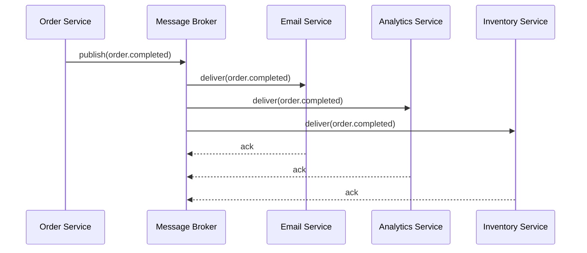
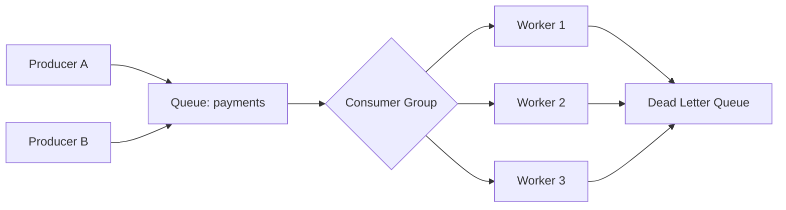
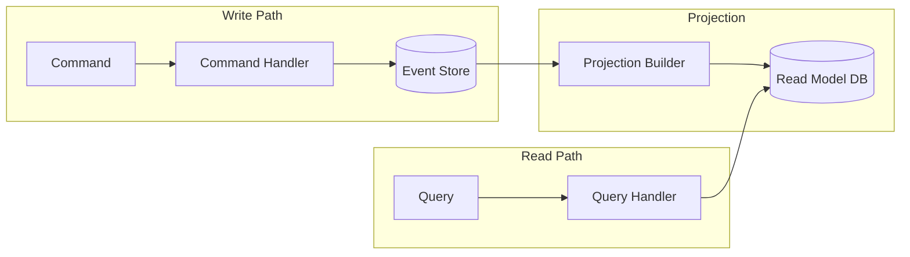

# Event-Driven Architecture

Patterns for asynchronous, event-based communication in SaaS systems: pub/sub, message queues, event sourcing, CQRS, delivery guarantees.

These patterns implement the layered architecture defined in **Read** [`code-conventions/architecture.md`](../code-conventions/architecture.md). Event dispatch and orchestration belong in the **service/use-case layer** (section 3.3); event persistence (stores, snapshots) belongs in **repositories** (section 3.4); transport concerns (broker connections, serialization, queue bindings) belong in **gateways/adapters** (section 3.5).

---

## 1. Overview

EDA decouples producers from consumers via emitted events, enabling loose coupling, independent scaling, and temporal decoupling.

### When to Use: Decision Matrix

| Criteria | Request/Response | Event-Driven | Recommendation |
|----------|-----------------|--------------|----------------|
| Latency requirements | Low, predictable | Higher, variable | Request/response when sub-100ms is required |
| Coupling tolerance | Tight (caller knows callee) | Loose (producer unaware of consumers) | Event-driven when teams/services evolve independently |
| Failure isolation | Caller blocked on failure | Consumer retries independently | Event-driven for resilience |
| Scaling profile | Scale both sides together | Scale producers and consumers independently | Event-driven for asymmetric load |
| Data consistency | Immediate consistency | Eventual consistency | Request/response for strong consistency requirements |
| Auditability | Requires explicit logging | Events are the log | Event-driven for audit-critical flows |
| Complexity | Lower | Higher (ordering, idempotency, DLQs) | Request/response for simple CRUD |
| Fan-out | 1:1 calls, N calls for N consumers | 1:N via broker | Event-driven when multiple consumers react to same trigger |

**Decision rule:** start with request/response. Introduce events when you need decoupling, fan-out, audit trails, or independent scaling. Avoid event-driven for flows requiring immediate consistency or fundamentally request/reply (e.g., "get user profile").

## 2. Event Design

### Event Envelope

Reuse the canonical event structure defined in **Read** [`webhook-patterns.md`](webhook-patterns.md) (section "Event Structure"):

```json
{
  "id": "evt_abc123",
  "type": "order.completed",
  "created_at": "2026-03-21T14:23:45Z",
  "data": {
    "order_id": "ord_xyz",
    "total": 4999,
    "currency": "eur"
  },
  "api_version": "2026-03-01"
}
```

Fields: `id` (globally unique, idempotency key), `type` (dot-separated past tense), `created_at` (ISO 8601), `data` (domain payload), `api_version` (schema version for consumer compatibility).

### Naming Conventions

Dot-separated, past-tense: `<resource>.<action>` → `order.completed`; `<resource>.<sub>.<action>` → `order.item.added`; `<domain>.<resource>.<action>` → `billing.invoice.paid`. Always lowercase, nouns for resources, verbs for actions. Avoid generic names like `data.changed` — be specific.

### Schema Evolution

- **Safe (additive):** adding new fields to `data`, adding new event types
- **Unsafe (breaking):** removing fields, renaming fields, changing field types
- **Breaking changes:** introduce a new event type (e.g., `order.completed.v2`) or bump `api_version`
- **Consumer rule:** ignore unknown fields (forward-compatible parsing)

## 3. Patterns

### 3.1 Pub/Sub

Fan-out pattern where a single event reaches multiple independent subscribers. The publisher does not know (or care) how many subscribers exist.

**Use when:** multiple services react to the same event independently (e.g., `order.completed` triggers email, analytics, inventory update).



Key properties:
- **Topic-based routing:** subscribers filter by event type or topic pattern (`order.*`, `billing.invoice.*`)
- **Independent consumption:** each subscriber has its own offset/cursor -- slow consumers do not block others
- **At-least-once delivery:** standard guarantee; subscribers must be idempotent

### 3.2 Event Bus (In-Process)

For monoliths or modular monoliths -- decouple modules without network overhead.

**Use when:** modules within a single process need loose coupling, but a full broker is overkill.

```typescript
// Typed event emitter pattern
interface AppEvents {
  "order.completed": { orderId: string; total: number };
  "user.registered": { userId: string; email: string };
}

class EventBus<T extends Record<string, unknown>> {
  private handlers = new Map<keyof T, Set<(data: any) => void>>();

  on<K extends keyof T>(event: K, handler: (data: T[K]) => void): void {
    if (!this.handlers.has(event)) this.handlers.set(event, new Set());
    this.handlers.get(event)!.add(handler);
  }

  emit<K extends keyof T>(event: K, data: T[K]): void {
    for (const handler of this.handlers.get(event) ?? []) {
      handler(data);
    }
  }
}

const bus = new EventBus<AppEvents>();
bus.on("order.completed", (data) => sendConfirmationEmail(data.orderId));
bus.on("order.completed", (data) => updateAnalytics(data.total));
```

Limitations:
- No persistence -- events lost on crash
- No retry/DLQ -- failures require manual handling
- Single-process only -- cannot scale consumers independently

Upgrade path: when you need durability or independent scaling, move to a message queue or pub/sub broker.

### 3.3 Message Queue

Point-to-point delivery -- each message is consumed by exactly one consumer in a consumer group. Provides ordering guarantees within partitions and backpressure via queue depth.

**Use when:** work must be processed exactly once by one worker (e.g., payment processing, image resizing).



Key properties:
- **Competing consumers:** multiple workers pull from the same queue -- horizontal scaling
- **Ordering:** guaranteed within a partition/key (e.g., all events for `order_123` go to the same partition)
- **Backpressure:** queue depth signals overload -- add consumers or throttle producers
- **Retry + DLQ:** failed messages retry with backoff, then move to dead letter queue after max attempts

### 3.4 Event Sourcing

Instead of storing current state, store the sequence of events that led to that state. Current state is derived by replaying events.

**Use when:** audit trail is critical (finance, healthcare, legal), temporal queries needed, undo/redo required. **Avoid when:** simple CRUD, high-throughput read-heavy workloads (projections add latency), or team unfamiliar with the pattern.

```
Events (append-only):
  1. OrderCreated { orderId, items, total }
  2. PaymentReceived { orderId, amount }
  3. OrderShipped { orderId, trackingId }
  4. OrderDelivered { orderId, deliveredAt }

Current state = replay(events 1..4)
  → { status: "delivered", total: 4999, trackingId: "TRK_123" }
```

**Snapshotting:** for aggregates with many events, periodically save a snapshot. Replay only events after the snapshot to rebuild state.

**Projections:** materialized read models built by applying events. Multiple projections can serve different query patterns from the same event stream.

## 4. CQRS

Command Query Responsibility Segregation separates the write model (commands) from the read model (queries). Often paired with event sourcing but can be used independently. **Write path:** validates commands, applies business rules, persists events. **Read path:** queries optimized read models (projections) that are eventually consistent with the write model.



### When to Use CQRS

| Scenario | CQRS? | Reason |
|----------|-------|--------|
| Read/write ratio > 10:1 | Yes | Optimize read models independently |
| Complex domain with rich write validation | Yes | Keep write model focused on invariants |
| Multiple read representations of same data | Yes | Each projection tailored to its use case |
| Simple CRUD, balanced reads/writes | No | Overhead not justified |
| Team < 3 engineers | No | Operational complexity too high |

### Eventual Consistency

CQRS introduces eventual consistency. Handle explicitly: **UI** shows optimistic updates; **API** returns command result immediately while read model catches up asynchronously; **Consistency window** is typically milliseconds to low seconds — monitor projection lag as an SLA metric.

## 5. Delivery Guarantees

### Comparison

| Guarantee | Behavior | Use Case | Implementation |
|-----------|----------|----------|---------------|
| At-most-once | Fire and forget, no retry | Metrics, logging, non-critical notifications | Publish without ack |
| At-least-once | Retry until ack, possible duplicates | **Recommended default** -- payments, emails, state changes | Publish + consumer ack + retry |
| Exactly-once | Each message processed exactly once | Financial transactions, inventory | At-least-once + idempotency (true exactly-once is a distributed systems myth) |

True exactly-once delivery is impossible in distributed systems (network partitions, crashes between processing and ack). What systems call "exactly-once" is actually at-least-once delivery combined with idempotent processing.

### Idempotency Keys

Every event consumer must be idempotent. Use the event `id` as the idempotency key:

```typescript
async function handleOrderCompleted(event: OrderCompletedEvent): Promise<void> {
  const alreadyProcessed = await db.idempotencyKeys.exists(event.id);
  if (alreadyProcessed) return; // skip duplicate

  await db.transaction(async (tx) => {
    await tx.idempotencyKeys.insert({ key: event.id, processedAt: new Date() });
    await tx.inventory.decrement(event.data.items);
    await tx.notifications.enqueue(event.data.orderId);
  });
}
```

### Dead Letter Queues (DLQ)

Messages that fail after max retry attempts move to a DLQ for investigation:

- **Monitor DLQ depth** -- alert when non-zero
- **Preserve full context** -- original message, error, attempt count, timestamps
- **Replay capability** -- tooling to re-enqueue DLQ messages after fixing the bug
- **TTL on DLQ** -- auto-expire after retention period (e.g., 14 days)

### Outbox Pattern

To ensure events are published reliably when state changes, use the transactional outbox:

1. Within the same database transaction, write the state change AND insert the event into an `outbox` table
2. A separate process polls the outbox (or uses CDC) and publishes to the broker
3. Mark outbox entries as published after successful broker ack

This avoids the dual-write problem (state committed but event lost, or vice versa).

## 6. Infrastructure Mapping

### Job Queues and Workflow Engines

For background jobs, scheduled tasks, and step functions, see **Read** [`stack-ref/jobs/`](../stack-ref/jobs/):

| Tool | Type | Best For |
|------|------|----------|
| Inngest | Event-driven workflow engine | Multi-step functions, fan-out, retries with backoff |
| Trigger.dev | Background job framework | Long-running jobs, integrations, cron |
| BullMQ | Redis-backed queue | Node.js, fine-grained queue control, priorities |
| Cloudflare Queues | Edge-native queue | Cloudflare Workers ecosystem, low-latency edge processing |

### Pub/Sub Brokers

| Broker | Model | Ordering | Persistence | Best For |
|--------|-------|----------|-------------|----------|
| Redis Pub/Sub | Fan-out | No ordering guarantees | No (fire-and-forget) | Real-time notifications, cache invalidation |
| Redis Streams | Log-based | Per-stream | Yes (append-only log) | Lightweight event sourcing, consumer groups |
| AWS SNS + SQS | Fan-out + queue | FIFO variant available | Yes (SQS retention) | AWS-native, SNS fan-out to SQS queues |
| Kafka | Log-based | Per-partition | Yes (configurable retention) | High-throughput, event sourcing, stream processing |
| NATS | Pub/sub + queue | Per-subject (JetStream) | Optional (JetStream) | Lightweight, multi-cloud, edge |

### Choosing Between Job Queue and Pub/Sub

| Need | Tool |
|------|------|
| "Do this work later" (single consumer) | Job queue (BullMQ, Inngest, Trigger.dev) |
| "Tell everyone this happened" (fan-out) | Pub/sub broker (Redis Pub/Sub, SNS, Kafka) |
| "Do this work later AND tell everyone" | Publish event to broker, one subscriber enqueues a job |

## 7. Anti-Patterns

| Anti-Pattern | Problem | Fix |
|-------------|---------|-----|
| Event Storms | A single action triggers a cascade of events causing exponential amplification | Introduce circuit breakers, rate-limit event emission, use sagas with explicit compensation steps; monitor event throughput per type |
| Circular Dependencies | Service A emits X → Service B emits Y → Service A emits X again | Map event flows as a directed graph; break cycles by merging logic into one service or introducing a saga/orchestrator |
| Oversized Events | Events carry full entity snapshots instead of minimal relevant data | Events carry IDs and changed fields only; consumers fetch full data via API or maintain their own projection; keep payloads under 256 KB |
| Missing Correlation IDs | No way to trace which events belong to the same business operation | Include `correlation_id` (and optionally `causation_id`) in every event envelope |
| Shared Mutable State via Events | Using events to synchronize shared mutable state leads to race conditions and lost updates | Each service owns its own data; events notify about facts — never use events as a distributed write-through cache |
| No Schema Registry | Producers change schemas without consumers knowing, causing silent deserialization failures | Maintain a schema registry (JSON Schema file per event type in the repo); validate at publish time; run consumer contract tests in CI |

**Missing correlation ID example:**

```json
{
  "id": "evt_def456",
  "type": "shipment.dispatched",
  "correlation_id": "req_abc789",
  "causation_id": "evt_abc123",
  "created_at": "2026-03-21T15:00:00Z",
  "data": { "shipment_id": "shp_001" },
  "api_version": "2026-03-01"
}
```
