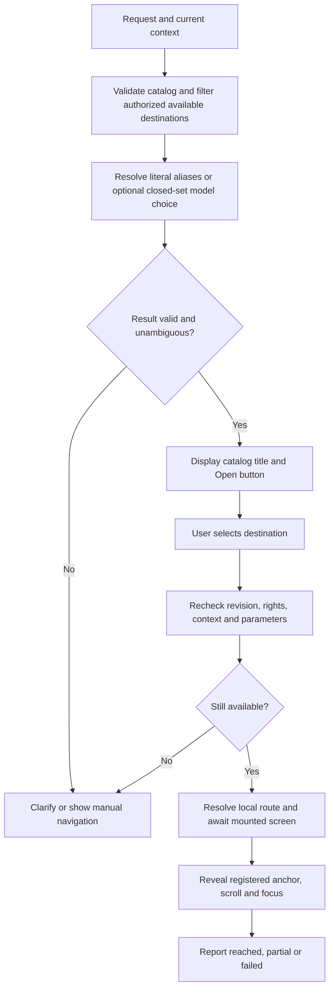

# Guided navigation contract

Help users reach a screen, section or control by expressing their goal in natural language. Each application supplies a destination catalog; a resolver selects catalog identifiers; the application's navigation adapter opens the destination and optionally reveals its anchor.

**Contract version:** `1.0`. **Reviewed:** 2026-10-18. **Status:** internal reference standard for adoption, not a published industry standard or an implemented library. Examples are illustrative contracts, not verified application routes. Runtime integration and provider benchmarking remain application work.

Read [the navigation component guidance](../design/components/navigation.md) and [accessibility requirements](../design/quality/accessibility.md) before implementing the UI. Read [multi-tenant isolation](multi-tenant.md) for server authorization boundaries.

## 1. Scope and reuse

Use this contract for in-app help, an intent search box, command palettes, onboarding assistance and navigation to sections of ordinary websites. It supports an anchor on the current page, a different screen followed by an anchor, and native screens through platform adapters.

The contract guides the user. It does not save a form, create a quote, record working hours, send a document, accept a payment or grant access. Opening an editor must not create a persisted draft or consume a quota. Where the current application creates on opening, navigate to its existing entry screen and highlight the explicit creation button instead.

| Approach | Use when | Trade-off |
|---|---|---|
| Common contract, local catalogs and adapters — recommended | Products share the navigation problem but have different routers, permissions and UI stacks | Stable vocabulary without a shared runtime dependency |
| Local implementations first, no common contract | One bounded experiment with no second consumer | Fast exploration; later reconciliation of IDs, states and safety behavior |
| Shared runtime package | Two measured implementations repeat the same resolver or adapter-neutral validation | Requires versioning, ownership and compatibility tests; do not extract a router/UI framework prematurely |

ai-ressources owns this provider-neutral document. Applications own destination truth, translated copy, permissions, routes, anchor registration and integration tests. Updating this reference does not automatically activate a feature in a consuming application. Consumers pin the supported contract version and the reviewed reference Git revision.

## 2. Portable catalog format

Use a serializable JSON manifest or a typed source file producing the same data. The field definitions below are normative for version `1.0`; no standalone JSON Schema or runtime validator is shipped with this document. Consumers implement schema validation from these definitions. Unknown versions and unknown fields fail validation; extensions require a future contract version. Omit optional fields rather than serializing `null`.

| Field | Required | Meaning |
|---|---|---|
| `contractVersion` | yes | Exact string `1.0` |
| `catalogRevision` | yes | Nonempty revision changed whenever destinations, bindings, copy or policy references change |
| `applicationId` | yes | Stable application namespace |
| `defaultLocale` | yes | Supported BCP 47 language tag present in every destination's `copy` |
| `destinations` | yes | Array of destination records, possibly empty |

Destination records:

| Field | Required | Meaning |
|---|---|---|
| `id` | yes | Stable, unique, namespaced identifier; never reused for another intent |
| `kind` | yes | Exact string `navigate`; business effects require a separate future contract |
| `copy` | yes | Locale map; each value contains nonempty `title`, `description`, and `aliases` array of nonempty strings (array may be empty) |
| `requiredCapabilities` | yes | Array of application-defined capability keys; empty means no capability beyond declared preconditions |
| `preconditionKeys` | yes | Array of named application checks, such as authentication and setup completeness; no executable expressions |
| `availabilityKey` | yes | Named application check for feature flags, plan, state and readiness |
| `scope` | yes | `public` or `current-tenant`; the latter requires a verified current tenant |
| `parameters` | yes | Map of declared parameters; `{}` for a destination without parameters |
| `bindings` | yes | Nonempty map keyed by `web`, `ios`, `android`, `desktop`; each value contains `routeKey` and optional `anchorKey` |
| `fallbackDestinationId` | no | Another same-catalog ID, authorized independently; cycles and self-references are invalid |

Identifiers and keys use ASCII lowercase letters, digits, dots and hyphens, start with a letter and have at most 128 characters. Locales use BCP 47 tags, independently of that key rule. Copy is UTF-8. Array entries are unique. Duplicate destination IDs, missing default translations, unresolved policy/route/anchor keys and invalid fallbacks fail catalog validation. Each binding's anchor is scoped to its route and platform. Locale fallback uses the catalog's default locale and reports that language; never invent a missing translation.

Each parameter declaration has `type` (`string`, `integer`, `boolean`), `required` (boolean) and `source` (`context`, `user-selection`). Optional `enum` is a nonempty array of unique values of the declared type. `integer` means a safe integer. Strings are nonempty, bounded to 256 characters by default, and further constrained by application validators. Extra parameters fail validation. A selected entity is revalidated for existence, ownership and capability on the server. A model never supplies parameter values or tenant IDs. Missing parameters require a local picker or clarification before resolving a route; optional absent values are omitted.

`routeKey` identifies an application-owned router binding, not a URL template for the model. The binding constructs and encodes a typed route from validated parameters. `anchorKey` identifies an application-registered target, not an arbitrary CSS selector, script, label guessed from the DOM or pixel coordinate. Business names and URLs may change without changing a destination ID.

Illustrative catalog, not live Ylune configuration:

```json
{
  "contractVersion": "1.0",
  "catalogRevision": "example-2026-10-18",
  "applicationId": "ylune",
  "defaultLocale": "fr",
  "destinations": [{
    "id": "ylune.availability.weekly",
    "kind": "navigate",
    "copy": {
      "fr": {
        "title": "Mes disponibilités",
        "description": "Choisir les jours et horaires où accepter des rendez-vous.",
        "aliases": ["mes horaires", "créneaux de consultation"]
      }
    },
    "requiredCapabilities": ["availability.edit"],
    "preconditionKeys": ["session.authenticated"],
    "availabilityKey": "availability.weekly.enabled",
    "scope": "current-tenant",
    "parameters": {},
    "bindings": {
      "web": {"routeKey": "availability.settings", "anchorKey": "weekly-hours"}
    }
  }]
}
```

The example's keys must be implemented before activation. It does not add attendance tracking. Livia can use the same format with `livia.quote.start`, its own capabilities, translated copy and a `quotes.entry` binding with a `new-quote` anchor.

## 3. Resolution and execution boundaries



The resolver receives only eligible destination IDs, descriptions and aliases for the supported locale, plus a minimal request context. Capability checks run in trusted application code. Authorization remains enforced at each protected data/API boundary; client-side filtering is a usability measure, not a security boundary.

Use this provider-neutral result union. Each record contains a `status` field equal to the variant name; only the fields listed for that variant are accepted:

- `matched`: `destinationId`, `catalogRevision`.
- `clarify`: `candidateIds` (two or three eligible IDs), `catalogRevision`.
- `no-match`: `catalogRevision`.
- `unavailable`: `catalogRevision`, `reasonCode` (`feature-disabled`, `unsupported-platform`, `missing-context`, `access-unavailable`, `resolver-failed`). Only trusted application code constructs this variant after its own checks; the model cannot choose or invent the reason. Do not include private destination details.

Reject unknown IDs, extra fields, stale revisions and any candidate outside the eligible set. Construct UI titles, explanation templates and links from the local catalog. Model output is untrusted even when it is typed. Instructions in the user's message cannot add destinations, change permissions, produce external links or execute scripts. A request containing several distinct goals is clarified rather than triggering a sequence of operations.

Show at most three suggestions and require an explicit selection before leaving the current screen or scrolling. Confirming navigation is not permission to save or submit the destination's form. Preserve unsaved work using the application's existing leave guard. Carry the selected ID through navigation in ephemeral UI state, not as a public deep link containing a private request.

Execution results are `reached` (screen and requested anchor reached), `partial` (screen reached, anchor absent) or `failed` (destination not reached). Never present `partial` as a successful highlight. No provider is allowed to supply a result claiming navigation succeeded.

A `fallbackDestinationId` is a candidate suggestion only when the selected destination becomes unavailable at execution time or has no binding for the current platform. It never causes automatic navigation. Resolve the fallback independently against the current session, tenant, capabilities, preconditions, availability, catalog revision and platform. Do not disclose an inaccessible destination. Present an eligible fallback using its own catalog title and require a new explicit selection; without one, return `unavailable` and keep manual navigation. Resolve the fallback's declared parameters from its own authorized context or a new local picker: never copy primary parameters implicitly. A missing anchor after reaching the primary screen remains `partial` and does not trigger fallback navigation. An ineligible fallback ends this attempt; do not recursively traverse the fallback graph at runtime.

## 4. Anchors across website and application surfaces

| Situation | Adapter responsibility |
|---|---|
| Target already on current page | Reveal collapsed section, scroll within the correct container, then focus target |
| Target on another route | Use local router, await data/render readiness, then resolve the anchor |
| Website section | Map `anchorKey` to a stable HTML `id`; router owns any fragment URL |
| Web application control | Map `anchorKey` to a registered element reference or stable `data-help-id` |
| Native application | Map `routeKey` to native navigation and `anchorKey` to a registered view/accessibility target |
| Target not mounted yet | Wait for a mount signal with a bounded application timeout; never poll forever |
| Missing anchor after navigation | Keep the valid screen, report partial guidance and show the normal section instructions |
| Hidden, disabled or virtualized control | Reveal only authorized content; adapter handles virtualization; do not focus a disabled control |

Anchor registration must be unique per mounted screen and removed on unmount. Cancel stale requests when the user navigates, changes tenant, changes query or dismisses help. Recheck authorization after asynchronous resolution. An anchor must not open a destructive modal, trigger payment, submit a form or persist data merely to become visible.

Use non-flashing visual emphasis plus text, focus without activation, a dismissible explanation, keyboard access and screen-reader announcement. Respect reduced motion; account for sticky headers and nested scroll containers. Restore focus on help dismissal where appropriate. In a partially reached state, focus a safe page heading. A native implementation may omit animation while preserving the same semantic contract.

## 5. Intent approach and optional Jev adapter

Start with a small explicit catalog and deterministic normalized alias matching. Exact matching is appropriate for curated phrases, not a promise to understand every sentence. Handle negation and multiple goals conservatively. For this small MVP, let an optional classifier see the complete eligible catalog plus an explicit no-match option; do not require semantic-search infrastructure. If catalogs grow, measure retrieval recall before introducing a shortlist.

Compare deterministic resolution alone, resolution plus the application's existing small model, and Jev on the same labeled requests. Evaluate French business language, paraphrases, negations, typos, out-of-scope queries and prompt injection. A model is useful only if it improves successful guidance at acceptable false-match, latency and cost levels.

Jev is a plausible closed-set adapter: TypeSafe documents `Choice` with predefined options, returned probabilities and confidence. This is a documented capability, not independent proof of application quality. Read [the official Choice contract](https://docs.typesafe.ai/primitives/choice) and [TypeSafe's introduction](https://docs.typesafe.ai/introduction), checked on 2026-10-18. This reference does not choose a provider, deployment region, endpoint integration or pricing plan. Livia's existing post-V1 Jev decision remains separate from navigation adoption.

Choose acceptance and ambiguity thresholds using held-out labeled examples. A high score is not a permission check or proof of correctness. Use no-match and clarification when uncertain. Pin provider/model configuration, record catalog/model revisions, and disable the model independently from manual navigation. Keep SDK clients local until two actual consumers justify a shared adapter package.

## 6. Privacy, latency, cost and failure

- Prefer local matching. For external inference, send only a minimized request, public destination descriptions and coarse context. Do not send questionnaires, client records, quote contents, medical information, names, full URLs or tenant identifiers. If personal content cannot be safely minimized, stay local and offer manual navigation. Do not promise automatic redaction catches everything.
- Keep credentials server-side. Before external inference, verify the chosen provider's retention, training use, processing region, contractual terms and security controls against the application's approved requirements. These are unverified integration prerequisites here, not provider assurances.
- Log destination ID, outcome, revision, resolver kind, latency and anonymous aggregate counters. Raw requests are off by default. Privileged debug collection requires an explicit retention and deletion policy; caches must be tenant/session isolated and invalidated on catalog/context changes.
- Proposed budgets for measurement: local suggestions p95 below 100 ms; model resolution deadline 2 seconds, at most one call, no automatic retry for interactive guidance. These are product targets, not observed performance or vendor guarantees. On timeout, invalid output, rate limit, offline state or provider failure, retain manual navigation and never select a default action silently.
- Track model calls, input/output tokens where reported, measured price per resolution, p50/p95 latency, no-match, clarification, accepted suggestions and actual reached outcomes. Estimate monthly inference cost as calls multiplied by measured mean request cost. No current price or savings claim is established here.

## 7. Adoption and acceptance

MVP: five frequent destinations per product, text entry, catalog-derived suggestions, one platform adapter per initially shipped surface, same-page/cross-page anchors, clarification, fallback and accessibility. Ylune should cover FR/EN/IT consistently before enabling this help in those locales. Livia starts in French. A microphone, generative FAQ, RAG, autonomous agent, business executor and shared component package are separate decisions.

Build-time checks validate field types, version, unique IDs, locales, parameter declarations, route/policy bindings, anchor registration and fallback graph. Unit tests cover eligible sets, revision checks, invalid model outputs and unavailable destinations. E2E tests verify the real router, focus/scroll, platform behavior and absence of business mutations. Retired IDs must not be reused; preserve a compatibility alias only if explicitly mapped and tested. Changing semantics requires a new destination ID. Breaking format changes increment the major version; any catalog change increments `catalogRevision`.

```gherkin
Feature: Guidance by catalog destinations
  Scenario: Reach an anchor on the current page
    Given an available authorized destination has a registered anchor
    When the user selects its help suggestion
    Then the application reveals, scrolls to and focuses that target
    And no business record is created or saved

  Scenario: Navigate before reaching the target
    Given a destination belongs to another screen
    When the user selects it and the screen mounts
    Then the adapter reaches the registered anchor without activating the control

  Scenario: Ambiguous or unsupported request
    Given a request has several plausible meanings or no catalog destination
    When intent resolution completes
    Then the UI offers clarification or manual navigation without inventing a link

  Scenario: Rights change while inference is running
    Given an initially eligible destination becomes unauthorized
    When the user selects the stale suggestion
    Then navigation is refused without disclosing protected content

  Scenario: Broken anchor
    Given the authorized screen opens but its anchor is absent
    When the bounded mount wait expires
    Then the UI reports partial guidance and keeps a usable screen
```

Before activation, run a proposed held-out corpus of at least 100 labeled requests per product, with at least 20 negative/ambiguous cases. Record match precision, destination coverage, clarification accuracy and reached outcomes separately; abstention must not inflate success. Suggested release gate: at least 95% correct among offered single-match suggestions, at least 80% correct destination inclusion for supported single-intent requests, and zero unauthorized navigation or business mutations in boundary/E2E tests. These are acceptance targets requiring product calibration, not measured results.

Roll out behind a local feature flag, retain ordinary navigation, and roll back by disabling help/model resolution without changing business data. Assign an owner for each destination; route or UI changes update bindings, anchors and tests in the same change. Retire unavailable destinations before suggesting them. Review usage data before expanding the catalog or extracting shared code.

## 8. Evidence and implementation boundary

The normative format and examples are authored for this reference. Source verification supports Jev's typed-choice capability only. No API benchmark, live application navigation, UI proof or provider privacy guarantee is claimed. Consumers must create their own feature/spec/plan through the repository's normal workflow before coding; documentation adoption alone does not mark the runtime feature implemented.
