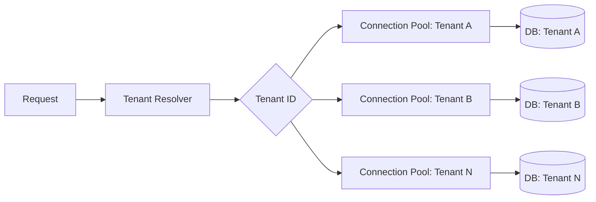
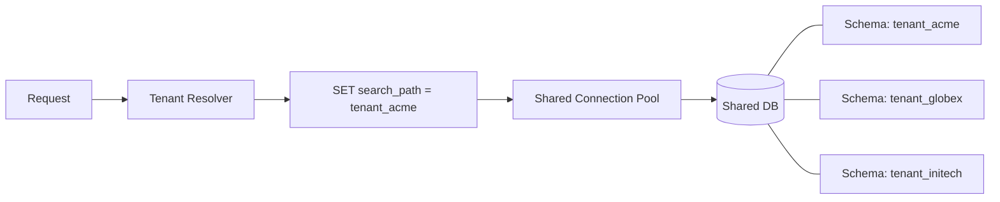
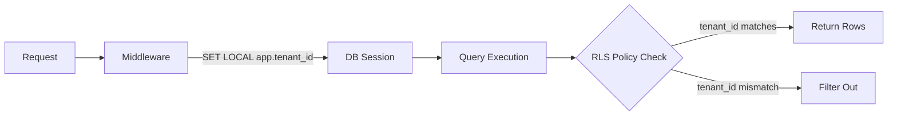
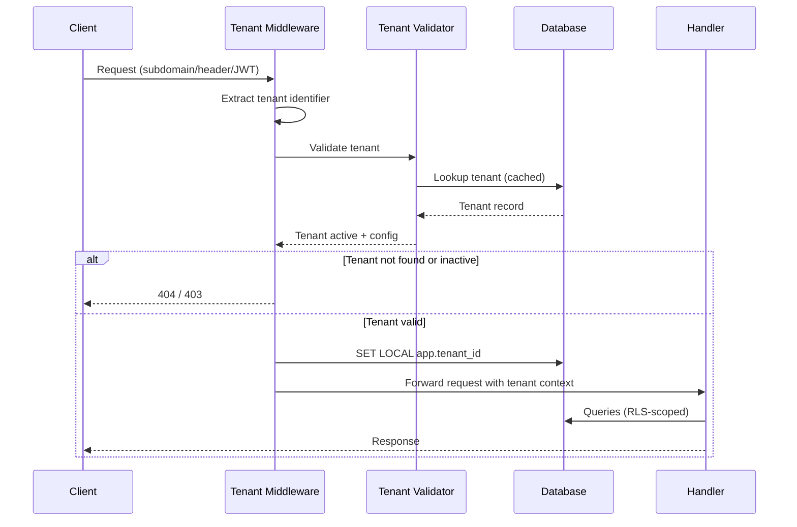
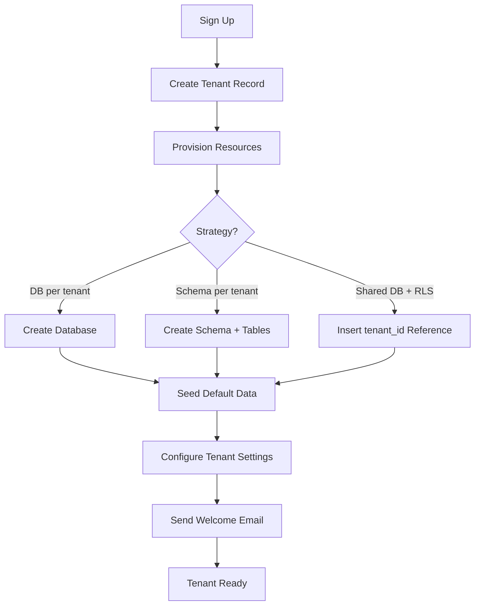
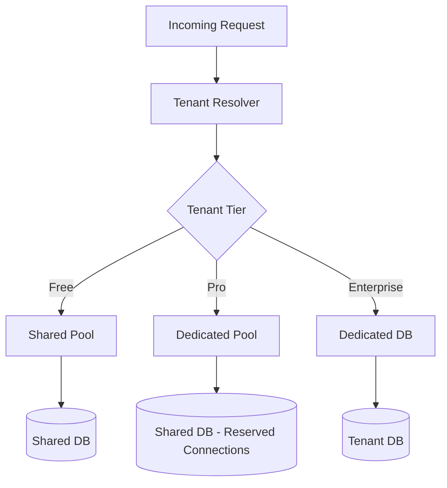
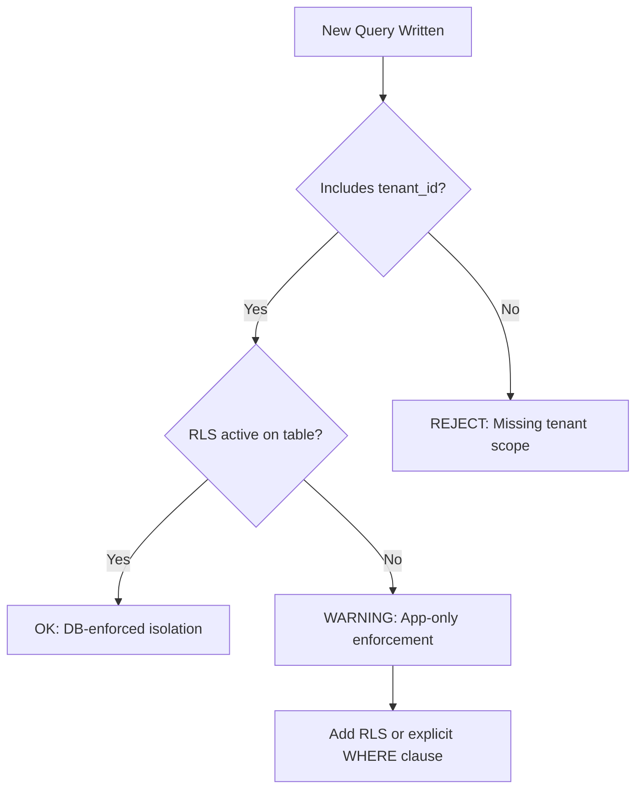

# Multi-Tenant Architecture

Patterns for safe, isolated data access across multiple customers in SaaS applications.

Complements **Read** [`code-conventions/architecture.md`](../code-conventions/architecture.md) §18 (Multi-Tenant Isolation).

---

## Isolation Strategies

### Decision Matrix

| Strategy | Data Isolation | Cost per Tenant | Complexity | Compliance | Best For |
|----------|---------------|----------------|------------|------------|----------|
| Database per tenant | Highest | Highest | High (migrations x N) | Easiest (full isolation) | Enterprise, regulated industries |
| Schema per tenant | High | Medium | Medium (schema migrations x N) | Good | Mid-market SaaS, moderate scale |
| Shared DB + RLS | Medium | Lowest | Low (single migration) | Requires careful enforcement | Startups, high tenant count, cost-sensitive |
| Shared DB + tenant_id column | Low (app-enforced) | Lowest | Lowest | Riskiest (no DB enforcement) | MVPs only, migrate away ASAP |

**Recommendation:** Start with shared DB + RLS. Upgrade to schema-per-tenant or DB-per-tenant only when compliance or performance demands it.

### Database per Tenant

Architecture: one DB instance (or cluster) per tenant. Each tenant's data lives in a completely separate database with its own credentials and connection parameters.



**Connection management:**
- One connection pool per tenant, lazily initialized on first request
- Pool eviction for inactive tenants (LRU with configurable TTL)
- Max total connections across all pools to prevent resource exhaustion

**When to use:** Healthcare (HIPAA), finance (SOC 2 with physical isolation), enterprise contracts requiring dedicated infrastructure.

### Schema per Tenant

Architecture: one schema per tenant within a shared database instance. All tenants share the same DB engine but operate in isolated namespaces.

**Naming convention:** `tenant_{uuid_short}` or `tenant_{slug}` (lowercase, no special characters).



**Migration strategy:**
1. List all tenant schemas
2. Iterate over each schema, apply migration within a transaction
3. Record success/failure per schema
4. On failure: halt or continue (configurable), log affected tenants
5. Provide a retry mechanism for failed schemas

**When to use:** Mid-market SaaS, moderate tenant count (<1000), need for some isolation without the cost of separate databases.

### Shared DB + Row-Level Security (RLS)

Architecture: single database, all tenants in the same tables. Every table includes a `tenant_id` column. The database enforces isolation via RLS policies.

```sql
-- Enable RLS on the table
ALTER TABLE orders ENABLE ROW LEVEL SECURITY;

-- Create isolation policy
CREATE POLICY tenant_isolation ON orders
    USING (tenant_id = current_setting('app.tenant_id')::uuid);

-- Force RLS even for table owners
ALTER TABLE orders FORCE ROW LEVEL SECURITY;
```

**Setting tenant context per request:**

```sql
-- At the beginning of each request/transaction
SET LOCAL app.tenant_id = 'a1b2c3d4-...';

-- All subsequent queries automatically filtered
SELECT * FROM orders; -- only returns current tenant's orders
```



**When to use:** Startups, SaaS with many small tenants, cost-sensitive environments, products where tenant count will grow rapidly.

---

## Tenant Resolution

### Strategies

| Method | Example | Pros | Cons |
|--------|---------|------|------|
| Subdomain | `acme.app.com` | Clear isolation, easy routing | DNS/TLS complexity, wildcard cert needed |
| Path prefix | `app.com/acme/...` | Simple, no DNS config | Routing complexity, less clean URLs |
| Header | `X-Tenant-Id: acme` | API-friendly, flexible | Not user-facing, requires client support |
| JWT claim | `{ "tenant_id": "..." }` | Stateless, no lookup needed | Token size, claim management |
| Query parameter | `?tenant=acme` | Simplest to implement | Leaks in logs/referers, not recommended |

**Recommendation:** Subdomain for user-facing apps, JWT claim for APIs, header for service-to-service.

### Middleware Pattern



**Implementation rules:**
- Tenant resolution runs before authentication — tenant context determines which user pool to check
- Cache tenant lookups (TTL 5-60 seconds) to avoid per-request DB hits
- Fail closed: if tenant cannot be resolved, reject the request
- Never fall back to a "default" tenant

---

## Cross-Tenant Operations

### Admin / Platform Operations

- **Superadmin access:** Use a separate connection or role that bypasses RLS. Never grant RLS bypass to application service accounts
- **Aggregation queries:** Use materialized views refreshed on schedule, or a dedicated analytics database (replicated asynchronously)
- **Platform-level queries:** Tenant listing, usage metrics, billing summaries run against platform tables outside RLS scope
- **Audit:** Every cross-tenant operation must be logged with operator identity, reason, and timestamp

### Data Migration Between Tenants

Never implicit — always an explicit admin action with audit trail. Follow Export → Transform (remap IDs, strip source references, validate integrity) → Import into target with new IDs. Validate no data leakage after migration. Provide rollback capability for a defined window.

---

## Tenant Lifecycle

### Onboarding



**Provisioning rules:**
- Onboarding must be idempotent — retries should not create duplicates
- Use a status field: `provisioning` -> `active` -> `suspended` -> `deleted`
- Timeout and alert if provisioning exceeds expected duration
- Seed data includes: default roles, initial admin user, default configuration

### Offboarding

States: `Active → Suspended → PendingDeletion → Deleted` (grace period 30 days). `Suspended → Active` (reactivation). `PendingDeletion → Active` (cancellation during grace period).

**Offboarding steps:**
1. **Soft delete:** Mark tenant as `suspended`, disable login, stop processing
2. **Data export:** Provide tenant data export before deletion (GDPR right to portability)
3. **Grace period:** 30 days before permanent deletion — allow reactivation
4. **Hard delete:** Purge all tenant data with cascading delete, verify completeness
5. **Resource cleanup:** Drop DB/schema (if applicable), remove cached entries, revoke credentials

---

## Performance

### Noisy Neighbor Mitigation

- **Rate limiting per tenant** — enforce request quotas at the API gateway (cross-ref **Read** [`rate-limiting.md`](rate-limiting.md))
- **Connection pool limits per tenant** — cap max connections to prevent one tenant from exhausting the pool
- **Query timeout per tenant** — set statement timeout in tenant middleware
- **Resource quotas** — storage caps, compute limits, API call budgets per billing tier
- **Queue priority** — separate queues or priority lanes for different tenant tiers

### Scaling Patterns

- **Shard by tenant_id** — consistent hashing or range-based partitioning
- **Hot tenant detection:** monitor per-tenant query volume; migrate hot tenants to dedicated infrastructure
- **Read replicas:** route heavy-read tenants to dedicated replicas
- **Tiered infrastructure:** free tier on shared, paid on isolated, enterprise on dedicated



---

## Security

### Data Leakage Prevention

- Every query MUST include tenant context — no exceptions
- Default-deny: queries without tenant scope must fail, not return all data
- **Integration test pattern:** Create 2 tenants, insert data for each, verify Tenant A cannot access Tenant B's data
- Audit logging: log `tenant_id` on every data access for forensic analysis
- Code review checklist: "Does this query respect tenant isolation?"
- Static analysis: lint for raw queries missing `tenant_id` (custom rule)



### Backup and Restore

- **Per-tenant restore:** Even with shared DB, provide the ability to restore a single tenant's data
- **DB-per-tenant / Schema-per-tenant:** Standard point-in-time recovery per database/schema
- **Shared DB + RLS:** Application-level export/import with tenant_id filtering
- **Test restore procedures** regularly — untested backups are not backups
- **Retention policy:** Define per compliance requirements (30 days, 1 year, 7 years)

---

## Anti-Patterns

| Anti-Pattern | Risk | Correct Approach |
|-------------|------|------------------|
| Trusting client-supplied `tenant_id` without server-side verification | Tenant impersonation | Derive tenant from authenticated session/JWT, never from request body |
| Global queries without explicit tenant filter | Full data leakage | RLS or mandatory `WHERE tenant_id = ?` on every query |
| Sharing cache keys across tenants | Cross-tenant data exposure | Prefix all cache keys: `tenant:{id}:{key}` |
| Single admin account for all tenants | Privilege escalation | Per-tenant admin roles with scoped permissions |
| Hardcoding tenant count assumptions | Scaling failures | Design for N tenants from day one |
| Skipping tenant context in background jobs | Jobs process wrong tenant's data | Pass `tenant_id` explicitly in job payload, set context before execution |
| Using tenant slug as primary identifier | Slug changes break references | Use UUID as `tenant_id`, slug as display/routing only |
| Logging tenant data without scrubbing | PII exposure in logs | Log `tenant_id` only, never tenant data content |
