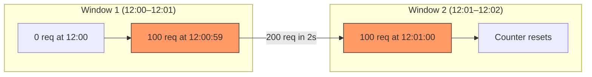
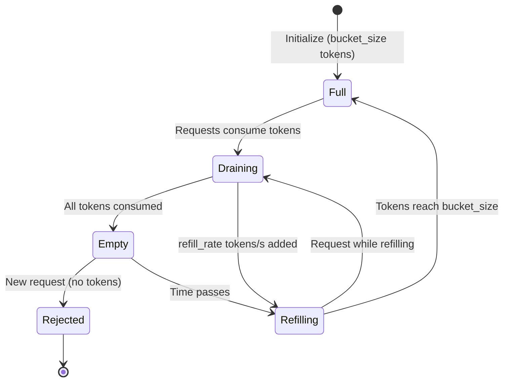
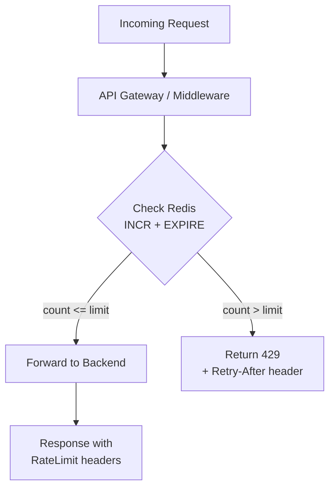
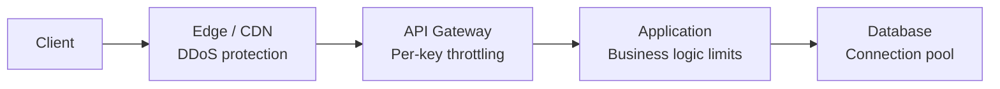
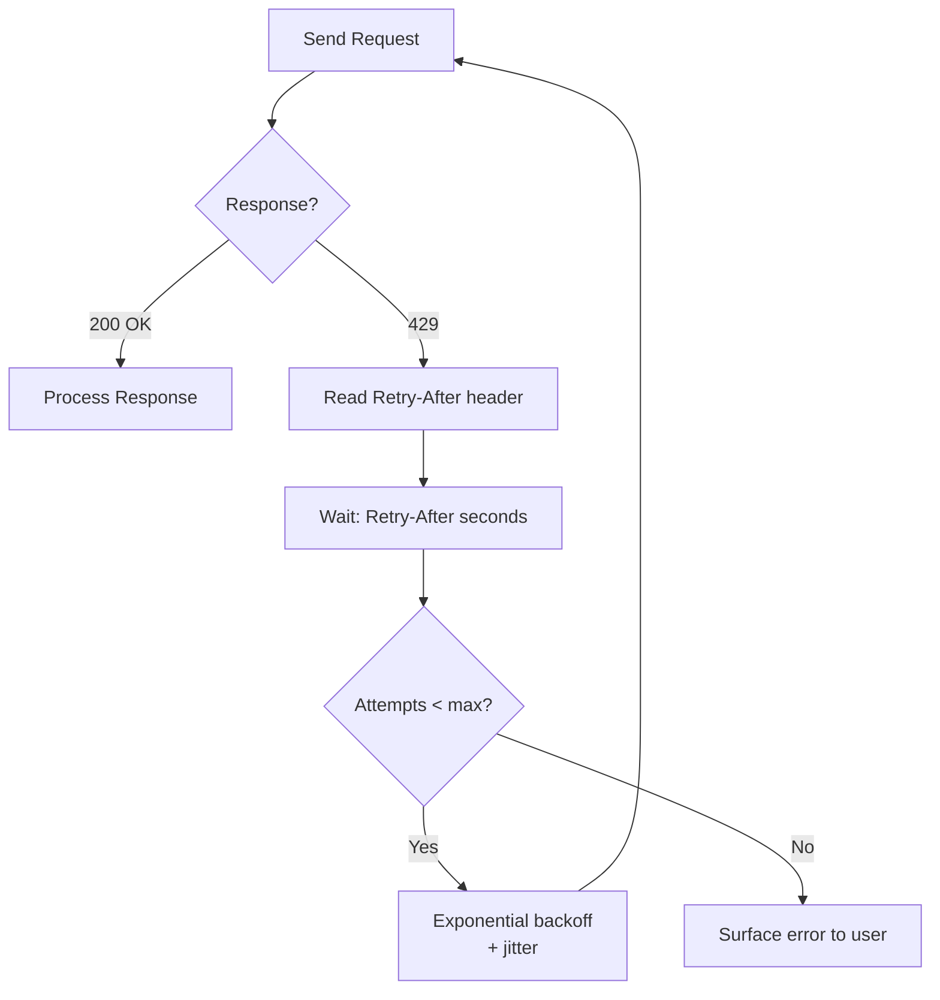

# Rate Limiting

Rate limiting strategies for SaaS APIs: algorithms, headers, distributed enforcement, tiered limits.

---

## Why Rate Limit

- **Protect backend resources** from overload — prevent cascading failures under traffic spikes
- **Ensure fair usage** across tenants and users — no single consumer starves others
- **Prevent abuse** — scraping, brute force attacks, credential stuffing, DDoS amplification
- **Meet SLA commitments** — guaranteed availability and response times for all customers

## Algorithms

### Decision Matrix

| Algorithm | Accuracy | Memory | Burst Handling | Complexity | Best For |
|-----------|----------|--------|---------------|------------|----------|
| Fixed Window | Low (boundary spike) | Lowest | Poor (2x burst at boundary) | Simplest | Internal APIs, low stakes |
| Sliding Window Log | Highest | Highest | Best | Medium | Payment APIs, audit-critical |
| Sliding Window Counter | High | Low | Good | Medium | **Recommended default** |
| Token Bucket | High | Low | Configurable burst | Medium | APIs with burst allowance |
| Leaky Bucket | High | Low | None (smoothing) | Medium | Downstream protection, queue-based |

### Fixed Window

Divide time into fixed intervals (e.g., 100 requests per minute starting at :00). Maintain a single counter per window. Reset at the boundary.

**Problem — boundary spike:** a client can send 100 requests at :59 and 100 requests at :00, producing 200 requests in 2 seconds while technically respecting the 100/min limit in each window.



Use only when precision does not matter and simplicity is paramount.

### Sliding Window Counter

Combines current and previous window counts with a weighted average to eliminate boundary spikes.

**Formula:** `count = current_window_count + previous_window_count * overlap_ratio`

**Example:** at 12:00:30 (halfway through the current window), with 60 requests in the current window and 80 in the previous: `count = 60 + 80 * 0.5 = 100`. If the limit is 100, the next request would be rejected.

This is the **recommended default** — best balance of accuracy, memory efficiency, and implementation simplicity. Two counters and one timestamp per key.

### Token Bucket

A bucket holds tokens up to a maximum capacity. Tokens are added at a constant refill rate. Each request consumes one token. If the bucket is empty, the request is rejected.

- `bucket_size` — maximum burst capacity
- `refill_rate` — tokens added per second
- Example: `bucket_size=10`, `refill_rate=5/s` allows a burst of 10 requests, then a sustained 5 requests/second



Token bucket is ideal when you want to allow short bursts while enforcing a sustained rate.

### Leaky Bucket

Requests enter a queue (the bucket). The queue is drained at a constant rate. If the queue is full, new requests are rejected immediately. Smooths bursty traffic into a constant output rate — no bursts reach the backend.

**Use case:** protecting downstream services that cannot handle bursts (legacy databases, third-party APIs with strict rate limits, payment processors).

## HTTP Response Headers

```http
RateLimit-Limit: 100
RateLimit-Remaining: 42
RateLimit-Reset: 1679875200
```

Legacy headers (still widely used): `X-RateLimit-Limit`, `X-RateLimit-Remaining`, `X-RateLimit-Reset`, `Retry-After`.

**Rules:**
- Include rate limit headers on **every** response, not just 429s — clients need visibility into their remaining quota proactively
- Use **Unix timestamp** for `Reset` (not relative seconds) — avoids clock synchronization ambiguity between client and server
- Always include `Retry-After` on 429 responses — tells the client exactly when to retry
- Prefer the IETF standard headers, but support legacy `X-RateLimit-*` headers during transition

## HTTP 429 Response

```json
{
  "error": {
    "type": "rate_limit_exceeded",
    "message": "Rate limit exceeded. Try again in 30 seconds.",
    "retry_after": 30,
    "limit": 100,
    "window": "1m"
  }
}
```

- Status code: **429 Too Many Requests**
- Include `Retry-After` header in the HTTP response
- Provide an actionable message with the wait time and the limit that was exceeded
- **Never** return 500 or 503 for rate limiting — 429 is the semantically correct status code and clients depend on it for retry logic

## Identification Keys

| Key | Granularity | Use Case | Pros | Cons |
|-----|-------------|----------|------|------|
| API key | Per application | External API consumers | Clear identification, per-key limits | Key sharing/leakage |
| User ID | Per user | Authenticated endpoints | Fair per-user limits | Auth required |
| IP address | Per client | Public endpoints, login | No auth needed | Shared IPs (NAT, corporate proxies), VPN evasion |
| Tenant ID | Per organization | Multi-tenant SaaS | Fair per-tenant limits | Requires tenant resolution middleware |
| Endpoint + Key | Per route per client | Sensitive endpoints | Granular control | Complex configuration matrix |

**Recommendation:** use API key or User ID as the primary identification key. Add IP address as a secondary defense layer for unauthenticated endpoints (login, signup, password reset).

## Tiered Limits

| Tier | Limit | Burst | Use Case |
|------|-------|-------|----------|
| Free | 60 req/min | 10 | Trial users, low-volume integrations |
| Pro | 600 req/min | 100 | Production applications |
| Enterprise | 6000 req/min | 1000 | High-volume, SLA-backed deployments |
| Internal | Unlimited (with circuit breaker) | N/A | Service-to-service communication |

**Guidelines:**
- Apply **different limits per endpoint** — search and write endpoints should have lower limits than read endpoints
- Communicate limits clearly in API documentation and the pricing page
- Provide a **usage dashboard** for customers to monitor their consumption and headroom
- Send **approaching-limit notifications** at 80% utilization (email or webhook)
- Allow temporary limit increases via support request or self-service for anticipated spikes

## Distributed Rate Limiting

### Redis-Based (Recommended)

Sliding window counter implemented with Redis atomic operations.

**Key format:** `ratelimit:{identifier}:{window_start_epoch}`

**Lua script for atomic check-and-increment:**

```lua
local key = KEYS[1]
local limit = tonumber(ARGV[1])
local window = tonumber(ARGV[2])

local current = redis.call("INCR", key)
if current == 1 then
    redis.call("EXPIRE", key, window)
end

if current > limit then
    return 0  -- rejected
end
return 1      -- allowed
```

**TTL:** set to window size + buffer (e.g., 120s for a 60s window) to ensure keys are cleaned up even if EXPIRE is missed.

### Architecture



**Considerations:**
- **Redis latency:** adds 1-2ms per request — acceptable for most APIs, negligible vs business logic
- **Redis failure mode:** prefer **fail open** (allow requests) over fail closed (reject all) — a momentary loss of rate limiting is better than a full outage
- **Multi-region:** deploy local Redis per region with eventual synchronization, or use a global Redis cluster with higher latency. Local Redis is preferred for latency-sensitive APIs

## Rate Limiting Layers

| Layer | Tool | Purpose |
|-------|------|---------|
| CDN / Edge | Cloudflare, AWS WAF, Fastly | DDoS protection, IP-based volumetric limits |
| API Gateway | Kong, AWS API Gateway, Traefik | Per-key limits, throttling, quota enforcement |
| Application | Custom middleware | Business logic limits (per-user, per-tenant, per-endpoint) |
| Database | Connection pooling, query timeouts | Resource protection, last line of defense |



**Recommendation:** enforce at **API Gateway + Application** layers as the primary defense. Use the Edge layer for volumetric DDoS protection only — do not duplicate business rate limiting at the edge.

## Client-Side Handling



- On 429: read the `Retry-After` header, wait the indicated duration, then retry
- **Exponential backoff with jitter:** `delay = min(base * 2^attempt + random_jitter, max_delay)`
- **Max retries:** 3-5 attempts before surfacing the error to the user
- **Never retry immediately** — always respect `Retry-After`

**SDK Design:**
- Expose rate limit info to callers: `remaining`, `reset` timestamp, `limit`
- Build **auto-retry** into the SDK with configurable behavior (on/off, max retries, backoff strategy)
- Implement **proactive throttling** — queue requests when approaching the limit rather than waiting for 429s
- Provide a `rate_limit` event or callback so consumers can react (log, alert, degrade gracefully)

## Anti-Patterns

| Anti-Pattern | Problem | Fix |
|-------------|---------|-----|
| Rate limiting only at application level | No edge protection against DDoS | Add CDN/WAF layer |
| Using 503 instead of 429 | Clients cannot distinguish rate limiting from server errors | Return 429 with Retry-After |
| No Retry-After header | Clients guess retry timing, causing thundering herd | Always include Retry-After |
| Rate limiting by IP only | Punishes users behind NAT/corporate proxy | Use API key or User ID as primary key |
| Unlimited internal APIs | Cascading failures between services | Add circuit breakers and internal rate limits |
| Silent rate limiting (dropping requests) | Clients see timeouts, cannot diagnose the issue | Return explicit 429 with error body |
| Hardcoded limits | Changing limits requires redeploy | Use configuration store or feature flags |
| Same limits for all endpoints | Write-heavy endpoints get same quota as reads | Per-endpoint or per-category limits |

## Monitoring

| Metric | Alert Threshold |
|--------|----------------|
| 429 rate > 5% of total traffic | Warning — limits may be too restrictive |
| 429 rate > 20% of total traffic | Critical — investigate misconfiguration or attack |
| Single key > 50% of capacity | Warning — potential abuse or poorly designed integration |
| Redis latency > 10ms (p99) | Warning — Redis may need scaling |

**Dashboard:**
- Per-tenant usage vs allocated limits (bar chart with threshold line)
- 429 rate over time (time series)
- Top 10 consumers by volume
- Limit utilization heatmap by endpoint and tier
