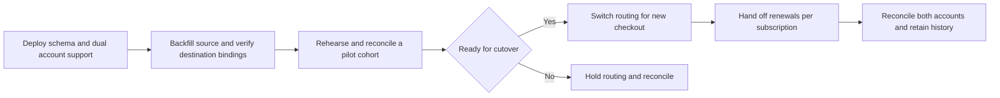

# Stripe account migration

Prepare an application to switch between two Stripe accounts without deploying a database schema change at cutover. Keep business offers, customer accounts and entitlements stable. Add the destination Stripe bindings in advance and retain the source bindings for invoices, refunds, disputes and in-flight work.

This reference covers a direct Stripe Billing integration with a catalog, recurring subscriptions and optional one-time purchases. Confirm the applicable migration process separately for Connect, managed payments or a change of legal entity. Confirm which payment methods and mandates can be copied, whether customers need to take action, and who will issue invoices and handle existing refunds and disputes.

## What Stripe copies

| Object | Preparation |
|---|---|
| Customer | Stripe documents that its account-to-account copy preserves the IDs of customers actually copied. Confirm each destination customer against the copy report or API before using it. Store a binding for each account even if both use the same `cus_…`. Other import or recreation workflows can assign different IDs. |
| Payment method | Verify eligibility, the destination ID and the default method for automatic collection. Stripe assigns new IDs to copied payment methods. The supported types and exceptions depend on the copy workflow. Include a recovery path for missing methods, mandates or required customer authentication. |
| Product and price | Recreate the destination catalog and record the actual identifiers. Compare amount, currency, billing interval and relevant quantity, tax and discount rules. The internal offer code is an application key. Stripe metadata or a lookup key can help correlate objects when explicitly configured. |
| Subscription | Recreate or schedule it on the destination account using the Billing migration toolkit or the API. Record the destination schedule where applicable and the new subscription ID when available. Keep the original subscription binding. |
| Invoice, charge, refund and dispute history | Keep references to the source account and preserve access for reconciliation, customer service and accounting. The copy does not transfer invoices or charges. |

Read [Stripe’s account copy procedure](https://docs.stripe.com/get-started/data-migrations/pan-copy-self-serve), [the list of objects Stripe copies](https://support.stripe.com/questions/data-that-can-be-copied-between-stripe-accounts) and [the Billing migration toolkit guide](https://docs.stripe.com/billing/subscriptions/import-subscriptions-toolkit).

## Reference data model

Use an immutable internal offer code such as `standard_monthly` or `credit_pack`. An offer identifies the business benefits of a purchase. The Stripe Price supplies the provider-side billing terms. Resolve the exact price for a new checkout in the selected account and validate the charge against the expected terms on the internal order. Persist those terms with the order if fulfillment, reconciliation or history requires them. Use integer minor units with explicit currency and avoid recalculating historical totals from the current catalog.

The table names below are illustrative. Reuse existing billing owners, subscriptions, orders and ledgers where their contracts fit. Use the project’s normal key strategy. Store Stripe IDs as opaque strings with size and equality rules verified for the integration.

| Record | Key fields and constraints | Writer and consumer |
|---|---|---|
| `billing_plans` | Internal primary key and immutable, required, unique business `code`. Link a version of the offer where benefits depend on the version bought. | Catalog administration defines the offer. Checkout and fulfillment use the business key. |
| `stripe_contexts` | Internal primary key plus required Stripe account ID and environment identity. Enforce uniqueness of the pair. Use a distinct environment identity for each configured sandbox or live environment. | Billing configuration provisions contexts. The Stripe adapter selects credentials per context from a secret store. |
| `stripe_prices` | Primary key or unique key on `(context_id, stripe_price_id)`, with required FKs to context and plan. Keep existing mappings for historical lookup after sales stop. | Catalog reconciliation registers actual Stripe prices. Checkout selects the configured offer binding and webhook reconciliation resolves existing prices in their own context. |
| `stripe_customers` | Primary key or unique key on `(context_id, stripe_customer_id)`, with required FKs to context and the internal billing owner. Only impose one Stripe customer per owner per context if the product guarantees it. | Customer provisioning or migration binds verified Stripe Customers. Checkout and billing events resolve the same internal owner. |
| `stripe_subscriptions` | Primary key or unique key on `(context_id, stripe_subscription_id)`. Require the customer binding in the same context and the internal subscription reference when the application tracks one. Keep one row per provider subscription. If a replacement relationship is needed for reconciliation, store the source-to-destination pair in the migration record and verify both belong to the same internal subscription or owner. | The subscription adapter and reconciliation worker record verified provider objects and dates when needed. The source and destination records can coexist. Keep migration progress distinct from Stripe subscription status. |
| `stripe_invoices` | Primary key or unique key on `(context_id, stripe_invoice_id)`. Require the customer binding. Reference the original subscription binding when the invoice originates from a subscription. A one-time invoice can link to its internal purchase instead. Keep ownership and context consistent across these references. | Invoice reconciliation stores issuer and provenance. History and customer service resolve against the issuing context. |

Use composite FKs or an equivalent database-enforced relationship to keep Stripe references in their owning context. Derive ownership from authoritative relationships where possible. Preserve financial references according to retention requirements when ending a subscription or deleting a business account. If using a one-price-per-subscription model, state that constraint. For subscriptions with multiple items, resolve each relevant item and retain item-level mappings if the application needs their history or reconciliation.

The checkout selector belongs in application configuration or in a small routing table with one selected binding for each supported offer and checkout scope. Switch the account and price selection together. Historic lookups do not consult this selector. Once a checkout or migration operation starts, persist its selected context and external operation identity so retries use the original destination. For example, `(source, cus_example)` and `(destination, cus_example)` can point to one internal billing owner. An invoice from `(source, sub_legacy)` keeps that link after creating `(destination, sub_replacement)`.

### Worked example with saved fields

The following rows illustrate one recurring offer and one one-time purchase. All IDs are placeholders, and timestamps are UTC. Assume one price per subscription and a single checkout scope. `customer_42` and `membership_42` are existing internal records.

| Table | Fields to save | Example rows |
|---|---|---|
| `billing_plans` | `id`, `code` | `(plan_monthly, standard_monthly)` and `(plan_credits, credit_pack)` |
| `stripe_contexts` | `id`, `stripe_account_id`, `environment_key` | `(source, acct_source, live)` and `(destination, acct_destination, live)` |
| `stripe_prices` | `context_id`, `stripe_price_id`, `plan_id` | `(source, price_old, plan_monthly)`, `(destination, price_new, plan_monthly)` and `(destination, price_pack, plan_credits)` |
| `stripe_customers` | `context_id`, `stripe_customer_id`, `billing_customer_id` | `(source, cus_example, customer_42)` and `(destination, cus_example, customer_42)` |
| `stripe_subscriptions` | `context_id`, `stripe_subscription_id`, `stripe_customer_id`, `internal_subscription_id` | `(source, sub_old, cus_example, membership_42)` and `(destination, sub_new, cus_example, membership_42)` |
| `stripe_invoices` | `context_id`, `stripe_invoice_id`, `stripe_customer_id`, `stripe_subscription_id`, `purchase_id` | Recurring invoice `(source, in_old, cus_example, sub_old, NULL)`. One-time invoice `(destination, in_pack, cus_example, NULL, order_17)` |
| `checkout_routes` or equivalent configuration | `plan_id`, `context_id`, `stripe_price_id` | For `plan_monthly`, change `(source, price_old)` to `(destination, price_new)` as one update. |
| `subscription_migrations` or the existing operation journal | `id`, `source_context_id`, `source_subscription_id`, `destination_context_id`, `destination_subscription_id`, `destination_schedule_id`, `source_period_end_at`, `renewal_at`, `destination_first_invoice_at`, `migration_status` | `migration_42` links `(source, sub_old)` to `(destination, sub_new)`. The observed source period ends at `2027-02-01T00:00:00Z`, which is also the planned `renewal_at`. Record the schedule ID when present. Fill the destination subscription ID and first invoice timestamp once observed. |
| `stripe_mutations` or the existing operation journal | `id`, `migration_id`, `context_id`, `step`, `idempotency_key`, intended request and result reference | `(operation_1, migration_42, destination, create_schedule, key_1)` and `(operation_2, migration_42, source, stop_renewal, key_2)` are distinct mutations. Each retry uses its original context and key. |
| `purchases` | `id`, `billing_customer_id`, `context_id`, `stripe_price_id`, `expected_total_minor`, `currency`, `grant_units`, `stripe_payment_intent_id` once known | `(order_17, customer_42, destination, price_pack, 2500, EUR, 10, pi_example)` |
| `stripe_event_inbox` and `credit_grants` | Inbox key `(context_id, event_id)`, event type and processing state. Grant key `purchase_id` and units granted for the one-grant-per-purchase policy. | `(destination, evt_example)` identifies the Stripe event across delivery attempts. The unique grant `(order_17, 10)` identifies the business effect. |

Enforce the example’s joins in the schema. For instance, a subscription resolves its customer through `(context_id, stripe_customer_id)`. An invoice with a subscription must match both the context and the customer on the subscription row. In a relational schema, this can use a composite FK on `(context_id, stripe_subscription_id, stripe_customer_id)` backed by a corresponding unique key. Apply the equivalent scope and owner check to a one-time invoice’s purchase. Keep connection credentials and signing secrets in runtime secret storage.

For example, compare `price_old` and `price_new` as `unit_amount_minor = 4900`, `currency = EUR`, `recurring_interval = month`, `recurring_interval_count = 1` and subscription item `quantity = 1`. Persist comparison evidence in the migration journal when needed for reconciliation. Cache these terms on `stripe_prices` only if the application has a concrete use for the cache.

Read the billing period from the object shape for the configured API version. From Stripe API version `2025-03-31.basil`, the period bounds are on subscription items. Store the observed bounds per item where periods differ. Keep `destination_first_invoice_at` separate from the actual payment outcome. Read [Stripe’s item-level billing period change](https://docs.stripe.com/changelog/basil/2025-03-31/deprecate-subscription-current-period-start-and-end).

At the renewal boundary, verify that `sub_old` will skip the period starting on February 1 before letting `sub_new` collect for it. Record observed schedule and collection results in the journal. Keep the original row for `in_old` and route its reads through `source`, even after `plan_monthly` starts using the destination price.

## Prepare and cut over

1. **Deploy and backfill ahead of the cutover.** Apply additive migrations, populate source-account bindings and verify them against existing subscriptions, invoices and purchases. Deploy readers and workers that can use both contexts. Enumerate in-flight sessions, payment retries, open invoices, credits, discount rules and any schedules that affect future billing. Read [expand and contract](database-migrations.md#3-zero-downtime-migrations-expandcontract).
2. **Prepare the destination.** Verify account settings, collection methods, invoice and portal configuration, tax configuration, API versions and webhook signing secrets. Copy eligible customer data using Stripe’s procedure. Stage and reconcile the destination catalog, customer mappings and payment methods before routing new purchases. Review provider and customer requirements for payment methods that need remediation.
3. **Rehearse the renewal handoff.** In a sandbox, check the first destination invoice, next billing date, trial, taxes, discounts, credits, proration and collection method. For each live subscription, record its source, destination or schedule, intended handoff timestamp and the account responsible for each renewal. Verify destination readiness and the first possible charge before scheduling the stop of source renewals. Verify that the source will skip the first period assigned to the destination. Leave enough time to hold or cancel the destination schedule before it can charge if the source stop cannot be verified. Account for unpaid or retrying invoices separately from future renewals. Read [Stripe’s subscription migration guide](https://docs.stripe.com/billing/subscriptions/migrate-subscriptions).
4. **Switch new checkout by configuration after the readiness checks pass.** Keep both event endpoints running and resolve existing Stripe objects in their recorded account. Process or expire outstanding source sessions according to the cutover plan. Move renewals in verified batches and reconcile both sides before proceeding to the next batch. Day-of changes are routing, mapping and operation state updates.
5. **Retain and reconcile.** Track unmapped Stripe objects, unprocessed events, duplicate charge attempts, missed renewals and mismatched totals. Keep old-account access and the required event handling for historical refunds, disputes and invoices. Define when the old account can stop accepting new activity separately from how long its history is kept.

If a batch fails, pause it and inspect both accounts before retrying. For new purchases, revert routing only after confirming that the source is ready and accounting for already-created destination sessions. For a particular renewal, verify whether the destination has scheduled, invoiced or collected it and whether the source can still charge. Choose either cancellation before a charge, continuation, or an explicit correction with reconciliation based on observed provider state.

## Events and one-time purchases

- Verify each event with its endpoint-specific signing secret over the raw request body. Bind the verified endpoint or provider context to the configured account and environment. Resolve objects with that context and the supported event API version. Keep a durable inbox deduplicated on `(context_id, event_id)` and acknowledge after durable acceptance. Retain enough information to retry with the correct account and reconcile events delivered out of order. Read [Stripe’s webhook guidance](https://docs.stripe.com/webhooks) and [the webhook pattern](webhook-patterns.md).
- Use a durable operation identity and persist the intended account and request before creating an external object. Retry the same request with its Stripe idempotency key when appropriate. Reconcile uncertain outcomes before retrying after the provider’s idempotency retention window or switching accounts. Read [Stripe’s idempotent requests](https://docs.stripe.com/api/idempotent_requests).
- A paid renewal updates the billing state of an existing subscription. For a one-time credit purchase, resolve the expected quantity from the internal purchase and verify settlement in its bound Stripe context. Deduplicate the business effect independently of webhook delivery. For example, insert a unique grant keyed by the internal purchase or purchase line and increment any materialized balance atomically in the same transaction only when the grant was inserted. Replayed or distinct events for the same purchase therefore produce one grant. Define reversal and reconciliation behavior for refunds and disputes. Read [Stripe Checkout fulfillment guidance](https://docs.stripe.com/checkout/fulfillment).

## Acceptance checks

| Scenario | Expected evidence |
|---|---|
| Same customer ID on both accounts | Two context-scoped bindings resolve to the expected owner. A cross-context reference fails. |
| Replacement subscription | The earliest destination charge and final source charge match the intended billing periods. A source invoice still resolves through its original subscription after cutover. |
| Mapping incomplete or destination API times out | The affected operation stays pending reconciliation. Retries keep the original context and can be reconciled before another creation attempt. |
| Replayed or out-of-order event | The worker resolves the correct account, preserves current billing state and grants a paid one-time purchase only once. |
| Customer cannot be charged automatically | The case appears in the remediation cohort, with the state and next action recorded before switching its renewal. |

Before adopting this reference, decide the exact offer and customer cardinalities, supported account and payment types, system of record, renewal cutoff rules and expected reconciliation totals. Verify the migrated schema and failure cases on the deployed engine. Read [the data-model review contract](../code-conventions/database.md#0-required-before-planning-or-reviewing-a-data-model).
