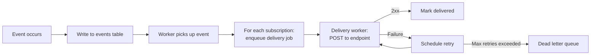
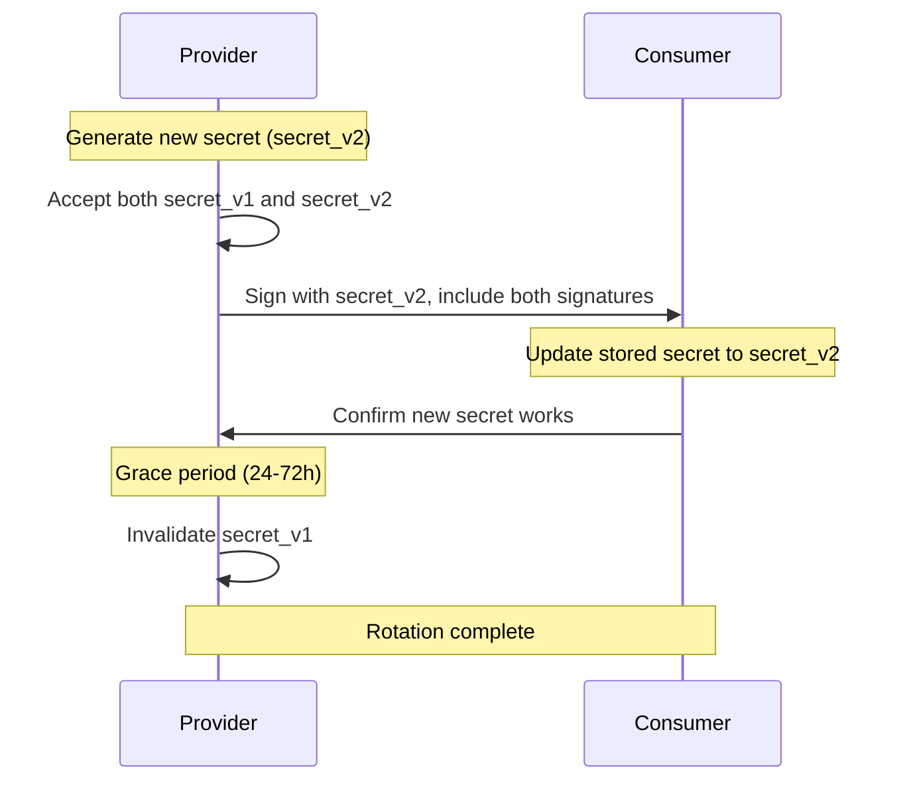
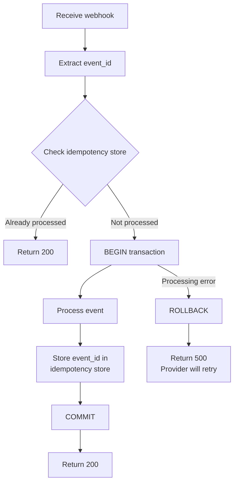

# Webhook Patterns

Webhook delivery and consumption patterns for SaaS: reliability, signatures, idempotency, retry strategies.

---

## Overview

- Webhooks are HTTP callbacks: your server POSTs to the customer's URL when an event occurs
- Two roles: **Provider** (sends webhooks) and **Consumer** (receives webhooks)
- Key challenges: delivery reliability, security, idempotency, ordering
- Webhooks are inherently asynchronous and unreliable — design for failure at every step
- Cross-reference: **Read** [`../code-conventions/architecture.md`](../code-conventions/architecture.md) for layer responsibilities (webhook delivery belongs in infrastructure/gateway, event dispatch in services)

## Event Design

### Event Structure

```json
{
  "id": "evt_abc123",
  "type": "payment.completed",
  "created_at": "2026-03-21T14:23:45Z",
  "data": {
    "payment_id": "pay_xyz",
    "amount": 2500,
    "currency": "eur"
  },
  "api_version": "2026-03-01"
}
```

Fields: `id` (globally unique, idempotency key), `type` (dot-separated past-tense event name), `created_at` (ISO 8601), `data` (full resource snapshot), `api_version` (schema version consumers can pin to).

**Naming:** dot-separated hierarchy `resource.action` in past tense. Examples: `payment.completed`, `subscription.renewed`, `invoice.payment_failed`. Nest for sub-resources: `subscription.invoice.payment_failed`.

### Payload Guidelines

- Include the full resource in `data` (not just the ID) — reduces consumer API calls
- Never include secrets, tokens, or PII beyond what is strictly necessary
- Version the payload with `api_version` — consumers can pin to a specific version
- Keep payloads under 64KB (some consumer infrastructures impose limits)
- Use consistent field names and casing across all event types
- Timestamps always in UTC, ISO 8601 format

## Delivery (Provider Side)

### Architecture



Key architectural decisions:

- **Decouple event creation from delivery** — the business operation writes the event to the database, a separate worker handles delivery
- **Fan-out per subscription** — each webhook subscription gets its own delivery job (one slow consumer does not block others)
- **Persistent event store** — events are written to a durable table before any delivery attempt (crash-safe)

### Delivery Guarantees

- **At-least-once delivery** — the only practical guarantee for webhooks
- Events may be delivered more than once (network issues, retries, worker restarts)
- Consumers MUST handle duplicates (see Idempotency section)
- Never promise exactly-once delivery — it is impossible over HTTP
- Ordering is not guaranteed (see Ordering section)

### Retry Strategy

| Attempt | Delay | Cumulative | Notes |
|---------|-------|------------|-------|
| 1 | Immediate | 0 | First attempt |
| 2 | 1 min | 1 min | |
| 3 | 5 min | 6 min | |
| 4 | 30 min | 36 min | |
| 5 | 2 hours | ~2.5 hours | |
| 6 | 8 hours | ~10.5 hours | |
| 7 | 24 hours | ~34.5 hours | Last attempt |

- Add jitter: +/-10% to each delay to prevent thundering herd on recovery
- Respect `Retry-After` header from consumer if provided
- Max retries: 5-7 attempts spanning 24-72 hours
- After max retries: move to dead letter queue, notify customer via email/dashboard
- Use exponential backoff as the baseline — the table above is a practical example

### Success / Failure Criteria

| Response | Action |
|----------|--------|
| HTTP 2xx | Mark delivered, done |
| HTTP 410 Gone | Auto-disable this webhook subscription |
| HTTP 4xx (not 410) | Retry (may be a transient issue on consumer side) |
| HTTP 5xx | Retry |
| Timeout (>10s default, 30s max) | Retry |
| Connection refused / DNS failure | Retry |

- Ignore response body — do not parse it, just check the status code
- Log response status for debugging but never store consumer response bodies long-term

### Dead Letter Queue

- Store failed events after max retries are exhausted
- Provide a dashboard for customers to view and manually replay failed events
- Auto-retry DLQ: optional, once per day for 7 days, then archive
- Webhook health monitoring: if >50% of deliveries fail for 3 consecutive days, auto-disable the subscription and send an email notification to the customer
- Expose a "replay" API endpoint so customers can programmatically retry failed events

## Signature Verification

### HMAC-SHA256 (Industry Standard)

The provider signs every webhook payload so the consumer can verify authenticity:

```
Signature = HMAC-SHA256(webhook_secret, timestamp + "." + payload_body)
```

Sent as an HTTP header:

```
X-Webhook-Signature: t=1679875200,v1=5257a869e7ecebeda32affa62cdca3fa51cad7e77a0e56ff536d0ce8e108d8bd
```

- `t` — Unix timestamp of when the signature was generated
- `v1` — the HMAC-SHA256 hex digest (versioned prefix allows future algorithm changes)

### Verification Steps (Consumer Side)

1. Extract timestamp `t` and signature `v1` from the `X-Webhook-Signature` header
2. Check timestamp is within +/-5 minutes of current time (prevents replay attacks)
3. Compute expected signature: `HMAC-SHA256(secret, t + "." + raw_request_body)`
4. Compare using constant-time comparison (prevents timing attacks)
5. If valid: process the event. If invalid: return 401, log the attempt for security monitoring

Important: use the **raw request body** (bytes as received), not a re-serialized version — JSON key order or whitespace differences will break the signature.

### Secret Rotation



- Generate new secret, set both old and new as valid simultaneously
- Sign payloads with both secrets during the grace period (include `v1` and `v2` in header)
- Grace period: 24-72 hours with both secrets valid
- Consumer updates their stored secret at their own pace during the grace period
- After grace period: invalidate the old secret

## Idempotency (Consumer Side)

Duplicate events are not a bug — they are a guarantee of at-least-once delivery (network timeouts, retry storms, worker restarts). Store processed event IDs; before processing, check if `event.id` was already seen; if yes, return 200 without re-processing. Keep event IDs for 7-30 days (match the provider's retry window).

### Implementation Pattern



- Use a database table or Redis SET for the idempotency store
- The event processing and idempotency key storage MUST be in the same transaction (or atomic operation) to avoid race conditions
- If using Redis: use `SET event_id NX EX 2592000` (NX = only if not exists, EX = 30-day TTL)

## Webhook Registration

### Subscription Management

Provide a CRUD API for webhook subscriptions:

| Field | Type | Description |
|-------|------|-------------|
| `id` | string | Unique subscription identifier |
| `url` | string | HTTPS endpoint to receive events |
| `events` | string[] | List of event types to subscribe to |
| `secret` | string | Auto-generated HMAC secret (shown once on creation) |
| `status` | enum | `active`, `paused`, `disabled` |
| `created_at` | datetime | When the subscription was created |
| `metadata` | object | Optional key-value pairs for consumer use |

- URL validation: must be HTTPS (except `localhost` / `127.0.0.1` for development), perform DNS resolution check on registration
- Test ping: send a `webhook.test` event on registration to verify the URL is reachable
- Secret display: show the secret only once at creation time — if lost, rotate to a new one

### Event Filtering

- Allow consumers to subscribe to specific event types (not all-or-nothing)
- Wildcard support: `payment.*` subscribes to all payment events
- Reduces noise and processing load for consumers
- Default: no events (consumer must explicitly opt in)
- Allow updating the event list without re-creating the subscription

## Ordering

Webhooks are **NOT ordered** — network latency, retries, and parallel delivery workers destroy ordering. Do not build systems that depend on webhook arrival order.

**Mitigation:** include `created_at` timestamp (consumer can sort), a `sequence` number per resource (consumer can detect gaps), full current state in payload (last-write-wins is safe regardless of order), and optionally `previous_state` for state-machine transitions. For critical ordering: consumer polls the API for authoritative state after receiving the webhook as a trigger.

## Local Development & Testing

**Tools:** ngrok (tunnel to localhost), Stripe CLI (`stripe listen --forward-to localhost:3000/webhook`), Svix Play (inspection UI), webhook.site (payload inspector), localtunnel (open-source ngrok alternative).

### Testing Checklist

- Verify signature validation works — send a request with a wrong signature and confirm it is rejected with 401
- Test retry handling — return 500 from consumer, verify the provider re-delivers
- Test idempotency — replay the same event twice, verify no duplicate processing
- Test timeout handling — add artificial delay in consumer, verify provider retries after timeout
- Test event filtering — subscribe to `payment.*`, verify no `user.*` events are received
- Test secret rotation — rotate the secret, verify both old and new signatures are accepted during grace period
- Test dead letter behavior — fail all deliveries, verify the event lands in the DLQ

## Monitoring (Provider)

### Key Metrics

| Metric | Target | Alert Threshold |
|--------|--------|-----------------|
| Delivery success rate | >99.5% | <95% per consumer |
| Delivery latency p50 | <1s | — |
| Delivery latency p95 | <5s | — |
| Delivery latency p99 | <15s | >30s |
| Retry rate | <5% | >15% |
| DLQ depth | 0 | Growing trend |
| Active subscriptions | — | Sudden drop |

### Alerting

- Success rate drops below 95% for a specific consumer: notify that consumer (their endpoint may be down)
- DLQ depth growing: investigate — may indicate a systemic issue
- Delivery latency p99 exceeds 30s: check consumer health or network issues
- Mass failure (>50% of all deliveries across all consumers): likely a provider-side issue — page on-call
- Sudden drop in active subscriptions: may indicate an accidental bulk-disable or API bug

## Anti-Patterns

| Anti-Pattern | Why It Fails | Correct Approach |
|--------------|-------------|------------------|
| Synchronous delivery (deliver in the request thread) | Blocks the user-facing operation on external network call | Always deliver via async queue/worker |
| No signature verification | Consumers cannot verify the webhook is authentic | Always sign with HMAC-SHA256, always verify |
| Trusting webhook payload blindly | Attacker can forge payloads if endpoint is discovered | Verify signature; for critical actions, fetch resource from API to confirm |
| Processing before returning 200 | Consumer timeout causes provider to retry, duplicate processing | Return 200 immediately, process asynchronously |
| No idempotency handling | Duplicates will happen — at-least-once delivery guarantees it | Store and check event IDs before processing |
| Blocking user flows on webhook delivery | User experience degrades if consumer is slow or down | Webhooks are async — never gate user actions on delivery |
| Storing webhook secrets in plaintext | Secret compromise allows forging webhooks | Use encrypted storage (e.g., envelope encryption, KMS, or OS keychain) |
| No dead letter queue | Failed events silently disappear with no recovery path | DLQ with dashboard and replay capability |
| Sending deltas instead of full state | Out-of-order delivery produces inconsistent state | Include full resource state — last-write-wins is safe |
| Parsing consumer response body | Couples provider to consumer implementation details | Check status code only, ignore body |
