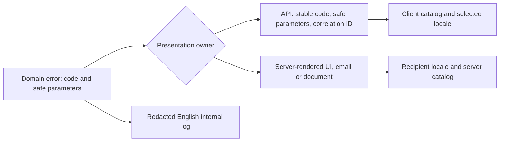

# Internationalization and Localization (All Languages)

All applications and servers must support translated product messages from the start. This is a repository policy; the libraries below are implementation choices, not mandatory dependencies. Read [general conventions](general.md) and [logging rules](logging.md) alongside this guide.

## Text ownership

| Audience / value | Required treatment |
|---|---|
| Product UI, including administration screens | Translate labels, actions, navigation, placeholders, tooltips, accessibility labels, empty/loading states and confirmations |
| User-facing failures | Translate validation, authorization, network, timeout and generic error messages; never display raw exceptions |
| Server-generated content | Translate email subjects/bodies, push notifications, SMS, reports, PDF text and human-readable exports using the recipient's locale |
| CLI / terminal UI | Translate user-facing help, prompts, progress and errors; preserve machine-readable output contracts |
| Internal developer diagnostics | Author log messages, traces, assertions and developer-only operational diagnostics in English; keep structured event names stable |
| Protocol / program identifiers | Keep error codes, field names, enum values, message IDs, metrics and JSON keys stable and language-independent |
| User-authored or external content | Preserve the original language; translate only through an explicit product feature, never by silently rewriting data |

- No directly rendered French, English or other natural-language literals in business logic, UI components, handlers or templates. A constants file containing untranslated UI sentences does not satisfy this rule.
- Product copy lives in versioned translation catalogs or platform resource files. Call sites use stable semantic message IDs; the base-language catalog is required too. Choose supported locales, the source language and fallback policy explicitly in product configuration; do not infer them from the developer's machine.
- Framework-required extractable declarations such as Delphi `resourcestring` are translation resources, not ordinary business constants. Keep them in dedicated resource units and deliver their translations. A framework allowing English source-message IDs does not authorize untranslated English output.
- For Gettext, prefer symbolic IDs with explicit base-language translations in this policy. If an existing project uses extractable source-message IDs, keep them only at its translation boundary with catalog coverage; do not spread new sentences through business logic. Never use missing-key output as product copy.
- Code identifiers, comments and internal diagnostics stay English. This requirement does not restrict translated resource values or user data. An end-user diagnostic remains product copy even when printed to stderr or shown in an admin screen.

## Locale and rendering contract

- Configure a bounded allowlist of supported BCP 47 language tags. Resolve precedence explicitly: validated user choice (including a locale route), saved profile preference, negotiated client language, configured default. Adapt this precedence to the product and document it. Honor `Accept-Language` weights and exclusions; use a language matcher rather than splitting on the first comma.
- Map external tags to the library's supported catalog names; validate before constructing paths, importing modules or loading resources. A language header is never an authorization or tenant signal. Decide separately whether a request excluding all supported languages uses the documented default or receives a negotiation failure.
- Keep language, time zone and currency separate. Persist timestamps canonically and currency with monetary amounts; use locale-aware formatters for dates, numbers, money, lists and relative time. Translation libraries do not automatically provide every formatter. Read [Elixir data and locale rules](elixir.md#data-locale-and-boundaries) for its money/time contract.
- Render complete messages with named parameters and library plural/select rules. Do not concatenate translated fragments, assume English word order, or implement pluralization as `count === 1`. Preserve placeholder names and types across catalogs; give translators context.
- Escape interpolated values for their output context. Rich messages use controlled components or sanitized markup; catalogs and interpolation must never become an arbitrary HTML execution path.
- Set document language and text direction. Use logical layout properties, flexible text space and appropriate fonts; check long translations and right-to-left layouts where supported. Localize images/media containing product copy too.
- Resolve fallback deliberately (for example, regional catalog, parent language, configured default). CI rejects missing required messages; production degrades to a known translated generic message and records an English diagnostic without sensitive parameters. A fallback is resilience, not translation completeness.
- Load catalogs once per configured runtime where practical; scope locale selection to the request, session or render operation. Never mutate a shared process-global locale per HTTP request. Include resolved locale and catalog version in relevant render-cache keys; use `Content-Language` for localized HTTP representations and `Vary: Accept-Language` when that header affects a cacheable representation. Personalized output also requires the usual private/cache isolation policy.
- SSR and browser hydration must receive the same resolved locale and compatible catalogs. Persist a validated locale with asynchronous notification work, and restore it explicitly in each worker/task; define whether queued delivery uses the captured locale or a newly resolved recipient preference.

## Domain errors, APIs and background work

Domain functions return typed errors with a stable code and safe structured parameters. A presentation adapter maps each code to a catalog entry. Do not put a translation service in every domain object, and do not persist translated sentences as business status values.



- For client-rendered products, clients translate the API's documented error code; an optional localized server message is supplementary and never parsed for control flow. For server-rendered content, the server owns translation. Record ownership per channel to avoid double translation.
- Validation errors carry stable field paths, constraint codes and safe parameters. Map database, provider and framework errors to this public contract; cover framework defaults such as 404/500 pages, auth failures and validation-library messages too.
- Unknown codes display a catalog-backed generic error plus a correlation reference. Stack traces, SQL, internal exception messages and secrets stay out of responses and notifications.
- Persist notification intent, template/message identifier, safe parameters and locale policy rather than a pretranslated sentence, unless an immutable sent-document snapshot is a product requirement. Version templates/catalogs or maintain compatibility for queued jobs and older clients.

## Stack selection

References checked 2026-11-04. Pin compatible versions and consult their documentation before integration; these are documented patterns, not runtime validation of any application's chosen dependencies. Resource syntax and plural conventions differ between libraries; share message meaning/contracts, not necessarily raw catalog files.

| Stack | Candidate and resource format | Integration boundary |
|---|---|---|
| JavaScript / TypeScript | i18next with JSON catalogs | Inject a translator into presentation; use `Intl` for formatting |
| React / React Native | react-i18next over i18next | Provider + hooks; controlled rich messages; mobile locale selection uses platform preferences |
| Next.js App Router | next-intl with message catalogs | Request configuration, server/client integration, validated locale routing if needed |
| Astro | Native i18n routing plus a message catalog library | Routing alone does not translate page content; align island and server locale |
| Vue / Angular | Vue I18n / Angular i18n | Use framework extraction/resources; decide whether language switching requires a localized build/navigation |
| Node.js server | i18next; i18next-http-middleware for supported HTTP frameworks | Request-scoped `req.t`, or explicit locale-bound translator; reuse loaded catalogs |
| Elixir / Phoenix / LiveView | Gettext `.pot` / `.po`; Localize for formatting | Translate at web/delivery boundaries, restore process-local locale |
| Rust | Fluent `.ftl` via fluent-bundle; rust-i18n as a simpler catalog alternative | Explicit locale or selected bundle passed to the presentation adapter |
| Go | go-i18n/v2 catalogs + `golang.org/x/text` | Shared initialized bundle, localizer per request/recipient |
| Delphi / VCL | `resourcestring`, form resources and resource DLLs; GNU Gettext for Delphi as an alternative | Dedicated resource units, form translation and target-specific packaging |
| Python / Django | Standard-library gettext; Django translation facilities | Catalog objects or framework request context, not mutable global locale |
| Swift / Kotlin Android | Apple String Catalogs / Android string and plural resources | Native resource lookup and locale-aware formatting; no UI literals bypassing resources |

### JavaScript, frameworks and Node.js

- Consult [i18next's instance API](https://www.i18next.com/overview/api) for initialization and locale-bound translation; consult [the Node middleware](https://github.com/i18next/i18next-http-middleware) for request integration. Preload the configured catalogs and wait for readiness before serving requests. Use `getFixedT(locale)` or the request translator; never call shared `changeLanguage` for concurrent users.
- Keep base and translated catalogs alongside the product. For example, a semantic ID such as `errors.account_locked` maps to separately reviewed locale values; the call site contains only the ID and parameters. Configure the fallback and missing-message handler rather than embedding English `defaultValue` sentences in UI code.
- Consult [react-i18next](https://react.i18next.com/) for providers/hooks and rich text, [next-intl](https://next-intl.dev/docs/getting-started/app-router) for App Router request setup, [Astro i18n](https://docs.astro.build/en/guides/internationalization/) for routes, [Vue I18n](https://vue-i18n.intlify.dev/guide/introduction) and [Angular i18n](https://angular.dev/guide/i18n) for native integration. Do not install multiple message engines without a concrete boundary requiring them.
- Consult [Node internationalization support](https://nodejs.org/api/intl.html) for `Intl` and ICU data availability in the deployed runtime. `Intl` formats values; it does not manage application message catalogs. In Workers or other non-Node runtimes, verify available APIs and load resources through supported bindings/bundling rather than assuming filesystem access.

### Elixir, Phoenix and LiveView

- Consult [Gettext](https://hexdocs.pm/gettext/Gettext.html) for a backend, extraction and plural messages. Use extractable literal IDs at the presentation boundary, with separate domain catalogs where useful; dynamic message lookup needs an explicit registry/extraction strategy. Run `mix gettext.extract` and `mix gettext.merge priv/gettext`, then review translations, placeholder compatibility and fuzzy entries before shipping.
- With symbolic IDs, provide the source-locale `.po` entries too; default Gettext missing-message behavior can expose the ID. Plural calls need extractable singular/plural IDs and translations appropriate to each locale.
- Gettext locale belongs to an Elixir process. Set it in Plug for HTTP rendering, restore it in each LiveView process at mount, and pass it explicitly into Tasks and Oban jobs. Use a scoped locale or restore previous state for reused processes; setting the HTTP process locale does not configure another process. Consult [LiveView's localization guide](https://phoenix-live-view.hexdocs.pm/0.17.12/using-gettext.html) for the process pattern; its older API examples must be adapted to the pinned release.
- Translate Ecto validation messages at the boundary, retaining interpolation metadata and counts. Consult [Localize](https://hexdocs.pm/localize/readme.html) for locale-aware number/date/currency formatting; configure its locale consistently with Gettext rather than assuming both share state.

### Rust

- Consult [fluent-bundle](https://docs.rs/fluent-bundle/latest/fluent_bundle/) for Fluent messages, variables and formatting errors. Load `.ftl` resources as assets or embedded resources, select the requested bundle through an adapter, and implement locale negotiation/fallback around the bundle. Handle parse, missing-message and formatting failures; do not copy example `unwrap`/`expect` paths into request handling.
- Consult [rust-i18n](https://docs.rs/rust-i18n/latest/rust_i18n/) for simpler YAML/JSON/TOML catalogs and `t!` calls with an explicit `locale` argument. Avoid its global locale setter in concurrent servers. Verify required plural/select behavior against the selected version before choosing it over Fluent.
- Keep typed Rust errors and `Display` diagnostics internal; map codes at HTTP/CLI/UI boundaries. A Tauri web UI can own its JavaScript translations while Rust returns stable codes. Neither approach automatically supplies all localized date/number formatting; evaluate a compatible formatter when required.

### Go

- Consult [go-i18n/v2](https://pkg.go.dev/github.com/nicksnyder/go-i18n/v2/i18n) for `Bundle`, `NewLocalizer` and `LocalizeConfig`. Load catalogs before concurrent serving and treat the shared bundle as immutable. Create a localizer from the validated request/recipient language, supply `MessageID`, `TemplateData` and `PluralCount` where required, and handle lookup errors instead of panicking.
- Use its `goi18n extract` / `goi18n merge` workflow for extractable message declarations. If code uses only IDs, maintain an explicit base catalog/registry; extraction cannot invent messages from arbitrary dynamic keys.
- Consult [x/text/message](https://pkg.go.dev/golang.org/x/text/message) for localized formatted output and its language tooling. Choose one clear message-catalog owner; do not assume go-i18n also formats all dates and currencies. Wrap standard-library validation/errors in stable public codes; never render `err.Error()` directly to users.

### Delphi / Pascal

- Consult [Embarcadero's resource isolation guide](https://docwiki.embarcadero.com/RADStudio/Sydney/en/Isolating_Resources) for `resourcestring`, `.dfm` resources, `.drc` extraction and VCL resource DLLs. Ordinary `const` strings and literal `ShowMessage` / exception sentences are not a localization mechanism. Translate captions, hints, actions, dialogs and runtime messages, including third-party controls.
- Consult [GNU Gettext for Delphi](https://github.com/jrathlev/GnuGetText-for-Delphi) for an alternative extraction/catalog toolchain. Verify compiler version, Unicode, license, plural support, runtime switching and deployment targets before adoption; do not assume a legacy Win32/VCL DLL workflow applies to FireMonkey, macOS or mobile.
- For FireMonkey or a Delphi server, select and verify a compatible resource/catalog adapter for each target. Keep language selection behind a translation interface; server rendering needs explicit request/recipient locale rather than desktop-global language state. A language switch must refresh existing forms as well as future dialogs. Do not claim FMX support merely because VCL resource extraction works.
- Keep exception categories/codes and diagnostic logging separate from translated dialog text. Use locale-specific formatting settings passed to formatting operations rather than mutating global formats per request; money retains its explicit currency and precision policy.

### Other covered languages

- Consult [Python gettext](https://docs.python.org/3/library/gettext.html) for explicit translation objects and [Django translation](https://docs.djangoproject.com/en/stable/topics/i18n/translation/) for middleware, extraction, lazy messages and scoped overrides. Avoid global installs or process-wide locale mutation in concurrent services; explicitly scope locale in workers.
- Consult [Apple String Catalogs](https://developer.apple.com/videos/play/wwdc2023/10155/) for `.xcstrings`, extraction and variations; use localized lookups in SwiftUI and non-UI presentation. Consult [Android localization](https://developer.android.com/guide/topics/resources/localization) for default and locale-specific string/plural resources, accessed through Android resource APIs. Both require complete base resources and checks for non-resource literals.

## Adoption and verification

- Inventory every product text surface, framework-generated error and third-party component before migration. Record supported locales, source language, fallback, locale precedence, time-zone/currency policy, catalog ownership and chosen library in the application's documentation.
- Add a reviewed base catalog and at least one additional product-approved locale. Migrate feature by feature, including server notifications and CLI output. All newly introduced product text must use the translation boundary immediately; existing untranslated surfaces remain explicit migration debt.
- In application CI, check catalog parsing, required IDs, source-locale coverage, placeholder/type compatibility, plural/select branches, stale/fuzzy translations and packaged assets. Use stack-appropriate literal detection plus review; a regex alone cannot prove coverage of dynamic templates or third-party defaults.
- Exercise representative failures and successful rendering in multiple supported locales; test weighted/unsupported language negotiation, generic fallback, simultaneous requests with different locales, SSR hydration, cache isolation and worker delivery. Assert stable error codes separately from localized copy; verify internal logs stay English and redacted.
- Check text expansion, accessibility names, document language, and RTL when supported. Reuse application tests that prove these behaviors; this reference does not install a library, configure a product's locales or certify its translations.

```gherkin
Scenario: Product error and developer log use separate language policies
  Given two simultaneous users have different supported locales
  When the same domain error occurs for each user
  Then each user receives the catalog message for their own locale
  And the error code stays identical and internal logs stay English
```
