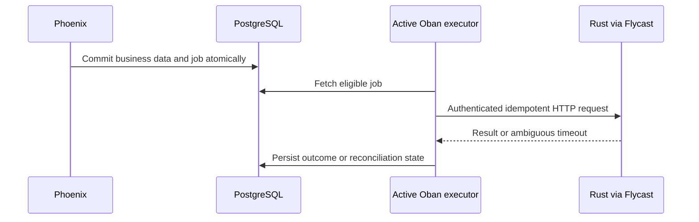

# Oban Durable Jobs Rules

## When to use

Use Oban for durable retries/schedules such as document generation, email, signatures, payment reconciliation and appointment reminders. Use supervised tasks for short-lived work that may be lost with its caller. Read [OTP rules](elixir-otp.md) for volatile execution and [Ecto rules](ecto.md) for transactions.

## Persistence and execution contract

- Configure the chosen engine/database explicitly and apply its Oban migrations. This guide targets PostgreSQL with the basic engine unless the project selects another supported engine. Verify the pinned version's prerequisites and features rather than assuming all engines behave identically.
- Supervise Oban after its Repo. Persist job creation atomically with business data using the `Oban.insert` Multi overload. A failure must roll back both; the worker later loads authorized data by explicit tenant/resource/operation IDs.

Illustrative Multi; `MyApp.Repo`, worker schema and changeset belong to the consuming application:

```elixir
Ecto.Multi.new()
|> Ecto.Multi.insert(:document, changeset)
|> Oban.insert(:render, fn %{document: document} ->
  MyApp.RenderDocument.new(%{document_id: document.id, tenant_id: document.tenant_id})
end)
|> MyApp.Repo.transaction()
```

- Job args must be JSON-compatible, minimal and versioned as necessary. Avoid secrets, complete structs, binary files and process-local identity/locale assumptions. Define how old enqueued jobs behave across deployment/schema changes.
- Treat delivery as retryable, not exactly-once. An external provider may accept a request just before a worker crashes or loses its response. Use a persisted operation key, provider idempotency support and a durable outcome/receipt; reconcile ambiguous results before initiating another charge/signature/send.
- Oban uniqueness can reduce duplicate inserts but does not replace business constraints or provider idempotency. Keep deduplication fields/states/period aligned with the actual operation; retries must not create fresh identities.

## Queues, retry and resource limits

- Separate email, CPU-heavy document work and provider-limited jobs when they require distinct concurrency/failure policies. Set concurrency against DB pool, memory, CPU and provider quotas; do not copy demonstration limits into production.
- Basic engine queue concurrency applies per node. Multiple nodes multiply capacity. Global/rate limits require an engine/edition or coordination mechanism that actually supports them; verify that selection before promising a cluster-wide cap.
- Return `:ok` / `{:ok, value}` for completion and `{:error, reason}` for retriable failures; choose `{:cancel, reason}` or `{:snooze, seconds}` deliberately where supported. Avoid rescuing failures and returning success.
- Define attempts, backoff, worker timeout and external-call deadlines together. Account for retries in both the HTTP client and Oban. Separate permanent validation/authorization failures from transient network/provider failures.
- Configure pruning/retention, job-data privacy, queue lag/failure/discard alerts and a safe manual retry procedure. Maintain reconciliation for stuck/unknown external outcomes and a runbook for database outages and backlog recovery.
- Schedule UTC instants for jobs; preserve IANA timezone/local intent for user schedules. Handle DST and schedule changes explicitly. Test rescheduling/cancellation and duplicate scheduler ticks.

## Active workers and Fly.io

- A job row cannot execute itself: at least one eligible Oban executor must be running, connected to the database and polling/receiving notifications. Database persistence does not wake an arbitrary suspended machine.
- Keep an eligible executor active (web node or dedicated worker), or design and test an external wake/scheduling mechanism. An insert alone is not that mechanism. Pure queue consumers cannot rely on HTTP traffic they never receive for autostart.
- An active Phoenix/Oban process may call a separate Rust HTTP service through Flycast with configured Fly Proxy autostart. Private `.internal` direct routing and Flycast proxy routing are different; use the documented Flycast service setup and test cold-start timeout/retry behavior.
- Authenticate requests, bound cold-start/processing time and reconcile ambiguous responses. A NIF shares the BEAM process and cannot be independently suspended/scaled as a separate service.



## Tests

Use `Oban.Testing` with `testing: :manual` to assert enqueue/transaction behavior without real background execution. Use `perform_job` for worker behavior and controlled `drain_queue` for integration; inline mode intentionally changes timing and must not stand in for retry/crash/restart tests. Read [Elixir testing](elixir-testing.md) for sandbox and separate real-worker checks.

## Sources

Official references checked 2026-10-28:

- Consult [Oban](https://hexdocs.pm/oban/Oban.html), [queue configuration](https://hexdocs.pm/oban/defining_queues.html) and [basic engine](https://hexdocs.pm/oban/Oban.Engines.Basic.html) for engine and concurrency contracts.
- Consult [Oban.Testing](https://hexdocs.pm/oban/Oban.Testing.html) for manual/inline execution.
- Consult [Flycast autostart for private applications](https://fly.io/docs/blueprints/autostart-internal-apps/) for the proxy/service prerequisites.
