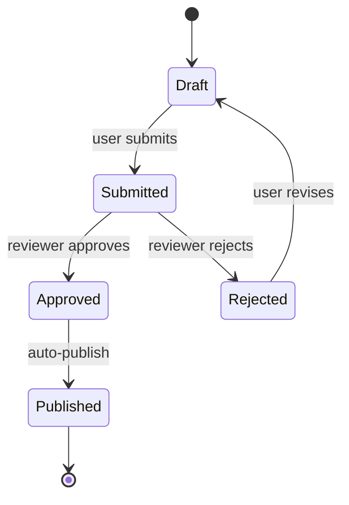
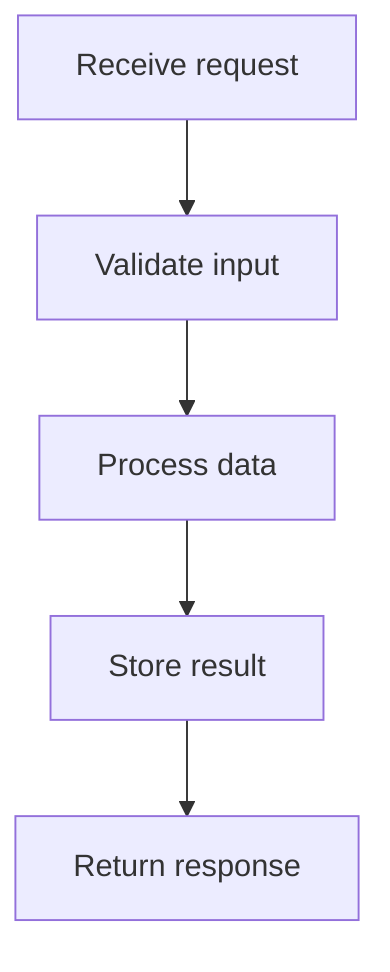
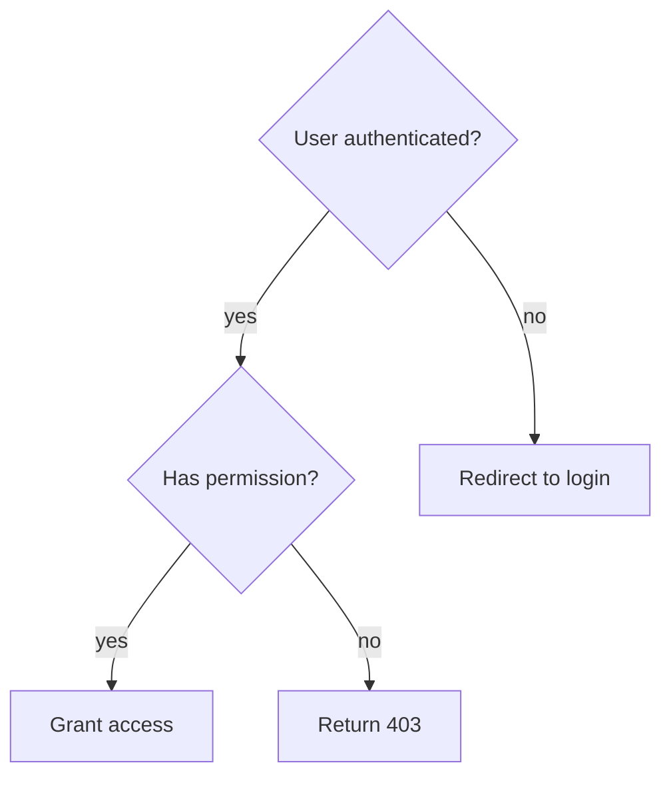
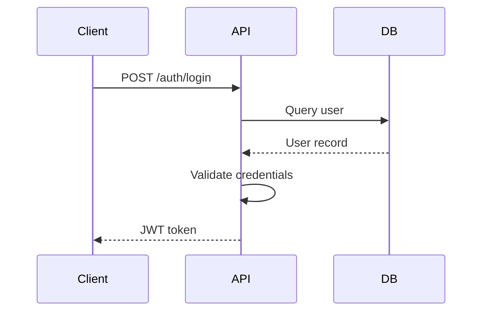

# Diagram Conventions

All flows MUST use structured diagram formats instead of narrative text.

## Format Selection

| Flow type | Format | Mermaid diagram type |
|---|---|---|
| Business scenario, user journey, acceptance criteria | **Gherkin** | N/A |
| Technical pipeline, request lifecycle | **Mermaid** | `flowchart` (rectangular nodes in series) |
| Interaction between services/components | **Mermaid** | `sequenceDiagram` |
| State machine, lifecycle | **Mermaid** | `stateDiagram-v2` |
| Decision tree, conditional routing | **Mermaid** | `flowchart` (diamond `{condition?}` nodes) |
| Hybrid flow (user action triggers technical sequence) | **Gherkin + Mermaid** | Gherkin for behavioral view, Mermaid for structural view |

## Gherkin — Business Flows

Use when the flow describes **behavior from a user or system perspective** — preconditions, actions, and expected outcomes.

```gherkin
Feature: User authentication

  Scenario: Successful login
    Given an unauthenticated user on the login page
    When they submit valid credentials
    Then they receive a JWT token
    And they are redirected to the dashboard

  Scenario: Failed login with locked account
    Given a user whose account is locked
    When they submit valid credentials
    Then they see an error message "Account locked"
    And no JWT token is issued
```

## Mermaid — Structural Flows

Use for **structural flows** — processes with branching, parallelism, states, or interactions between multiple actors.

### State machine



### Pipeline



### Decision tree



### Sequence diagram



## Audience Rules

### AI-only documents (rules, skills, internal specs)

- Diagram format only — no text paragraph restating the diagram
- One sentence max before the diagram to frame context
- Goal: minimize token usage, maximize precision

### Human-readable documents (README, runbooks, onboarding)

- Gherkin: keep as-is (already human-readable)
- Mermaid: keep as-is (renderable in GitHub, editors, doc tools)
- If a business flow in Gherkin benefits from a visual overview, add a Mermaid flowchart after it

### Redundancy vs. complementarity

**Gherkin + Mermaid together** for the same flow is complementarity, not redundancy:

- **Gherkin** = behavioral view (preconditions, actions, outcomes)
- **Mermaid** = structural view (branching, parallelism, multi-actor)

What IS redundancy (forbidden): a prose paragraph that restates what an adjacent diagram already expresses.

## Anti-patterns

- Writing a flow as a numbered list or prose paragraph when a diagram would be clearer
- Using Gherkin for technical pipelines or state machines (use Mermaid)
- Using Mermaid flowcharts for user scenarios with preconditions/outcomes (use Gherkin)
- Duplicating the same flow in both text AND diagram in AI-only documents
- Using `dot` / Graphviz when Mermaid covers the same diagram type
