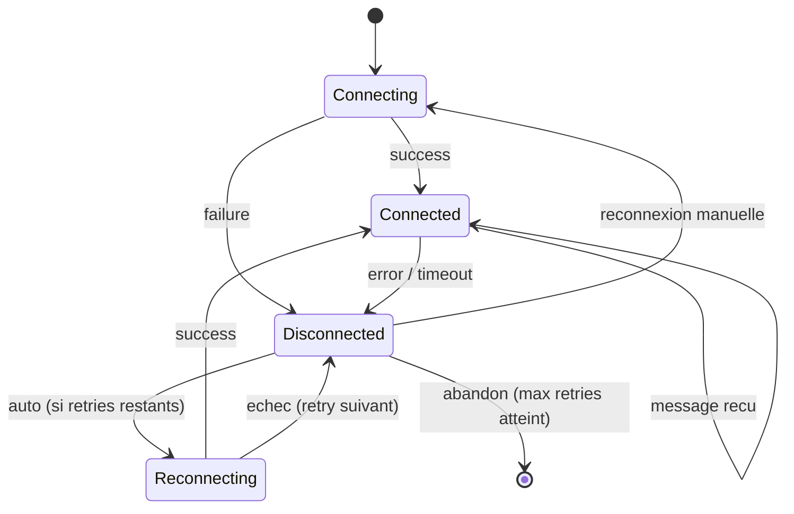

# Real-Time Streams

Patterns UI pour les flux temps reel : WebSocket, SSE, polling. Reconnexion, buffering, indicateurs d'etat.

---

## Transports

| Transport | Direction | Cas d'usage | Reconnexion | Support navigateur |
|-----------|-----------|-------------|-------------|-------------------|
| WebSocket | Bidirectionnel | Chat, collaboration, gaming | Manuelle | Universel |
| SSE (EventSource) | Serveur -> client | Logs, notifications, feeds | Automatique | Universel (sauf IE) |
| Long Polling | Requete -> reponse | Fallback, environnements restrictifs | Par requete | Universel |
| HTTP Streaming | Serveur -> client | LLM token streaming, gros fichiers | Manuelle | Universel |

**Regle** : preferer SSE pour les flux unidirectionnels (logs, metriques, notifications). Reserver WebSocket pour le bidirectionnel (chat, collaboration).

---

## Etat de connexion

### Machine a etats

### Indicateur visuel

| Etat | Indicateur | Couleur | Message |
|------|-----------|---------|---------|
| Connected | ● | Vert (`success`) | "En direct" / "Live" |
| Disconnected | ● | Rouge (`error`) | "Deconnecte" |
| Reconnecting | ● (pulse) | Jaune (`warning`) | "Reconnexion..." |
| Connecting | ● (pulse) | Gris (`neutral`) | "Connexion..." |

- Position : discret, dans le header ou la status bar. Ne pas bloquer l'interface
- Le pulse utilise l'animation `Pulse dot` definie dans **Read** [`../tokens/motion.md`](../tokens/motion.md) (opacity pulse, ease-in-out, cycle / 1200ms)
- Couleurs semantiques : **Read** [`../tokens/colors.md`](../tokens/colors.md) pour les tokens `success`, `error`, `warning`

### Reconnexion

- Exponential backoff : 1s -> 2s -> 4s -> 8s -> 16s -> 30s (cap)
- Jitter : +/-20% pour eviter le thundering herd
- Max retries : 10, puis basculer en polling degrade ou demander action manuelle
- Reprendre depuis le dernier event ID recu (SSE : `Last-Event-ID`, WS : custom)
- Afficher un toast discret a chaque reconnexion reussie
- Pendant la reconnexion, les donnees locales restent visibles et interactives

---

## Buffering et rendu

### Strategies de buffering

| Strategie | Description | Cas d'usage |
|-----------|-------------|-------------|
| Immediate | Rendu a chaque message | Chat, notifications (faible volume) |
| Batched | Accumule N messages, rendu toutes les Xms | Logs, metriques (haut volume) |
| Throttled | Max 1 rendu par Xms | Donnees haute frequence (trading, IoT) |
| Virtual | Seuls les elements visibles sont rendus | Listes infinies de logs |

**Regle** : pour les flux > 10 msg/s, toujours batcher. 60fps = rendu toutes les 16ms, mais un rendu toutes les 100-200ms suffit pour des logs.

### Seuils recommandes

| Volume | Strategie | Intervalle de rendu |
|--------|-----------|---------------------|
| < 1 msg/s | Immediate | Chaque message |
| 1-10 msg/s | Batched | 200ms |
| 10-100 msg/s | Throttled | 100ms |
| > 100 msg/s | Virtual + Throttled | 100ms, viewport only |

### Auto-scroll

- Comportement par defaut : auto-scroll active (suivre les nouveaux messages)
- Desactivation : des que l'utilisateur scroll manuellement vers le haut
- Reactivation : quand l'utilisateur scroll jusqu'en bas, OU clic sur le bouton "Nouveaux messages"
- Badge compteur : "42 nouveaux messages" (sticky bottom)
- Animation de scroll : **Read** [`../tokens/motion.md`](../tokens/motion.md), section Scroll Animations — utiliser `ease-out`, duree `normal` (250ms)
- Seuil de detection "en bas" : 50px du fond (tolerant aux petits ecarts)

### Retention cote client

- Buffer circulaire : garder les N derniers messages (1000-10000 selon le cas)
- Au-dela : supprimer les plus anciens silencieusement
- Indicateur optionnel : "Affichage des 1000 derniers logs"
- Pagination vers l'historique : appel API pour les messages plus anciens
- Ne jamais charger tout l'historique en memoire — toujours paginer

---

## Optimistic Updates

- Pattern : appliquer immediatement cote client, confirmer ou rollback cote serveur
- Etats visuels :

| Etat | Apparence | Comportement |
|------|-----------|-------------|
| Pending | Opacite reduite (0.6), indicateur "envoi..." | Interactif mais non confirme |
| Confirmed | Apparence normale | Transition fluide depuis pending |
| Failed | Rouge + option "Reessayer" | Afficher le message d'erreur |

- Transitions : **Read** [`../tokens/motion.md`](../tokens/motion.md) pour le timing (state change = ease-in-out)
- Ne PAS utiliser pour les actions destructives (suppression, paiement)
- Ne PAS utiliser si le serveur peut rejeter frequemment (validation complexe cote serveur)
- Timeout de confirmation : si pas de reponse serveur apres 10s, marquer comme failed

---

## Token Streaming (LLM)

- Afficher token par token avec curseur clignotant
- Curseur : barre verticale fine, clignotement `ease-in-out` cycle / 1000ms (voir **Read** [`../tokens/motion.md`](../tokens/motion.md))
- Pas de scroll automatique entre les tokens — l'utilisateur lit le texte au fur et a mesure
- Auto-scroll uniquement si l'utilisateur est deja en bas du conteneur
- Indicateur "En train de repondre..." pendant le stream
- Bouton "Stop" visible pendant la generation — arrete le stream immediatement
- A la fin du stream : le curseur disparait, le texte devient selectionnable
- Ne pas appliquer de loading state (spinner/skeleton) pendant le streaming — le flux de tokens EST l'indicateur de chargement
- Delai avant affichage du premier token : appliquer la regle des 200ms (voir **Read** [`../tokens/motion.md`](../tokens/motion.md), section Loading States)

### Markdown streaming

- Parser le Markdown incrementalement (ne pas attendre la fin du stream)
- Les blocs de code incomplets restent ouverts visuellement jusqu'a la fermeture du bloc
- Eviter le re-layout brutal quand un bloc de code apparait — reserver l'espace verticalement

---

## Terminal — Patterns specifiques

- Comportement `tail -f` : append-only, pas de reecriture
- Ctrl+S / Ctrl+Q : pause/resume de l'output (flow control classique)
- Alternating row background (subtil) pour la lisibilite
- Monospace font obligatoire — respecter le token typographique
- Limite de lignes visibles sans pagination : ~10000 (au-dela, ralentissement terminal)
- Couleurs ANSI : supporter les codes de couleur standard (16 couleurs minimum)
- Wrap long lines par defaut, option no-wrap pour les logs structures

---

## Heartbeat et health check

| Parametre | WebSocket | SSE |
|-----------|-----------|-----|
| Ping interval | 30s (client -> serveur) | Pas necessaire (TCP keepalive) |
| Pong timeout | 10s apres le ping | — |
| Idle detection (client) | Pas de message depuis > 60s | Pas de message depuis > 60s |
| Idle closure (serveur) | Fermer apres 5min d'inactivite | Fermer apres 5min d'inactivite |

- Cote client : si pas de message ni de pong depuis > 60s, afficher "Connexion inactive" et tenter une reconnexion
- Les heartbeats ne doivent pas etre visibles dans l'UI — traitement silencieux
- SSE : utiliser des commentaires SSE (`:heartbeat\n\n`) pour maintenir la connexion vivante sans generer d'evenements

---

## Gestion de la bande passante

### Degradation gracieuse

| Condition | Action |
|-----------|--------|
| Connexion lente detectee | Reduire la frequence d'envoi (serveur) |
| Client en arriere-plan (tab inactive) | Suspendre le rendu, reprendre au retour |
| Buffer overflow cote client | Dropper les messages les plus anciens du batch |

### Compression

| Transport | Methode | Notes |
|-----------|---------|-------|
| SSE | gzip (via HTTP) | Transparent, supporte par tous les serveurs |
| WebSocket | permessage-deflate | Negocier a la connexion, attention au CPU |
| Long Polling | gzip (via HTTP) | Standard |

### Filtrage cote serveur

- Subscription model : le client s'abonne uniquement aux channels/topics necessaires
- Ne pas envoyer ce que le client ne regarde pas (onglet inactif, section collapsed)
- Permettre au client de changer ses subscriptions a chaud sans reconnexion

---

## Guidelines

- Toujours afficher un indicateur d'etat de connexion — l'utilisateur doit savoir si les donnees sont en temps reel ou non
- Preferer SSE pour les flux unidirectionnels, WebSocket pour le bidirectionnel — ne pas sur-ingenierer
- Implementer la reconnexion avec exponential backoff + jitter — jamais de retry en boucle immediate
- Batcher le rendu pour les flux haute frequence — ne pas re-render a chaque message au-dela de 10 msg/s
- Respecter l'intention de scroll de l'utilisateur — ne jamais forcer l'auto-scroll si l'utilisateur a scrolle vers le haut
- Appliquer les optimistic updates uniquement pour les actions non-destructives et frequemment reussies
- Le token streaming LLM n'a pas besoin de loading state — le flux de tokens est son propre indicateur
- Buffer circulaire cote client — ne jamais stocker un historique illimite en memoire
- Tester avec des connexions lentes et instables — la degradation gracieuse est aussi importante que le happy path
- **Read** [`../tokens/motion.md`](../tokens/motion.md) pour tous les timings d'animation (loading states, scroll, transitions)
- **Read** [`../tokens/colors.md`](../tokens/colors.md) pour les couleurs semantiques des indicateurs d'etat
