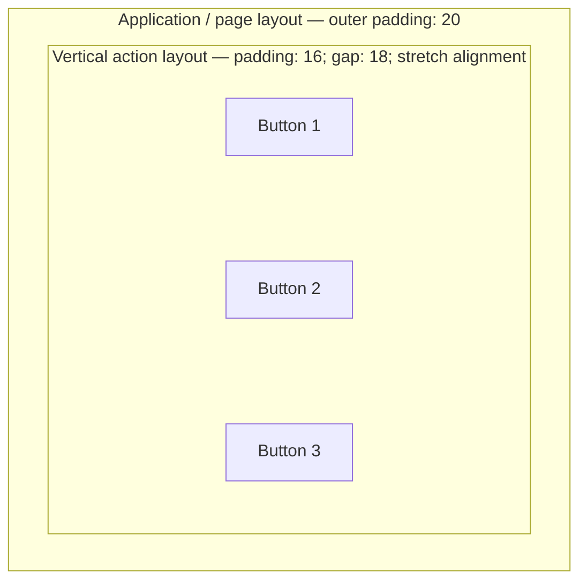

# Spacing Tokens

Consistent spacing across iOS, Android, and Web. All values map to a shared semantic scale.

## Mandatory Layout Containers in Product Code

These requirements apply to every implemented website, web application and native application, including reusable UI components; mockups must reflect the same structure.

- Every UI element must belong to a layout container that controls its placement. Compose the screen from nested layouts: page/screen, sections, coherent groups, then controls/content.
- Give each semantic group its own layout: adjacent buttons form an action group; a label, field and help/error text form a field group; each settings category forms a section with its heading and rows. Nest these groups in their parent layout.
- A single element may belong directly to its existing section or group; add a dedicated container when it needs independent spacing, alignment or sizing. Every element has a layout owner; wrappers without a layout responsibility are unnecessary.
- Each layout must define direction or grid structure, child alignment, sizing/wrapping behavior, internal padding and spacing between children. Define its external separation through the parent layout or a margin/inset supported by the framework. Zero or a deliberate native default is valid; nonzero padding and margin are not required at every nesting level.
- The parent must own spacing between siblings. Use one consistent gap for equivalent siblings within a group; create nested groups for different relationships. Keep related items closer than separate categories. Uniform gaps do not require equal child widths or heights.
- Keep padding (inside a container), gap (between its children) and margin/external separation (outside it) distinct. Do not stack child margins on top of the parent gap or apply safe-area insets twice.
- Custom spacing must use semantic tokens from the selected product/platform scale; use the scale below as the fallback. Preserve native component metrics where they take precedence. Identical numeric values across platforms are not required.
- Ordinary controls must use normal layout flow and framework constraints. Do not repair alignment with absolute coordinates, per-child offsets, negative margins or repeated spacer elements. Overlays, badges and spatial content such as maps/charts may use deliberate positioning within an owning container; document the reason.
- Groups must adapt to available window width, orientation, text scaling, keyboard and localized content. Wrap or stack action groups when needed; use leading/trailing or start/end alignment for writing direction.

### Platform Implementation

| Target | Layout primitives | Spacing and adaptation |
|--------|-------------------|------------------------|
| iOS/iPadOS/macOS | SwiftUI stacks, grids, `Form`/`Section`; UIKit/AppKit stack views and Auto Layout | Native spacing, padding, layout margins and safe-area guides; Dynamic Type where available and resizable windows |
| Android | Compose `Row`, `Column`, lazy layouts and grids; XML layout containers and constraints | Arrangement spacing, padding and resource/theme dimensions in dp; window insets, font scaling and window size classes |
| Websites and web applications | Semantic sections and component groups using normal flow, Flexbox or Grid | Token-based gap, padding and logical margins; responsive wrapping/columns, readable max-width and zoom support |

Read [Apple platform guidance](../systems/apple-hig.md), [Android platform guidance](../systems/material-design.md) or [web platform guidance](../systems/web-standards.md) before selecting platform values. The tables below are project defaults, not universal OS requirements; query runtime insets rather than copying device-specific constants.

### Nested Layout Example

Illustrative values only: outer separation 20, group padding 16 and sibling gap 18, expressed in the target platform's logical units. Production values must resolve to product/platform tokens; 18 is not part of the fallback scale below.

The page provides the group's outer separation; the action layout provides its inner padding and equal gaps. Buttons require no individual placement offsets. For settings, use the same nesting with one section layout per category and one row/group layout per coherent set of controls.

For framework behavior, consult [Apple layout documentation](https://developer.apple.com/documentation/swiftui/laying-out-a-simple-view), [Compose layout documentation](https://developer.android.com/develop/ui/compose/layouts/basics), [Compose modifier documentation](https://developer.android.com/develop/ui/compose/modifiers) and [CSS gap documentation](https://developer.mozilla.org/en-US/docs/Web/CSS/Reference/Properties/gap).

## Platform Base Units

|Platform|Unit|Base|Notes|
|--------|----|----|-----|
|iOS|pt|8pt|UIKit/SwiftUI layout unit|
|Android|dp|4dp|Density-independent pixel|
|Web|px|4px|CSS pixel (rem-based recommended)|

## Spacing Scale

Semantic tokens mapped to platform values. Use these names in code and design files.
|Token|iOS (pt)|Android (dp)|Web (px)|Use case|
|-----|--------|------------|--------|--------|
|`2xs`|2|2|2|Hairline gaps, icon-to-badge|
|`xs`|4|4|4|Inline icon-to-text, tight groups|
|`sm`|8|8|8|Related items within a component|
|`md`|12|12|12|Default padding inside components|
|`base`|16|16|16|Standard gap between components|
|`lg`|24|24|24|Section padding, card body|
|`xl`|32|32|32|Major section separation|
|`2xl`|40|40|40|Page-level vertical rhythm|
|`3xl`|48|48|48|Hero spacing, large gaps|
|`4xl`|64|64|64|Landing page sections|
|`5xl`|80|80|80|Max section separation|

## Screen Margins
|Context|iOS (pt)|Android (dp)|Web (px)|
|-------|--------|------------|--------|
|Phone portrait|16|16|16|
|Phone landscape|16|16|16|
|Tablet portrait|20|24|24–32|
|Tablet landscape|24|24|32–40|
|Desktop (<=1200px)|—|—|24–40|
|Desktop (>1200px)|—|—|auto (max-width container)|

## Component Internal Spacing
|Component|Horizontal padding|Vertical padding|Internal gap|
|---------|------------------|----------------|------------|
|Button|16–24|10–14|8 (icon-to-label)|
|Card|16|16|12 (between elements)|
|List row|16|12|8 (text-to-accessory)|
|Text input|12–16|12|4 (label-to-field)|
|Chip / tag|12|6|6 (icon-to-label)|
|Navigation bar|16|0 (height-defined)|8 (between items)|

## Vertical Rhythm
- Anchor vertical spacing to the **base unit** (8pt / 8dp / 8px) for visual consistency
- Headings: add `xl` (32) above, `md` (12) below
- Paragraphs: `base` (16) between blocks
- Form fields: `md` (12) between fields, `lg` (24) between field groups
- List rows: built into the row height — no extra vertical gap unless grouped
- Sections: `xl` (32) to `2xl` (40) between sections

## Guidelines
- Always use tokens, never magic numbers — makes platform-specific overrides trivial
- When in doubt, choose the **larger** spacing — whitespace is easier to reduce than to add
- Touch targets need adequate spacing even if visual spacing looks tight (see [cross-platform.md](cross-platform.md))
- Test spacing with Dynamic Type / font scaling enabled — tight spacing breaks first
