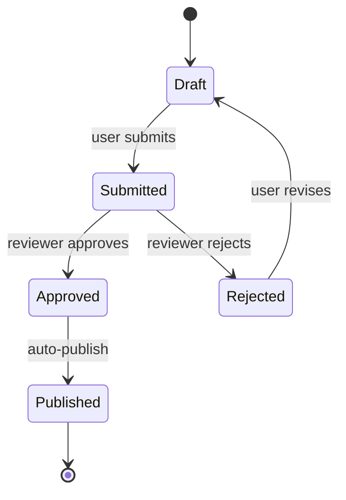
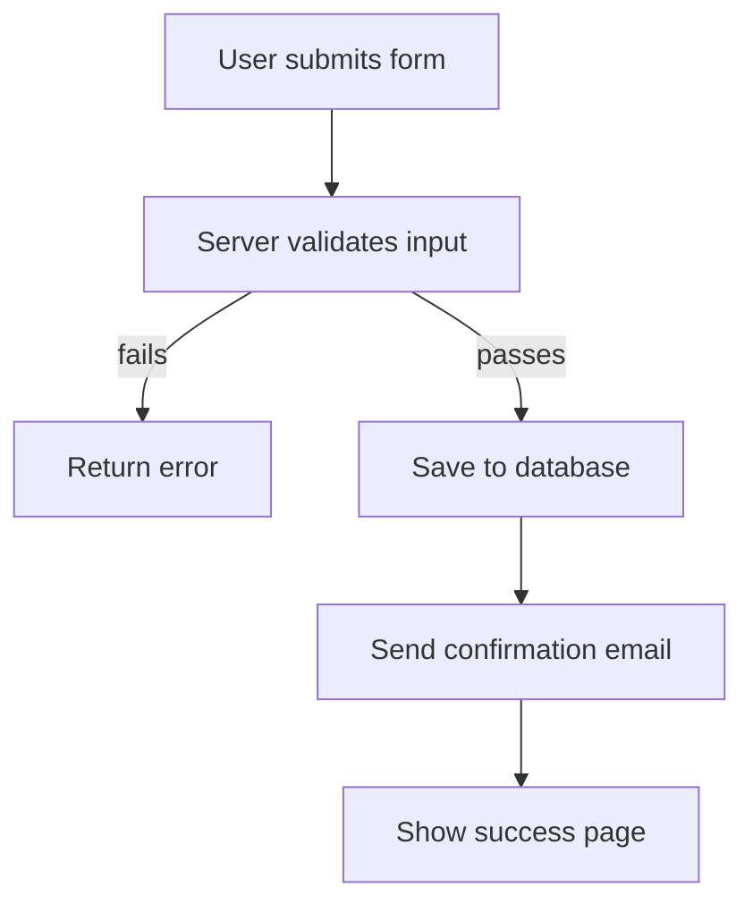

# Design Spec: Transversal Diagram Conventions

**Date:** 2026-03-20
**Status:** Draft
**Scope:** All projects — code, specs, rules, skills, runbooks, documentation

---

## Problem

Flows described in plain text are ambiguous, verbose, and harder for AI to parse precisely. There is no convention today for how to represent flows in documentation, specs, rules, or code comments. This leads to inconsistent, text-heavy descriptions that are both harder for AI to reason about and harder for humans to scan.

## Decision

All flows MUST use structured diagram formats instead of narrative text:

- **Gherkin** (`Given / When / Then`) for business scenarios
- **Mermaid** for everything else (technical flows, state machines, sequences, decision trees)

The format choice depends on the audience:

- **AI-only docs** (rules, skills, internal specs): diagram format only — no redundant text
- **Human-readable docs** (README, onboarding, runbooks): diagram format + Mermaid rendering when applicable

## Format Selection Guide

| Flow type | Format | Mermaid diagram type | Examples |
|---|---|---|---|
| Business scenario, user journey, acceptance criteria | **Gherkin** | N/A | Auth flow, onboarding, checkout, business rules |
| Technical pipeline, request lifecycle | **Mermaid** | `flowchart` | CI/CD, data pipeline, request handling |
| Interaction between services/components | **Mermaid** | `sequenceDiagram` | API calls, webhook flows, auth handshakes |
| State machine, lifecycle | **Mermaid** | `stateDiagram-v2` | Order status, FSM, connection states |
| Decision tree, conditional routing | **Mermaid** | `flowchart` (diamond `{condition?}` nodes) | Error handling, feature flags, routing logic |
| Hybrid flow (user action triggers technical sequence) | **Gherkin + Mermaid** | Gherkin for behavioral view, Mermaid for structural view | Checkout → payment processing, signup → provisioning |

**Distinguishing pipelines from decision trees in Mermaid:** Both use `flowchart`, but pipelines use rectangular nodes in series (`A --> B --> C`), while decision trees use diamond nodes for branching (`A{condition?} -->|yes| B`).

### When to use Gherkin

Gherkin is the right choice when the flow describes **behavior from a user or system perspective** — preconditions, actions, and expected outcomes. The `Given / When / Then` structure explicitly separates these concerns, which is more semantically precise for AI than a flowchart.

```gherkin
Feature: User authentication

  Scenario: Successful login
    Given an unauthenticated user on the login page
    When they submit valid credentials
    Then they receive a JWT token
    And they are redirected to the dashboard

  Scenario: Failed login with locked account
    Given a user whose account is locked
    When they submit valid credentials
    Then they see an error message "Account locked"
    And no JWT token is issued
```

### When to use Mermaid

Mermaid is the right choice for **structural flows** — processes with branching, parallelism, states, or interactions between multiple actors. It handles complexity that Gherkin cannot express naturally.



## Audience Rules

### AI-only documents (rules, skills, internal specs)

- Use the diagram format alone (Gherkin or Mermaid)
- Do NOT add a text paragraph that restates what the diagram already says
- Brief context before the diagram is fine (one sentence max to frame it)
- Goal: minimize token usage while maximizing precision

### Human-readable documents (README, runbooks, onboarding, external docs)

- Gherkin scenarios: keep as-is (already human-readable)
- Mermaid diagrams: keep as-is (renderable in GitHub, editors, doc tools)
- If a business flow is expressed in Gherkin AND the document benefits from a visual overview, add a Mermaid flowchart after the Gherkin block — same flow, visual representation
- Do NOT duplicate Mermaid diagrams in text form

### Redundancy vs. complementarity

Using **Gherkin + Mermaid together** for the same flow is NOT redundancy — it is complementarity. Each format captures a different view:

- **Gherkin** = behavioral view (preconditions, actions, outcomes — source of truth for tests)
- **Mermaid** = structural view (branching, parallelism, multi-actor interactions — visual aide)

What IS redundancy (and forbidden): a prose paragraph that restates what an adjacent diagram already expresses.

## File Structure

```
ai-ressources/
├── conventions/
│   ├── index.yaml               ← new directory index
│   └── diagrams.md              ← single source of truth for diagram conventions
├── code-conventions/
│   └── index.yaml               ← add cross-reference to ../conventions/diagrams.md
├── index.yaml                   ← add conventions domain entry
├── claude/
│   └── rules/
│       ├── code.md              ← unchanged (diagrams.md loaded globally, not here)
│       └── diagrams.md          ← global rule (symlinked via cc-hub)
```

### `conventions/index.yaml`

New index for the `conventions/` directory:

```yaml
files:
  - file: diagrams.md
    description: "Diagram conventions: Gherkin for business flows, Mermaid for technical flows. Applies to all contexts (code, specs, rules, skills, docs)"
```

### `code-conventions/index.yaml` update

Add a cross-reference entry pointing to the shared conventions:

```yaml
  - file: ../conventions/diagrams.md
    description: "Diagram conventions (transversal — also loaded outside code context). See conventions/"
```

### `claude/rules/diagrams.md` — Global loading rule

Always-active rule (no guard clause). Loaded at session start as passive guidance — does not need an explicit trigger to activate. The convention text itself serves as the constraint.

When the task involves producing a diagram, **Read** `conventions/diagrams.md` before writing it.

Trigger signals (non-exhaustive):

| Signal in task | Action |
|---|---|
| Describing a user journey, scenario, acceptance criteria | Load conventions, use Gherkin |
| Describing a pipeline, request lifecycle, CI/CD | Load conventions, use Mermaid `flowchart` |
| Describing service interactions, API calls | Load conventions, use Mermaid `sequenceDiagram` |
| Describing states, lifecycle, FSM | Load conventions, use Mermaid `stateDiagram-v2` |
| Describing decision logic, routing, error handling | Load conventions, use Mermaid `flowchart` (diamonds) |
| Writing a spec with behavioral + structural flow | Load conventions, use Gherkin + Mermaid pair |

Applies to: code comments, specs, rules, skills, README, runbooks, onboarding docs.

### `claude/rules/code.md` — No modification needed

Since `diagrams.md` is a global rule (always active), it does NOT need to be added to the `code.md` load order. It is already loaded independently. Adding it to `code.md` would cause double-loading during coding tasks.

The `code.md` display block remains unchanged.

## Scope of Application

This convention applies beyond code — wherever a flow needs to be expressed:

| Context | Example usage |
|---|---|
| Code comments | Complex algorithm flow in Mermaid |
| Specs & design docs | User journeys in Gherkin, architecture flows in Mermaid |
| Claude rules & skills | Process flows in Mermaid |
| API documentation | Sequence diagrams for auth, webhooks |
| Runbooks & onboarding | Decision trees for troubleshooting |
| Acceptance criteria | Gherkin scenarios attached to stories |

### Root `index.yaml` update

Add a `conventions` domain entry:

```yaml
  conventions:
    description: "Transversal conventions (not code-specific): diagram formats, shared standards. Loaded by dedicated global rules."
    status: active
    file_count: 1
```

## Anti-patterns

- Writing a flow as a numbered list or prose paragraph when a diagram would be clearer
- Using Gherkin for technical pipelines or state machines (use Mermaid)
- Using Mermaid flowcharts for user scenarios with preconditions/outcomes (use Gherkin)
- Duplicating the same flow in both text AND diagram in AI-only documents
- Using `dot` / Graphviz when Mermaid covers the same diagram type

### Negative example

Instead of this prose description:

> First the user submits the form. Then the server validates the input. If validation fails, an error is returned. If it passes, the data is saved to the database. Then a confirmation email is sent. Finally the user sees a success page.

Use a Mermaid flowchart:


