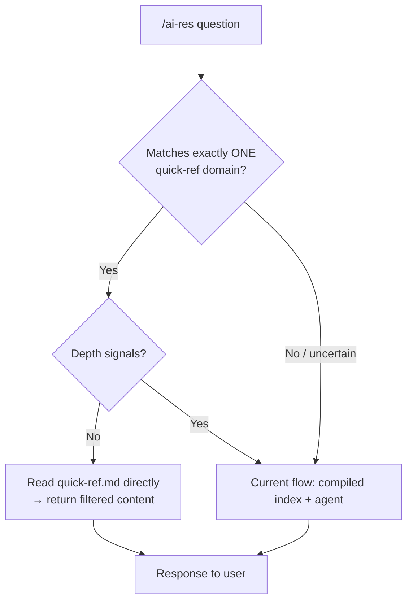

# Design: Fast Path Quick-Ref pour /ai-res

## Summary

Add a fast path in `/ai-res` SKILL.md that reads quick-ref files directly for simple, single-domain questions — bypassing the compiled index read and agent spawn entirely.

## Problem

Every `/ai-res` query currently spawns an `ai-res-librarian` agent (~1 min), even for simple questions like "best image model for e-commerce?" where the answer is already in `models/quick-ref.md` (159 lines, section `## Image`).

## Solution

Insert a quick-ref routing step **before** the compiled index + agent pipeline. If the question maps to exactly one quick-ref domain with no depth signals, read the quick-ref file directly and return.

## Routing

### Domain mapping

| Keywords in question | Domain | Quick-ref file |
|---|---|---|
| model, modele, LLM, image gen, video gen, music gen, which model, best model, cheapest model | `models` | `models/quick-ref.md` |
| stack, hosting, auth, database, DB, payment, email provider, which platform, quelle stack | `stack-ref` | `stack-ref/quick-ref.md` |

### Matching rules

1. Scan question for keywords above
2. Exactly **one** domain matched → candidate for fast path
3. **Two** domains or **zero** → agent flow
4. One quick-ref domain + one non-quick-ref domain → agent flow

### Depth signals (force fallback to agent)

- Detailed comparison: "compare X vs Y in detail", "full specs of", "differences between"
- Specific model/tech not in quick-ref
- Cross-domain: question mixes two topics
- Exhaustive request: "all", "everything", "complete list"

When in doubt → fallback to agent.

### Bare domain shortcut

`/ai-res models` or `/ai-res stack-ref` (bare domain name, no question) → fast path, return entire quick-ref file.

## Response format

1. Read `quick-ref.md`
2. If question targets a specific type (e.g., "image", "video", "auth") → extract only the matching `##` section
3. If general → return entire file
4. Append footer: `> For deeper detail, use /ai-res <detailed question> (routed via agent)`

## Changes

**One file modified:** `claude/skills/ai-res/SKILL.md`

- New "Quick-ref fast path" section inserted between alias resolution (step 1) and compiled index read (step 2)
- Existing steps renumbered (2→3, 3→4, etc.)
- No changes to `ai-res-librarian` agent, `compiled-index.txt`, or any other file

## Edge cases

| Case | Behavior |
|---|---|
| "Best image model for e-commerce?" | Fast path → `models/quick-ref.md` section `## Image` |
| "Which stack for a B2B SaaS?" | Fast path → `stack-ref/quick-ref.md` full |
| "Which model AND which stack?" | Agent (2 domains) |
| "Compare Nano Banana 2 vs Seedream in detail" | Agent (depth signal) |
| "EU hosting with RGPD?" | Fast path → `stack-ref/quick-ref.md` |
| "Multi-tenant architecture + which DB?" | Agent (cross-domain) |
| "/ai-res models" | Fast path → `models/quick-ref.md` full |

## Performance

| Metric | Before | After (fast path) |
|---|---|---|
| Tool calls | 2-4 | 1 |
| Estimated time | ~60-70s | ~5-10s |
| Tokens consumed | ~40k | ~2-3k |
