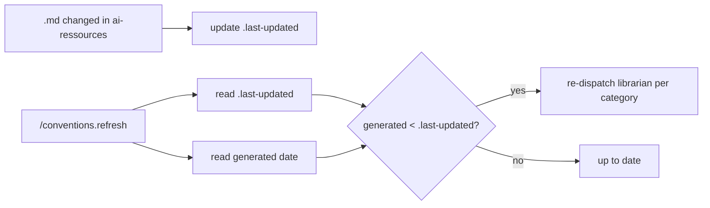

# Design: /conventions.init + /conventions.refresh (v3)

- **Date**: 2026-03-27
- **Status**: Approved

## Problem

Agents load conventions at runtime via `/ai-res` — slow, redundant, and subagents lack context. All conventions are loaded at every action, so size matters.

## Solution

Two skills + one global rule + one freshness marker:

1. **`/conventions.init`** — Analyzes cwd project, detects stack/domains, dispatches `ai-res-librarian` agents per category in parallel to synthesize a **single file** `.conventions/conventions.md`
2. **`/conventions.refresh`** — Compares `generated` date vs `.last-updated` marker, re-dispatches librarian for same categories if stale
3. **`conventions-preload.md`** rule — Auto-loads the single file before work, replaces `/ai-res`, injects into subagent prompts
4. **`.last-updated`** file — Updated automatically when any domain `.md` file changes in ai-ressources

## Key Design Decisions

| Decision | Choice | Rationale |
|---|---|---|
| File count | Single `conventions.md` | Loaded at every action — one compact file > many medium files |
| Content | Synthesized by ai-res-librarian | Same quality as `/ai-res` responses, not raw copy-paste |
| Generation | One librarian agent per category, parallel | Focused context per category + speed |
| Size budget | 200-400 lines max | Loaded in context at every action, must stay lightweight |
| Format | `##` sections, imperative rules, `> Covers:` lines | Optimized for AI agent parsing speed |
| Freshness | Date comparison (`generated` vs `.last-updated`) | Simple, no hash computation, works with synthesized content |
| Refresh scope | Same categories, no re-detection | Fast refresh, `--full` for re-detection |

## Freshness Mechanism



## File Structure

```
ai-ressources/
├── .last-updated          (date marker, auto-updated)
└── ...

target-project/
└── .conventions/
    └── conventions.md     (single file, 200-400 lines)
```
