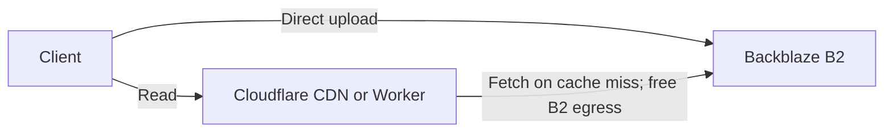

# Backblaze B2 + Cloudflare

> Default comparison assumption: always deliver B2 files through Cloudflare, with no B2 download fees for that route.

## What it is

S3-compatible object storage with Cloudflare delivery through the Bandwidth Alliance. Public files can use Cloudflare CDN; private buckets can use a Cloudflare Worker for authenticated access.

## Pricing

Verified 2026-10-16; USD before taxes.

| Resource | Price |
|----------|-------|
| Storage | Advertised from $6.95/TB-month; first 10 GB free |
| Downloads through Cloudflare | $0 B2 egress, including above 3x stored volume |
| Uploads | Free |
| Common Class A/B/C API operations | Free |
| Class D event-notification operations | First 2,500/day free, then $0.004/10,000 |
| Direct internet downloads, outside the default architecture | Free up to 3x average monthly storage; then $0.01/GB |

The current commercial pricing page takes precedence over older storage rates still present in API notes. No minimum file size or storage duration fee. Optional Cloudflare Workers, transformations and paid plans have their own charges; free B2 egress does not make those services free.

### Comparison

Read [the Railway comparison](railway-buckets.md#comparison-with-r2-and-b2--cloudflare) for example workloads. Before free allowances and other services, 1 TB costs from $6.95/month on B2 versus $15 on R2 or Railway, about 54% less. Downloading 1 TB or 10 TB through Cloudflare leaves that B2 storage estimate unchanged.

## Delivery pattern

## When to use

- Large active-storage volumes, backups, exports and public assets delivered through Cloudflare.
- Lower storage costs alongside server-side encryption, Object Lock and replication options.

## Trade-offs

- Two providers to configure; private access may require Worker authentication code.
- No native R2-style Workers binding.
- Compare cold-cache and warm-cache latency for the real workload; neither R2 nor Railway is universally faster without measurements.
- At small stored volumes, assess whether the savings justify the additional setup.

## Alternatives

Read [the R2 reference](cloudflare-r2.md) for native Workers integration and [the Railway reference](railway-buckets.md) for integrated app hosting and free bucket operations. Keep all three on the storage shortlist.

## Sources

- Read [current commercial pricing](https://www.backblaze.com/cloud-storage/pricing) and [API operation pricing](https://www.backblaze.com/cloud-storage/transaction-pricing).
- Read [public delivery through Cloudflare](https://www.backblaze.com/docs/cloud-storage-deliver-public-backblaze-b2-content-through-cloudflare-cdn) and [private delivery through Cloudflare](https://www.backblaze.com/docs/cloud-storage-deliver-private-backblaze-b2-content-through-cloudflare-cdn).
- Read [B2 security features](https://www.backblaze.com/cloud-storage/security) for encryption, immutability and replication.
